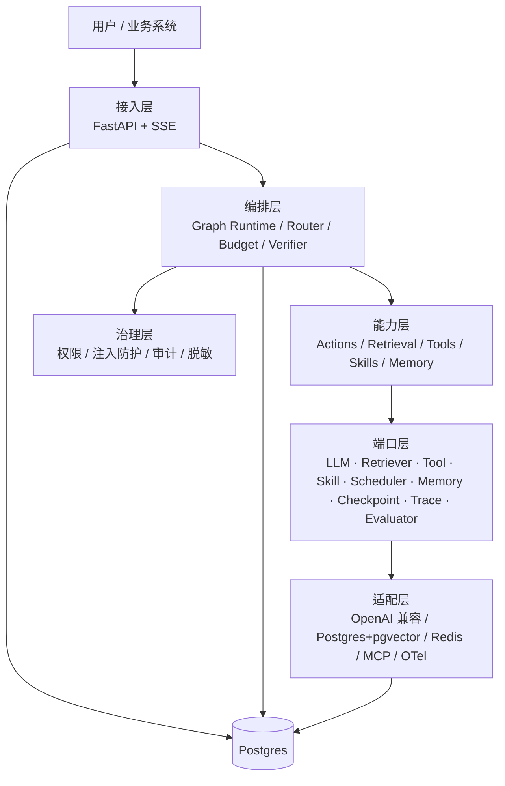

# zCAISAgent · 通用 Agent 运行时（基于复合 AI 系统 / CAIS 范式）

> 通用 Agent 为内核，Agentic RAG 为内置能力：可私有化、可审计、可评估、可扩展。

当前阶段：**M0 可运行骨架已落地**（方案设计 + 最小实现，46 项测试全绿）。五份方案文档 + 代码：

| 文档                                           | 内容                                                         | 适合谁         |
| -------------------------------------------- | ---------------------------------------------------------- | ----------- |
| [01 · 研究与范式分析](docs/01-research-cais.md)   | 通用 Agent / Agentic RAG / CAIS 的统一模型；图中流程逐节点优劣分析；能力分级 L0-L3 | 产品、架构、技术负责人 |
| [02 · 产品层方案](docs/02-product.md)           | 定位、用户与场景、功能地图（MVP/V1/V2）、指标与验收、路线图                         | 产品、业务、管理层   |
| [03 · 技术架构方案](docs/03-architecture.md)     | 分层架构、运行时模型、领域模型与端口契约、检索/工具/记忆/编排/治理/评估/可观测、部署与配置           | 研发、架构       |
| [04 · 工程落地计划](docs/04-engineering-plan.md) | 目录骨架、依赖规则、扩展点手册、里程碑与 DoD、测试策略、ADR                          | 研发、项目管理     |
| [05 · PRD 需求契约](docs/05-prd.md)            | 80 条稳定编号功能需求、AI 专项规格（模型/提示/证据/失败模式/标注）、状态机、共享规则与开放问题       | 产品、研发、测试    |

***

## 核心结论（5 条）

1. **zCAISAgent 的内核是通用 Agent**：检索、工具调用、代码执行、浏览器、文件操作都是同一 `ActionSpace` 中的不同动作，统一由状态机、预算与验证器约束。
2. **Agentic RAG 是通用 Agent 的一个受限实例**：只保留检索/答案/校验/追问动作；二者统一于 CAIS，共用同一运行时。
3. **图中流程是最小可行版本（L1）**：闭环思想正确，但缺少预算/终止、证据重排、claim 级校验、多源融合、记忆与治理，且"回退到原始 Query"会导致状态丢失与不收敛。
4. **生产化的关键是"证据闭环 + 预算驱动 + 渐进式自主"**：默认 L1 快路径，复杂任务升级 L2/L3，所有循环受硬预算约束。
5. **架构用"端口-适配器 + 配置驱动 + 模块化单体"**：内核不依赖框架与 SDK，能力可插拔，后期可按指标拆分服务。

***

## 统一模型（一句话版）

```
zCAISAgent       = Agent(ActionSpace ⊇ {Retrieve, ToolCall, CodeExec, Browse, FileOp, AskUser, Finish})
Agentic RAG  = zCAISAgent with ActionSpace = {Retrieve, Answer, Verify, AskUser, Finish}
CAIS         = Orchestrator(Graph(Components), Contracts, Evaluation, Observability)
```

**zCAISAgent 是通用 Agent 内核；Agentic RAG 是它面向知识密集任务的受限形态，二者共用一个内核。**

***

## 架构速览



***

## 扩展接口（详见 [03 §18](docs/03-architecture.md)）

| 接口                  | 现状                     | 说明                                             | 里程碑   |
| ------------------- | ---------------------- | ---------------------------------------------- | ----- |
| MCP Client          | 已预留（复用 `ToolPort`）     | 接入外部 MCP 工具/资源                                 | M1    |
| MCP Server          | 新增 `McpServerPort`     | 把检索/Agent 对外暴露，默认关闭                            | V1    |
| Skill               | 新增 `SkillRegistryPort` | 指令+工具白名单+知识+策略的可复用包                            | M1    |
| Cron                | 新增 `SchedulerPort`     | 只触发 Run，不复制执行路径                                | M2    |
| Security            | 新增 5 个端口               | Identity / Policy / Guardrail / Audit / Secret | M0 起步 |
| Webhook / A2A / 多模态 | 预留                     | EventSink / AgentPeer / Parser                 | M2/V2 |

> 原则：**接口先冻结，实现按需补**；未实现的端口用 Noop/Fake 占位，不阻塞 M0 的 7 个核心端口。

***

## M0 已交付

已完成最小可运行链路：

1. 工程骨架：`pyproject.toml` / `Makefile` / Docker Compose / CI / import-linter 契约；
2. `domain/`：`RunState`、`Evidence`、`Answer`、`Budget`、`StatePatch` + reducer；
3. `ports/`：7 个核心端口 + 安全端口契约；
4. `orchestration/`：`GraphRuntime`、预算/终止、JSONL checkpoint、trace；
5. 节点：`analyze → route → retrieve → synthesize → verify → respond / abstain / direct_answer`；
6. 适配器：OpenAI 兼容 LLM、内存检索、JSONL 检查点/追踪、API Key/RBAC/审计/护栏；
7. 接口：`POST /v1/runs`、`POST /v1/chat`（SSE）、`GET /v1/runs/{id}/trace`、CLI；
8. 数据：3 篇种子语料 + 30 条黄金集；20 条冒烟用例；
9. 架构借鉴（dsh-superagent）：`SourceRegistry` 多源并行/降级、`Mandate` 授权可审计、`TicketStage` 派生阶段、`HealthBoard` 组件健康。

### 快速开始

```powershell
cd zCAISAgent
$env:PYTHONPATH="src"

python -m zcaisagent.cli ask "一线城市住宿标准是多少？"
python -m pytest
python -m zcaisagent.cli eval data/eval/golden.jsonl
uvicorn zcaisagent.api.app:app --reload --port 8080
```

配置默认从项目根目录的 `.env` 读取（进程环境变量优先）。模型提供者在 `config.toml`
定义，密钥经 `.env` / 系统环境变量注入（如 `AI_KEY_DS`）；未配置 provider 时回退
`FakeLLM`，无需 API Key 即可跑通。

模型配置支持多个模型集，每个集含主模型与备用链（主模型调用失败时按序降级）：

```dotenv
ZCAISAGENT_MODEL_SET=high            # 切换模型集：default | low | high | max
ZCAISAGENT_MODEL_SETS=default,low,high,max
ZCAISAGENT_MODEL_HIGH=deepseek-reasoner
ZCAISAGENT_MODEL_HIGH_FALLBACKS=deepseek-chat,deepseek-flash
```

改 `ZCAISAGENT_MODEL_SET` 一行即可切换主模型；未配置的集回退到 `default`。

***

## 术语表

| 术语               | 含义                                                              |
| ---------------- | --------------------------------------------------------------- |
| **zCAISAgent**       | 本项目：通用 Agent 运行时，内置检索、工具、代码、浏览、文件、记忆、Skill 与调度能力                |
| **CAIS**         | Compound AI Systems，复合 AI 系统：用多个交互组件（多模型、检索器、工具、记忆、编排）完成任务的系统范式 |
| **Agentic RAG**  | 由 LLM 在运行时决定检索行为的 RAG 系统；检索是 action 而非固定阶段                      |
| **Enhanced RAG** | 固定管线 + 路由/改写/重排等增强模块，控制权仍在代码                                    |
| **ActionSpace**  | Agent 可执行的动作集合，每个动作有 schema、副作用、风险、成本                           |
| **Evidence**     | 统一的外部信息抽象：来源、内容、评分、时间、权限、引用                                     |
| **Sufficiency**  | 证据是否"足够支撑回答"，区别于 relevance（是否相关）                                |
| **Budget**       | token / 成本 / 时间 / 步数的硬约束，由运行时强制执行                               |
| **HITL**         | Human-in-the-loop，人类在环：澄清、审批、纠错                                 |
| **MCP**          | Model Context Protocol，工具/资源接入标准协议                              |
| **L0-L3**        | 通用 Agent 自主性分级：直答 / 单步工具+检索 / 多步 Agent / 深度自主任务                 |
| **Golden Set**   | 分层黄金评估集，用于回归门禁                                                  |

***

## 已确认决策（2026-11-05）

| #  | 决策     | 确认结果                                        |
| -- | ------ | ------------------------------------------- |
| Q1 | 首个落地场景 | 通用任务循环 + 企业知识问答作为首个内置 Skill                 |
| Q2 | 部署形态   | 私有化单机起步；逻辑多租户、物理单租户                         |
| Q3 | 模型来源   | 混合：生成用云/本地大模型，embedding/rerank 本地           |
| Q4 | 技术栈    | Python 3.12 + 端口化 + 自研轻量运行时；LangGraph 适配器可选 |
| Q5 | 语料与评估集 | 从零新建 100 条黄金集，M0 同步启动标注                     |
| Q6 | 多模态    | 不进 MVP，V2 再做                                |

> 详见 [02-product.md §13](docs/02-product.md)。变更需走 ADR。

***

## 文档状态

| 项        | 状态                   |
| -------- | -------------------- |
| 研究结论     | ✅ 完成                 |
| 图中流程优劣分析 | ✅ 完成                 |
| 产品层方案    | ✅ 已完成并确认（Q1-Q6 基线）   |
| 技术架构方案   | ✅ 完成                 |
| 工程落地计划   | ✅ 完成                 |
| 代码实现     | ✅ M0 可运行骨架（46 项测试通过） |
