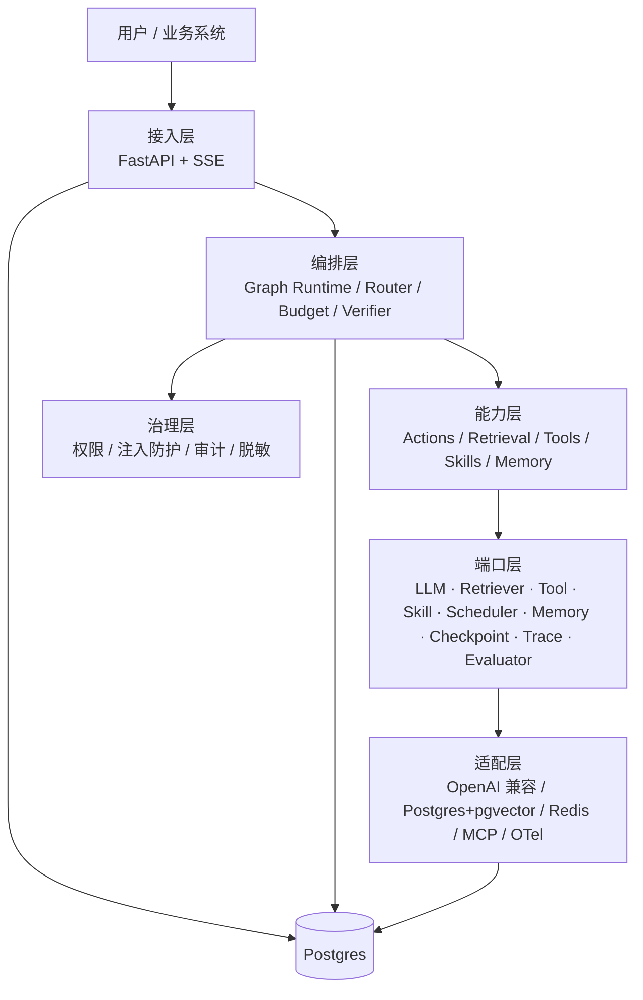
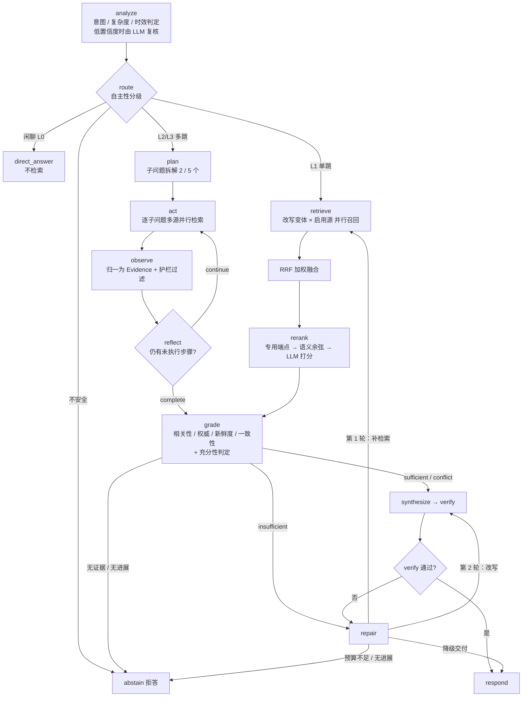

# zCAISAgent · 通用 Agent 运行时（基于复合 AI 系统 / CAIS 范式）

> 通用 Agent 为内核，Agentic RAG 为内置能力：可私有化、可审计、可评估、可扩展。

当前阶段：**M2 已完成，M3 产品化交付**（Studio 四页、Admin 平台 API、成本/延迟/质量看板、压测与故障演练、Python SDK、智能问数与查询数据权限，400+ 项测试全绿）。八份文档 + 代码：

| 文档                                         | 内容                                                         | 适合谁         |
| ------------------------------------------ | ---------------------------------------------------------- | ----------- |
| [01 · 研究与范式分析](docs/01-research-cais.md)   | 通用 Agent / Agentic RAG / CAIS 的统一模型；图中流程逐节点优劣分析；能力分级 L0-L3 | 产品、架构、技术负责人 |
| [02 · 产品层方案](docs/02-product.md)           | 定位、用户与场景、功能地图（MVP/V1/V2）、指标与验收、路线图                         | 产品、业务、管理层   |
| [03 · 技术架构方案](docs/03-architecture.md)     | 分层架构、运行时模型、领域模型与端口契约、检索/工具/记忆/编排/治理/评估/可观测、部署与配置           | 研发、架构       |
| [04 · 工程落地计划](docs/04-engineering-plan.md) | 目录骨架、依赖规则、扩展点手册、里程碑与 DoD、测试策略、ADR                          | 研发、项目管理     |
| [05 · PRD 需求契约](docs/05-prd.md)            | 80 条稳定编号功能需求、AI 专项规格（模型/提示/证据/失败模式/标注）、状态机、共享规则与开放问题       | 产品、研发、测试    |
| [06 · 部署手册](docs/06-deployment.md)          | 本地 / Docker Compose / 单机生产、环境变量、可选依赖与回退、安全清单、升级回滚             | 运维、交付       |
| [07 · 运维手册](docs/07-runbook.md)             | 健康检查、观测入口、故障处置、备份恢复、容量与扩容、故障演练、事故响应                            | 运维、值班       |
| [08 · Python SDK](docs/08-sdk.md)            | 安装、认证、Run 查询、SSE 流式、审批、指标与健康、异常与重试                       | 集成开发        |

***

## 核心结论（5 条）

1. **zCAISAgent 的内核是通用 Agent**：检索、工具调用、智能问数（数据查询）、代码执行、浏览器、文件操作都是同一 `ActionSpace` 中的不同动作，统一由状态机、预算与验证器约束。
2. **Agentic RAG 是通用 Agent 的一个受限实例**：只保留检索/答案/校验/追问动作；二者统一于 CAIS，共用同一运行时。
3. **图中流程是最小可行版本（L1）**：闭环思想正确，但缺少预算/终止、证据重排、claim 级校验、多源融合、记忆与治理，且"回退到原始 Query"会导致状态丢失与不收敛。
4. **生产化的关键是"证据闭环 + 预算驱动 + 渐进式自主"**：默认 L1 快路径，复杂任务升级 L2/L3，所有循环受硬预算约束。
5. **架构用"端口-适配器 + 配置驱动 + 模块化单体"**：内核不依赖框架与 SDK，能力可插拔，后期可按指标拆分服务。

***

## 统一模型（一句话版）

```
zCAISAgent       = Agent(ActionSpace ⊇ {Retrieve, ToolCall, DataQuery, CodeExec, Browse, FileOp, AskUser, Finish})
Agentic RAG  = zCAISAgent with ActionSpace = {Retrieve, Answer, Verify, AskUser, Finish}
CAIS         = Orchestrator(Graph(Components), Contracts, Evaluation, Observability)
```

**zCAISAgent 是通用 Agent 内核；Agentic RAG 是它面向知识密集任务的受限形态，二者共用一个内核。**

***

## 架构速览



***

## 检索路由链路

检索是运行时的一个 action，不是固定阶段。入口先按问题复杂度分级，再决定"是否检索、检索几轮、失败如何升级"。



**入口分级**（`analyze` 判定；非闲聊问题若规则置信度低于 0.5，再由 LLM 复核）：

| 等级 | 判定依据 | 检索编排 |
| --- | --- | --- |
| L0 直答 | 闲聊、问候、无需外部信息 | 不检索，直接 `direct_answer` |
| L1 快路径 | 单一事实、单跳（默认档） | `retrieve` 一次：改写变体 × 全部启用源并行 → 融合 → 重排 |
| L2 多步 | 对比、操作指引、并列多跳、需取数推算 | `plan` 拆 2 个子问题，逐个 `act` 并行检索，`reflect` 收口后统一评分 |
| L3 深度 | 分析、调研、方案、规划、报告 | 同 L2，子问题上限 5 个 |

**查询改写分级**（`rewrite_queries`，原 query 永远保留且排第一）：

| 复杂度 | 变体 |
| --- | --- |
| `simple` | 仅原 query；问题较长且含疑问虚词时追加一条 `light`（去"是什么/多少/怎么"等） |
| `multi_hop` | 原 query + `light` + 按"和 / 与 / 、 / ；/ 以及"拆出至多 3 条 `multi_N` |
| `open` | 原 query + 按句读拆出至多 3 条 `decompose_N` |
| `open` + HyDE | 开启 `hyde_enabled` 时追加一条 `hyde` 变体（假设性答案，仅用于召回，失败自动跳过） |

**单次检索内部链路**（`retrieve` 节点）：

1. **选源**：`SourceRegistry` 取启用源（按 priority 排序）；命中 Skill 时用其 `allowed_sources` 再收窄；每个源自身完成 tenant / ACL / 版本（同文档族只留最高版本）过滤。
2. **并行召回**：`query 变体 × 源` 全部并发，单源超时或异常只记 `degraded`，不阻断其余源。
3. **RRF 加权融合**：`k=60`；`inmemory` / `bm25` / `vector` / `pgvector` 权重 1.0，`pageindex` / `graph` 权重 0.5；内容相同的片段合并为一条，跨源出处记入 `metadata.sources`。
4. **重排**：`FallbackReranker` 优先调专用端点（`style="dashscope"` 原生格式 / `"cohere"` Jina 兼容），失败后记忆切换至 embedding 语义余弦，再回退 LLM chat 打分；分数直接写入 `evidence.relevance` 并透传给 `grade`，全部失败则保留词法相关性。
5. **护栏过滤**：`guardrail.check_evidence` 隔离违规片段并写入轨迹。
6. **评分与充分性**：`0.45×相关性 + 0.25×权威 + 0.15×新鲜度 + 0.15×一致性`；`final ≥ 0.30` 保留，`≥ 0.40` 且覆盖问题主题才算达标证据；任一条达标即 `sufficient`，高相似但数字互斥则 `conflict`，否则 `insufficient`。
7. **不足升级**（最多 2 轮修复）：第 1 轮定向补检索（`goal + 首个未被支撑的 claim`），第 2 轮严格改写；补检索后证据数未增加判 `no_progress` 直接拒答，剩余预算不够走完一轮也直接拒答。
8. **上下文打包**：`context_pack` 按可信度排序、剔除 `drop`、父块正文替换子块，按 `max_context_tokens` 截断（至少保留 1 条）。

**检索源**（`capabilities/retrieval/sources/`，全部实现 tenant/ACL/版本过滤与降级）：

| 源           | 类型  | 说明                                |
| ----------- | --- | --------------------------------- |
| `inmemory`  | 词法  | overlap 比例打分，常驻默认                 |
| `bm25`      | 关键词 | SQLite FTS5，中文单字+二元组展开            |
| `vector`    | 语义  | embedding 余弦，服务不可用自动降级            |
| `pgvector`  | 语义  | 持久化向量检索，需启用 `[database]`，不可用自动回退内存   |
| `pageindex` | 结构  | markdown 章节树导航，默认停用               |
| `graph`     | 关联  | LLM 实体关系图 + 一跳邻居，失败补抽 + 磁盘缓存，默认停用 |

**评测基线**（golden 集 100 案例，`retrieval-eval`）：

| 配置                                | doc Recall\@5 | doc Recall\@10 | doc NDCG\@10 |
| --------------------------------- | ------------- | -------------- | ------------ |
| 词法两路（基线）                          | 0.8195        | 0.9390         | 0.8843       |
| **词法 + vector + 专用 rerank（当前默认）** | **0.9100**    | **0.9971**     | **0.9525**   |

**重排端点**：`rerank-server` 子命令可启动本地 `/v1/rerank` 兼容端点，供 `[rerank] base_url` 指向本机；无专用端点时按上述回退链降级。

***

## 智能问数（NL2SQL）与查询数据权限

智能问数不是独立服务，而是运行时的一个数据查询动作：`analyze` 命中数据查询意图后，`route` 直接进入 `n2sql` 节点，不进入知识检索。

- **入口**：`POST /v1/n2sql`，请求 `{question, user_id, tenant_id}`；聊天链路（`/v1/chat`）同样支持自然语言问数。
- **链路**：LLM 生成 SQL → 只读校验（单条 `SELECT/WITH`、表白名单、禁注释/DDL/DML/系统库/危险函数、禁止逗号连接）→ **服务端强制注入行级过滤** → 自动补 `LIMIT` → MySQL 只读执行 → LLM 归纳答案（失败时回退结构化结果摘要）。
- **数据权限**：`[[n2sql.users]]` 定义 `user_id → role`。`admin` 不限制；`teacher` 只能看本人课程及其学生成绩；`student` 只能看本人成绩与学生信息；**未知用户直接拒绝**。过滤条件由服务端把白名单表改写为带 `WHERE` 的派生表，模型生成的 SQL 无法绕过。
- **审计**：每次查询写入 `n2sql.query`（`outcome` / `scope` / `sql_digest` / `row_count`），SQL 与答案随 Run 轨迹留痕。
- **降级**：未配置 `[n2sql]` 或连接参数缺失时，`/v1/n2sql` 返回 503，聊天链路不触发数据查询；数据库异常返回 502，不影响检索与其他组件。
- **连接参数**：只从环境变量读取（`ZCAISAGENT_N2SQL_HOST` / `_PORT` / `_USER` / `_PASSWORD` / `_DATABASE`），密钥不落配置文件。

> 实现与测试：`src/zcaisagent/capabilities/n2sql/`、`ports/n2sql.py`、`orchestration/nodes/n2sql.py`、`adapters/store/mysql.py`、`tests/unit/test_n2sql_*.py`、`tests/integration/test_n2sql_api.py`、`tests/security/test_doc_acl.py`。

***

## 扩展接口（详见 [03 §18](docs/03-architecture.md)）

| 接口                  | 现状                     | 说明                                             | 里程碑   |
| ------------------- | ---------------------- | ---------------------------------------------- | ----- |
| MCP Client          | 已预留（复用 `ToolPort`）     | 接入外部 MCP 工具/资源                                 | M1    |
| MCP Server          | 新增 `McpServerPort`     | 把检索/Agent 对外暴露，默认关闭                            | V1    |
| Skill               | 新增 `SkillRegistryPort` | 指令+工具白名单+知识+策略的可复用包                            | M1    |
| Cron                | 新增 `SchedulerPort`     | 只触发 Run，不复制执行路径                                | M2    |
| Security            | 新增 5 个端口               | Identity / Policy / Guardrail / Audit / Secret | M0 起步 |
| Webhook / A2A / 多模态 | 预留                     | EventSink / AgentPeer / Parser                 | M2/V2 |

> 原则：**接口先冻结，实现按需补**；未实现的端口用 Noop/Fake 占位，不阻塞 M0 的 7 个核心端口。

***

## M0 已交付

已完成最小可运行链路：

1. 工程骨架：`pyproject.toml` / `Makefile` / Docker Compose / CI / import-linter 契约；
2. `domain/`：`RunState`、`Evidence`、`Answer`、`Budget`、`StatePatch` + reducer；
3. `ports/`：7 个核心端口 + 安全端口契约；
4. `orchestration/`：`GraphRuntime`、预算/终止、JSONL checkpoint、trace；
5. 节点：`analyze → route → retrieve → synthesize → verify → respond / abstain / direct_answer`；
6. 适配器：OpenAI 兼容 LLM、内存检索、JSONL 检查点/追踪、API Key/RBAC/审计/护栏；
7. 接口：`POST /v1/runs`、`POST /v1/chat`（SSE）、`GET /v1/runs/{id}/trace`、CLI；
8. 数据：6 篇种子语料 + 100 条黄金集（20 条冒烟用例）；
9. 架构借鉴（dsh-superagent）：`SourceRegistry` 多源并行/降级、`Mandate` 授权可审计、`TicketStage` 派生阶段、`HealthBoard` 组件健康。

### 快速开始

```powershell
cd zCAISAgent
$env:PYTHONPATH="src"

python -m zcaisagent.cli ask "一线城市住宿标准是多少？"
python -m pytest
python -m zcaisagent.cli eval data/eval/golden.jsonl
python -m zcaisagent.cli eval --out data/eval/latest.json       # 写入 Studio 评估页读取的最新报告
python -m zcaisagent.cli retrieval-eval --source fused          # 检索评测（fused 或任一源名）
python -m zcaisagent.cli retrieval-eval --source fused --rerank # 融合后重排评测
python -m zcaisagent.cli eval-gate --path data/eval/golden.jsonl  # 评估门禁（违规返回 1）
python -m zcaisagent.cli index build                            # 构建 pgvector 索引（需启用 [database]）
python -m zcaisagent.cli index stats                            # 查看索引块数 / 租户数 / 维度
python -m zcaisagent.cli rerank-server --port 8090              # 本地 /v1/rerank 兼容端点
uvicorn zcaisagent.api.app:app --reload --port 8080
```

服务启动后（另开终端）：

```powershell
python scripts/loadtest.py --concurrency 20 --requests 40  # 压测并写入 data/perf/
python scripts/fault_drill.py                               # 四类故障演练，写入 data/drills/

# 智能问数（需在 .env 配置 MySQL 连接；user_id 需存在于 [[n2sql.users]]）
Invoke-RestMethod -Method Post http://127.0.0.1:8080/v1/n2sql `
  -Headers @{"X-API-Key"="dev-key"} `
  -Body (@{question="S1 的成绩是多少？"; user_id="s_s1"} | ConvertTo-Json)
```

访问 <http://127.0.0.1:8080/studio> 打开 Studio；`loadtest.py` 默认请求 `http://127.0.0.1:8080`，
并可用 `--base-url` / `--api-key` 覆盖。

配置默认从项目根目录的 `.env` 读取；普通运行参数进程环境变量优先，模型密钥则由
`key_env` 指定并优先从 `.env` 读取（缺失时回退系统环境变量）。`.env` 只放密钥等运行参数，
模型路由全部在 `config.toml` 定义，密钥经 `key_env` 引用（如 `AI_KEY_DS`）；
一个 provider 都没配置时回退 `FakeLLM`，无需 API Key 即可跑通。仓库默认 `config.toml` 已配置 provider；
若暂时没有模型密钥，可把 `ZCAISAGENT_CONFIG_FILE` 指向不含 `[model_providers.*]` 的 TOML 做离线演示（见
[06 · 部署手册 §2.3](docs/06-deployment.md)）。

#### SDK 速用

```python
import asyncio
from zcaisagent.sdk import ZCAISClient


async def main() -> None:
    async with ZCAISClient("http://127.0.0.1:8080", api_key="dev-key") as client:
        run = await client.create_run("一线城市住宿标准是多少？", level="L1")
        print(run["status"], run["answer"])
        data = await client.ask_n2sql("S1 的成绩是多少？", user_id="s_s1")
        print(data["answer"], data["row_count"])
        print((await client.health())["status"])


asyncio.run(main())
```

完整方法、SSE、智能问数与异常处理见 [08 · Python SDK](docs/08-sdk.md)。

模型选择由「是否显式指定 `reasoning_effort`」决定：

```toml
model_provider = "deepseek"              # 调用方未指定 reasoning_effort 时直接使用
effort_levels = ["low", "high", "max"]   # 合法等级，同时决定降级顺序

[purpose_effort]                         # 仅在没有默认 provider 时兜底
synthesize = "low"
analyze = "high"
default = "low"

[model_providers.deepseek]               # 一个 provider 绑定一个等级
model = "deepseek-flash"
base_url = "https://api.deepseek.com"
key_env = "AI_KEY_DS"
reasoning_effort = "high"
```

调用方显式传 `reasoning_effort` 时，在该等级的全部 provider 中按配置顺序选主模型；未传时
直接使用 `model_provider`。两种情况都带降级：主模型调用失败后先尝试同等级其余 provider，
再按 `effort_levels` 向邻近等级双向扩展（如 `high → low → max`）。

检索相关服务在 `config.toml` 配置：`[embedding]`（语义向量源与语义重排）、
`[rerank]`（专用 rerank 端点，`style="dashscope"|"cohere"`，不可用自动回退）。
详细策略见上文「检索路由链路」。

### 控制台（启动后端 + 打开前端）

Windows 双击 [~start-backend.bat](./~start-backend.bat)（或在项目根目录执行 `.\~start-backend.bat`），按菜单选择操作：

```powershell
.\~start-backend.bat
# 1 = 启动   2 = 重启   0 = 停止   Q = 退出
```

脚本行为：

1. 依次探测 `.venv` → PATH 中的 `python` → 当前 conda 环境 → `python3`，取第一个能 `import click, uvicorn` 的解释器；
2. 以 `uvicorn zcaisagent.api.app:app --host 127.0.0.1 --port 8080` 后台启动，`PYTHONPATH` 指向 `src`；
3. 轮询 8080 端口，确认监听成功后打印访问地址；停止/重启按 8080 的监听进程处理，无需手动找 PID。

启动后浏览器打开 <http://127.0.0.1:8080/>，即控制台页面：由 FastAPI 同源托管 `api/static/chat.html`，可直接多轮对话、查看答案与引用来源，无需单独启动前端。首次使用在左侧「X-API-Key」填写密钥（默认 `dev-key`，可用环境变量 `ZCAISAGENT_API_KEY` 覆盖）。

日志：`.zcaisagent/backend.log`（stderr）与 `.zcaisagent/backend.log.out`（stdout）；启动失败时先看这里。

等价手动启动：

```powershell
$env:PYTHONPATH="src"
uvicorn zcaisagent.api.app:app --reload --port 8080
```

***

## Studio 与运营

Studio 由 FastAPI 同源托管（`src/zcaisagent/api/static/studio.html`），无需单独启动前端：

- **数据源**：列出每个检索源的名称、类型、优先级、启用状态与健康状态，可即时启用/停用；启停只对当前进程生效，重启后回到配置文件状态。
- **轨迹**：按状态筛选 Run，查看节点级轨迹、耗时、tokens、成本、证据与最终答案。
- **评估**：展示最新评估报告、门禁阈值与通过/失败项，并可按 `tag` / `limit` 触发一次评估。
- **配置**：展示模型、检索、安全、工具、记忆、缓存、调度、事件的脱敏快照；**只读**，修改需改配置文件并重启。

所有 `/v1/admin/*` 接口（含 Studio 使用的数据）都需要 API Key 与 `admin:read` scope，写操作需要 `admin:write`；
本地默认 `dev-key` 带 admin scope，生产请在 `[security]` 中收窄角色权限。Studio 的 Key 保存在浏览器 `sessionStorage`。

评估页读取 `data/eval/latest.json`（由 `zcaisagent eval --out` 产出）；文件缺失时回退 `data/eval/baselines/`
下最新的报告，二者都没有则显示不可用，不影响其他页面。

部署形态、可选依赖回退与安全清单见 [06 · 部署手册](docs/06-deployment.md)；
健康检查、故障处置与备份恢复见 [07 · 运维手册](docs/07-runbook.md)。

***

## 术语表

| 术语               | 含义                                                              |
| ---------------- | --------------------------------------------------------------- |
| **zCAISAgent**   | 本项目：通用 Agent 运行时，内置检索、工具、代码、浏览、文件、记忆、Skill 与调度能力                |
| **CAIS**         | Compound AI Systems，复合 AI 系统：用多个交互组件（多模型、检索器、工具、记忆、编排）完成任务的系统范式 |
| **Agentic RAG**  | 由 LLM 在运行时决定检索行为的 RAG 系统；检索是 action 而非固定阶段                      |
| **Enhanced RAG** | 固定管线 + 路由/改写/重排等增强模块，控制权仍在代码                                    |
| **ActionSpace**  | Agent 可执行的动作集合，每个动作有 schema、副作用、风险、成本                           |
| **Evidence**     | 统一的外部信息抽象：来源、内容、评分、时间、权限、引用                                     |
| **Sufficiency**  | 证据是否"足够支撑回答"，区别于 relevance（是否相关）                                |
| **Budget**       | token / 成本 / 时间 / 步数的硬约束，由运行时强制执行                               |
| **HITL**         | Human-in-the-loop，人类在环：澄清、审批、纠错                                 |
| **MCP**          | Model Context Protocol，工具/资源接入标准协议                              |
| **NL2SQL**       | 自然语言转 SQL；本项目作为 `DataQuery` 动作接入统一运行时                     |
| **DataScope**    | 用户可见数据范围（admin / teacher / student），由服务端在执行前强制注入              |
| **L0-L3**        | 通用 Agent 自主性分级：直答 / 单步工具+检索 / 多步 Agent / 深度自主任务                 |
| **Golden Set**   | 分层黄金评估集，用于回归门禁                                                  |

***

## 已确认决策

| #  | 决策     | 确认结果                                        |
| -- | ------ | ------------------------------------------- |
| Q1 | 首个落地场景 | 通用任务循环 + 企业知识问答作为首个内置 Skill                 |
| Q2 | 部署形态   | 私有化单机起步；逻辑多租户、物理单租户                         |
| Q3 | 模型来源   | 混合：生成用云/本地大模型，embedding/rerank 本地           |
| Q4 | 技术栈    | Python 3.12 + 端口化 + 自研轻量运行时；LangGraph 适配器可选 |
| Q5 | 语料与评估集 | 从零新建 100 条黄金集，M0 同步启动标注                     |
| Q6 | 多模态    | 不进 MVP，V2 再做                                |

> 详见 [02-product.md §13](docs/02-product.md)。变更需走 ADR。

***

## 文档状态

| 项        | 状态                                      |
| -------- | --------------------------------------- |
| 研究结论     | ✅ 完成                                    |
| 图中流程优劣分析 | ✅ 完成                                    |
| 产品层方案    | ✅ 已完成并确认（Q1-Q6 基线）                      |
| 技术架构方案   | ✅ 完成                                    |
| 工程落地计划   | ✅ 完成                                    |
| 代码实现     | ✅ M0 骨架 + Agentic RAG 检索链路 + M2 工具/记忆/治理 + M3 产品化（Studio、压测、故障演练、SDK、部署/运维文档、智能问数与查询数据权限，400+ 项测试） |
