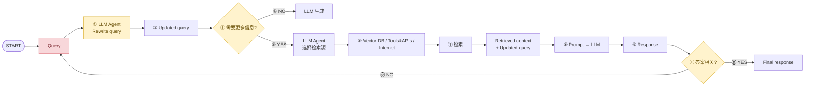
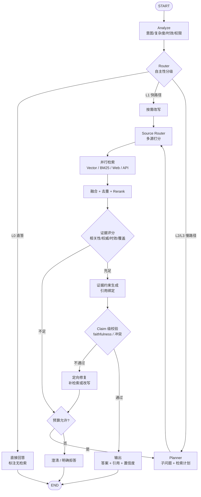

# 01 · 通用 Agent × Agentic RAG × 复合 AI 系统（CAIS）研究与范式分析

> 版本：v1.0 ｜ 日期：2026-11-05 ｜ 适用范围：`zCAISAgent` 项目的产品与技术决策依据
> 实现状态（2026-11-10）：本文论证的"证据闭环 + 预算驱动"与多源融合/重排/评测已在检索链路升级中落地，当前进展见 [README](../README.md)
> 输入素材：`Agentic RAG.gif`（Traditional RAG vs. Agentic RAG，DailyDoseOfDS）
> 产出目标：回答"为什么这样设计"，为 `02-product.md` 与 `03-architecture.md` 提供论证基础

---

## 0. 执行摘要（TL;DR）

本节先给三条结论，后文逐条展开论证：

**结论一｜Agentic RAG 的本质不是"更复杂的 RAG"，而是控制权转移。**
传统 RAG 把"检索 → 拼接 → 生成"写死在代码路径里；Agentic RAG 把检索降级为 Agent 的一个 **action**，由模型在运行时决定"要不要检索、检索什么、去哪里检索、够不够、要不要再来一轮"。因此它属于 **Agentic System**，而不是 RAG 管线的增强版。这个判断直接决定了工程实现：**应该建 Agent 运行时，而不是在 RAG 流程上打补丁。**

**结论二｜Agentic RAG 与通用 Agent 应当统一到 CAIS（Compound AI Systems）范式。**
二者不是两个产品，而是同一个运行时的两种 **ActionSpace 配置**：

```
通用 Agent   = Agent(ActionSpace = {Retrieve, ToolCall, DataQuery, CodeExec, Browse, AskUser, ...})
Agentic RAG  = Agent(ActionSpace ⊇ {Retrieve(source, query, k), Answer, Verify, AskUser})
CAIS         = Orchestrator(Graph(Components), Contracts, Evaluation, Observability)
```

差别只在"动作集合"和"策略配置"，不在架构。统一后，项目只需要维护 **一套状态机、一套预算/终止机制、一套证据抽象、一套追踪与评估**，通用 Agent 能力可以随插随用，不会分裂成两套代码。`zCAISAgent` 以通用 Agent 为默认形态，Agentic RAG 作为其"知识密集任务"能力包存在。

智能问数（NL2SQL）同理：它不是一个独立产品线，而是 `DataQuery` 动作——模型负责"问题 → SQL"的语义映射，运行时负责只读校验、表白名单与数据范围强制注入，再把查询结果折回 `Evidence` 参与统一的引用与校验。

**结论三｜图中流程是"最小可行 Agentic RAG"（L1 级），覆盖了 4 个关键决策，但缺少 7 类生产必需能力。**
它值得学习的是**闭环思想**（改写 → 判断 → 选源 → 检索 → 生成 → 相关性校验 → 回退），但不能照搬。直接实现会在**成本、延迟、收敛性、可审计性**四个维度出问题，其中"回退到原始 Query"和"无预算/无终止条件"是最危险的两处设计缺陷。本项目的目标架构应在图的基础上补齐：**自适应路由、证据评分与重排、claim 级引用校验、预算与早停、记忆、权限治理、轨迹评估**。

**建议的落地策略：渐进式自主（L0 → L3）+ 预算驱动 + 证据闭环。** 不要一上来做全自主 Agent；按任务复杂度分层启用自主性，用预算和验证器兜底。

---

## 1. 概念谱系：从 RAG 到 CAIS

### 1.1 五个阶段

| 阶段 | 控制权 | 执行路径 | 典型组件 | 代表工作 | 主要失败模式 |
|---|---|---|---|---|---|
| **Naive RAG** | 代码 | 固定：检索 → 拼接 → 生成 | Embedding + Vector DB + LLM | Lewis et al., 2020 | 噪声检索、越界查询也强行检索、query-doc 语义错配 |
| **Enhanced / Advanced RAG** | 代码（固定管线） | 固定：路由 → 改写 → 检索 → 重排 → 生成 | Router、Rewriter、Reranker、CRAG、Self-RAG | Gao et al. 2023；Yan et al. 2024；Asai et al. 2023 | 管线僵硬、模块间错误累积、无法按需多轮 |
| **Agentic RAG** | LLM（运行时决策） | 动态循环：判断 → 选源 → 检索 → 评估 → 再检索/生成 | LLM Controller + 检索工具 + 工具/API/Web | Yao et al. 2023 (ReAct)；Singh et al. 2025 综述 | 成本/延迟不可控、判断不稳定、循环不收敛 |
| **通用 Agent** | LLM | 动态循环，动作空间更广 | 检索、工具、代码执行、浏览器、文件、记忆 | Anthropic, 2024/2025；Claude Agent SDK | 复合错误、权限越界、长程任务漂移 |
| **CAIS（复合 AI 系统）** | 编排器 + 多组件 | 多模型/多组件/多协议的系统级编排 | Orchestrator、Retriever、Memory、MLLM、Tools、Evaluator | Zaharia et al., BAIR 2024；Chen et al., 2026 综述 | 系统复杂度、互操作性、评估困难、协调开销 |

### 1.2 关键认知：这是一条"控制权连续谱"，不是四个互斥品类

- **控制权**从"代码硬编码"逐步转移到"模型运行时决策"；
- **组件复杂度**从"单检索器"扩展到"多源、多工具、多模型、多协议"；
- 二者**正交**。因此存在大量中间态：固定管线 + 一个 LLM 路由器（Enhanced），或全自主 Agent + 仅一个检索工具（单工具 Agentic RAG）。

这解释了一个常见误区：**"用了 LangGraph / function calling" 不等于 Agentic RAG**。判断标准是：**下一步做什么，是代码决定的，还是模型在运行时根据当前状态决定的。**

### 1.3 RAG 与 Agent 的关系（去神秘化）

- RAG 解决的是 **知识边界** 问题（幻觉、时效、私有数据）；
- Agent 解决的是 **行动边界** 问题（多步、工具、环境交互）；
- 二者共享同一套底层需求：**状态管理、上下文预算、工具调用、错误恢复、评估**。

所以"Agentic RAG"不是 RAG 的升级包，而是 **Agent 范式在知识密集型任务上的特化**。反过来说，通用 Agent 天然包含 Agentic RAG 作为子能力。

---

## 2. Agentic RAG 的六个决策点（通用 Agent 的检索子集）

任何 Agentic RAG 系统，无论图怎么画，本质上都在回答六个问题。这张表可以直接作为**能力验收清单**。

| # | 决策点 | 问题 | 常见实现 | 失败模式 | 本项目对应模块 |
|---|---|---|---|---|---|
| D1 | **检索必要性** | 这个问题需要查资料吗？ | 意图分类、语义路由、模型自判 | 该查不查（幻觉）、不该查乱查（浪费/越界） | `QueryAnalyzer` + `Router` |
| D2 | **查询构造** | 用什么 query 去查？ | 改写、扩展、多查询、HyDE、子问题分解 | 过度改写丢原意、指代未消解、多跳未拆 | `QueryRewriter` / `Decomposer` |
| D3 | **检索源选择** | 去哪里查？ | 向量库、BM25、Web、SQL、业务 API、图数据库 | 单选源覆盖不足、选错源、权限越界 | `SourceRouter` + `RetrieverRegistry` |
| D4 | **检索深度** | 查多少、查几轮？ | top-k、多轮检索、迭代深化、并行多源 | 召回不足、重复检索、上下文爆炸 | `RetrievalPolicy` + `Budget` |
| D5 | **证据充分性** | 这些证据够回答问题吗？ | 相关性打分、覆盖度判断、sufficiency judge | 相关性 ≠ 充分性；漏判导致硬答 | `EvidenceGrader` + `SufficiencyJudge` |
| D6 | **答案可信性** | 答案有依据吗？ | claim 拆解、引用校验、NLI/LLM judge、反思 | 引用装饰化、无依据断言、冲突未处理 | `AnswerVerifier` + `CitationBinder` |

> **重要区分（D5）**：*relevance*（这段内容和问题有关）与 *sufficiency*（这些内容足以支撑答案）是两个不同的判断。图中第 10 步只做了 relevance，没做 sufficiency，这是它容易"答得自信但没根据"的根因之一。

---

## 3. 通用 Agent 最佳实践（可迁移到本项目）

主要依据 Anthropic《Building effective agents》与后续 Agent SDK 实践，结合生产系统经验。

### 3.1 核心原则

1. **简单优先（Start simple）**
   能用一次 LLM 调用 + 检索解决，就不要上 Agent。Agentic 系统是**用延迟和成本换任务表现**，这个交易必须被证明划算。
2. **区分 Workflow 与 Agent**
   - Workflow：LLM 与工具由**预定义代码路径**编排 → 可预测、可测试、成本稳定；
   - Agent：LLM **动态决定**流程与工具使用 → 灵活、适合开放任务、但成本/错误会累积。
   - 生产系统常常是两者混合：**外层 Workflow 保底，内层 Agent 处理不确定性**。
3. **保持透明（Transparency）**
   显式暴露计划、每一步动作、证据与判断理由。既是调试需要，也是用户信任与合规审计需要。
4. **精心设计 ACI（Agent-Computer Interface）**
   工具命名、描述、参数 schema、错误信息、示例，和 prompt 同等重要。工具设计差是 Agent 失败的第一大来源。
5. **用环境反馈闭环**
   `gather context → act → verify → repeat`。验证必须来自环境（检索结果、工具返回、测试、校验器），不能只靠模型自评。
6. **控制爆炸半径**
   沙箱、最小权限、超时、最大步数、预算上限、高风险动作人工审批。
7. **评估驱动**
   没有评估集的 Agent 不可上线。至少覆盖：任务成功率、轨迹质量、成本、延迟、安全。

### 3.2 常见编排模式（按复杂度递增）

| 模式 | 结构 | 适用 | 不适用 | 在本项目中的位置 |
|---|---|---|---|---|
| **Prompt Chaining** | 固定串行 + 门禁 | 任务可清晰拆成固定子步骤 | 步骤数不确定 | 索引管线、报告生成 |
| **Routing** | 分类后分流到专用处理 | 输入类别清晰、可准确分类 | 类别模糊、多意图 | D1/D3 成本分层路由 |
| **Parallelization** | 分区并行 / 多次投票 | 子任务独立、需多视角 | 强依赖、上下文共享 | 多源并行检索、多 judge 投票 |
| **Orchestrator-Workers** | 中心模型动态拆解 + 分派 | 子任务数量不可预知 | 简单任务 | 深度调研、多跳问题 |
| **Evaluator-Optimizer** | 生成器 + 评估器循环 | 有明确质量标准、迭代有收益 | 无客观标准 | 答案验证与修复、查询改写 |
| **Autonomous Agent** | 模型自主循环 + 工具 | 开放环境、步数不可预知 | 高风险、强合规 | L3 深度研究模式（受预算约束） |

### 3.3 生产级 Agent 的 10 条工程约束

| # | 约束 | 具体做法 | 反模式 |
|---|---|---|---|
| 1 | **状态可持久化** | 每步 checkpoint，支持崩溃恢复与 HITL 暂停 | 状态只在内存/只在 messages 里 |
| 2 | **步数与预算硬上限** | max_steps / max_tokens / max_cost / max_wall_time | 只靠 prompt 说"不要循环太多" |
| 3 | **工具最小权限** | 按租户/用户/任务授予 scope；写操作需审批 | 给 Agent 一把万能 key |
| 4 | **检索内容视为不可信** | 证据与指令分区、注入检测、工具输出不直接当指令 | 把网页内容直接拼进 system prompt |
| 5 | **上下文分层与压缩** | working set / 摘要 / 外部记忆；按 token 预算裁剪 | 无限堆历史消息 |
| 6 | **失败可降级** | 单源失败 → 多源兜底；模型失败 → 备用模型；检索失败 → 明确拒答 | 一处失败整条链路崩 |
| 7 | **幂等与去重** | 工具调用幂等键；检索结果 hash 去重 | 同一 query 重复打库 |
| 8 | **全链路追踪** | run/step/tool/retrieval/LLM 级 span + 成本 | 只打一行日志 |
| 9 | **评估即代码** | 黄金集 + 回归门禁 + 在线 A/B | 上线后靠感觉调 prompt |
| 10 | **人类在环（HITL）** | 关键节点 interrupt：澄清、审批、纠错 | 要么全自动、要么全人工 |

### 3.4 通用 Agent 与 Agentic RAG 的能力映射

| 通用 Agent 能力 | Agentic RAG 中的对应 | 共用基础设施 |
|---|---|---|
| 规划（Plan） | 子问题分解、检索计划 | 同一 `Planner` + `Plan` 状态 |
| 工具调用 | 检索器、业务 API、计算器 | 同一 `ToolGateway` + 权限模型 |
| 记忆 | 会话上下文、用户偏好、历史证据 | 同一 `MemoryStore` |
| 反思 | 证据充分性判断、答案校验 | 同一 `Verifier` + `Verdict` |
| 终止条件 | "信息够了/答案可信" | 同一 `Budget` + `TerminationPolicy` |
| 可观测 | 检索轨迹、引用链 | 同一 `Trace` schema |

**这张表就是"统一于 CAIS"的工程落点：不是写两套系统，而是让 RAG 复用 Agent 的全部基础设施。**

---

## 4. CAIS：复合 AI 系统范式

### 4.1 定义与动因

**定义（Berkeley BAIR, 2024）**：CAIS 是用**多个交互组件**（多次模型调用、检索器、外部工具）来完成 AI 任务的系统，区别于单一统计模型。

**定义（Chen et al., 2026 综述）**：CAIS 是模块化、可扩展的架构，将 LLM 与专用外部组件（高召回检索器、工具型 Agent、符号规划器、长期记忆、 多模态编码器、编排框架）集成，以完成复杂、动态、高精度任务；通过**解耦子任务职责并智能路由**，突破单模型能力上限。

**动因**：单模型的三个结构性缺陷——幻觉、时效性、有限上下文/有限推理；以及单模型无法覆盖的多模态、私有数据、实时性、可审计性需求。

### 4.2 CAIS 的四个正交轴（本项目取前三轴 + 编排）

| 轴 | 解决的问题 | 核心组件 | 本项目取舍 |
|---|---|---|---|
| **Retrieval（RAG）** | 知识边界 | 检索器、索引、重排、证据处理 | **必选**，且作为一等能力 |
| **Agency（Agent）** | 行动边界 | 规划、工具、反思、终止 | **必选**，作为运行时内核 |
| **Multimodal（MLLM）** | 感知边界 | 图像/音频/视频编码、跨模态对齐 | V2 预留（文档解析先支持 PDF/图片 OCR） |
| **Orchestration（编排）** | 协调边界 | 图/状态机、路由、调度、记忆管理 | **必选**，本项目的核心差异点 |

### 4.3 统一管线模型

CAIS 综述给出的形式化可简化为：

```
Output = f(L, C, D)
  L = Language Model(s)        语言模型（可多个、可异构）
  C = Context                  上下文（检索证据、记忆、工具结果、用户输入）
  D = Decision/Orchestration    决策与编排（谁在何时调用哪个组件）
```

对本项目的直接含义：**质量 = 模型能力 × 上下文质量 × 编排质量**。多数团队只优化第一项（换更大的模型），而生产收益主要来自后两项。

### 4.4 组件角色分类（统一术语）

| 角色 | 职责 | 典型实现 | 本项目模块 |
|---|---|---|---|
| **Controller / Planner** | 决定下一步做什么 | LLM + 策略 | `Orchestrator` / `Planner` |
| **Router** | 输入分类与分流 | 分类器 / 小模型 / 语义路由 | `QueryAnalyzer` + `Router` |
| **Retriever** | 从知识源取候选 | 向量、BM25、Web、SQL | `RetrieverRegistry` |
| **Shaper** | 改写、扩展、压缩、融合 | LLM / 规则 / RRF | `QueryRewriter`、`Fusion` |
| **Verifier / Critic** | 判断质量与充分性 | LLM judge / NLI / 规则 | `EvidenceGrader`、`AnswerVerifier` |
| **Memory** | 跨轮/跨任务状态 | KV、向量、事件日志 | `MemoryStore` |
| **Tool Executor** | 与外部世界交互 | MCP、OpenAPI、代码沙箱 | `ToolGateway` |
| **Orchestrator** | 组件编排与调度 | Graph/StateMachine | `GraphRuntime` |
| **Evaluator** | 离线/在线质量度量 | RAGAS、轨迹评估 | `evaluation/` |
| **Observer** | 追踪、成本、审计 | OTel、Langfuse | `observability/` |

> **Skill（技能包）** 不是新组件，而是 Orchestration 轴上的"可复用配置单元"：**指令 + 工具白名单 + 知识资源 + 策略覆盖**。它把"某类任务的专家做法"沉淀成可匹配、可按需加载、可版本化的包，运行时仍复用同一状态机、预算与追踪。

### 4.5 编排策略谱（从确定性到自主性）

```
固定工作流 → 路由 → 并行 → 编排者-工人 → 评估者-优化者 → 自主循环 → 多 Agent 协作
   确定性高 ←──────────────────────────────────────────────→ 自主性高
   成本低   ←──────────────────────────────────────────────→ 成本高
```

**生产建议**：默认停在第 4~5 档（编排者-工人 + 评估者-优化者），只有开放型深度研究任务才进入第 6 档；多 Agent 协作（第 7 档）只在有明确角色分工与通信协议时使用，否则协调成本大于收益。

### 4.6 互操作与协议层

| 层 | 协议 | 用途 | 本项目策略 |
|---|---|---|---|
| 工具接入 | **MCP**（Model Context Protocol） | 标准化工具/资源暴露 | **首选**，所有外部工具优先走 MCP |
| Agent 间 | **A2A**（Agent-to-Agent） | 跨进程/跨厂商 Agent 协作 | V2 预留 |
| Agent 通信 | **ACP / ANP** | 消息与网络层 | 暂不引入 |
| 服务接口 | **OpenAPI** | 业务系统接入 | **必选**，OpenAPI → Tool 自动转换 |
| 数据接口 | SQL / JDBC | 结构化数据 | 只读、参数化、白名单 |

### 4.7 CAIS 的评估维度

| 维度 | 指标 | 说明 |
|---|---|---|
| **端到端质量** | 任务成功率、答案正确性、faithfulness | 最终用户视角 |
| **组件质量** | 检索 recall/precision、重排 NDCG、工具成功率 | 定位瓶颈 |
| **轨迹质量** | 步数、无效动作率、重复检索率、是否走捷径 | Agent 特有 |
| **效率** | P50/P95 延迟、tokens/task、$/task、缓存命中 | 生产可行性 |
| **安全与合规** | 越权率、注入成功率、PII 泄漏、拒答准确率 | 上线门槛 |
| **可维护性** | 配置变更影响面、回归通过率 | 长期成本 |

### 4.8 CAIS 的四个核心挑战（本项目必须正面处理）

1. **Scalability**：多组件串行放大会放大延迟 → 并行、缓存、流式、模型分层。
2. **Interoperability**：组件接口不统一 → 端口-适配器 + MCP + schema 版本化。
3. **Benchmarking**：单一 benchmark 无法反映系统质量 → 分层评估集 + 轨迹评估 + 在线指标。
4. **Coordination**：多组件/多 Agent 协调开销 → 默认少 Agent，用图编排而非自由对话。

---

## 5. 统一模型：通用 Agent 与 Agentic RAG 的合流

### 5.1 形式化定义

```
Agent        = (Goal, State, ActionSpace, Policy, Memory, Budget, Verifier)
ActionSpace  = {a₁, a₂, ..., aₙ}   每个 action 有 schema、副作用、风险等级、成本
Policy       = 选择 action 的函数 π(State) → Action
CAIS         = Orchestrator(Graph(Components), Contracts, Observability, Evaluation)
```

- **zCAISAgent（本项目）**：`ActionSpace = {Retrieve, ToolCall, CodeExec, Browse, FileOp, AskUser, Finish}`
- **Agentic RAG**：`ActionSpace = {Retrieve(source, query, k), Answer, Verify, AskUser, Finish}`
- **增强型 Agentic RAG**：在 Retrieval 之上增加 `GradeEvidence`、`Replan`、`VerifyAnswer`

可见：**Agentic RAG 是通用 Agent 的一个受限 ActionSpace 实例**；通用 Agent 是 Agentic RAG 的动作空间扩展。二者共用 State、Policy、Budget、Verifier。

### 5.2 五条设计推论（本项目架构的直接依据）

1. **只建一套运行时**
   不为 RAG 和通用 Agent 各写一套循环。RAG 只是"注册了检索工具"的 Agent。
2. **检索是一等能力（Capability），不是管线阶段（Stage）**
   检索器实现统一 `RetrieverPort`，可被任意 Agent/节点调用；而不是写死在 `retrieve_node` 里。
3. **策略与能力解耦**
   能力回答"能做什么"，策略回答"何时做、做几次、花多少预算"。换策略不改能力，加能力不改策略。
4. **证据抽象统一**
   检索结果、工具返回、网页、数据库行，统一为 `Evidence`；引用、校验、展示、审计都基于同一结构。这是 RAG 与通用 Agent 融合的关键接缝。
5. **预算/终止/追踪统一**
   `Budget`、`TerminationPolicy`、`Trace` 由运行时统一执行，任何节点不得绕过。防止"某个 Agent 分支把成本打爆"。

### 5.3 统一五层参考架构

```mermaid
flowchart TB
    subgraph L5["⑤ 产品与交互层 Product / UX"]
        P1["对话与任务界面"]:::p
        P2["证据与轨迹面板"]:::p
        P3["运营 / 评估 / 配置台"]:::p
    end

    subgraph L4["④ 编排与策略层 Orchestration"]
        O1["Graph Runtime<br/>状态机 / Checkpoint / Interrupt"]:::o
        O2["Router & Planner<br/>自适应自主性"]:::o
        O3["Budget & Termination"]:::o
        O4["Verifier / Critic"]:::o
    end

    subgraph L3["③ 能力层 Capabilities"]
        C1["Retrieval<br/>多源检索 / 重排 / 融合"]:::c
        C2["Tools<br/>MCP / OpenAPI / SQL / Sandbox"]:::c
        C3["Memory<br/>Working / Episodic / Semantic"]:::c
        C4["Generation<br/>Prompt / 结构化输出"]:::c
    end

    subgraph L2["② 契约与治理层 Contracts & Governance"]
        G1["Evidence / Citation Schema"]:::g
        G2["Permission & Tenant"]:::g
        G3["Guardrails / Injection Defense"]:::g
        G4["Eval & Trace Contracts"]:::g
    end

    subgraph L1["① 基础设施层 Infrastructure"]
        I1["Model Gateway"]:::i
        I2["Postgres + pgvector"]:::i
        I3["Redis / Queue / Object Store"]:::i
        I4["OTel / Langfuse"]:::i
    end

    L5 --> L4 --> L3 --> L2 --> L1
    L4 -.->|"统一 State / Budget / Trace"| L3

    classDef p fill:#e3f2fd,stroke:#1976d2,color:#0d47a1
    classDef o fill:#fff3e0,stroke:#ef6c00,color:#e65100
    classDef c fill:#e8f5e9,stroke:#2e7d32,color:#1b5e20
    classDef g fill:#fce4ec,stroke:#c2185b,color:#880e4f
    classDef i fill:#f5f5f5,stroke:#616161,color:#212121
```



**统一范式的落点**：L1~L4 只建一套；"RAG 产品"与"通用 Agent 产品"只是 L5 的两种用例与 L4 的两种策略配置。

---

## 6. 图中流程逐节点剖析

### 6.1 流程复述（按图中编号）

| 步 | 图中节点 | 实际动作 | 隐含假设 | 主要风险 |
|---|---|---|---|---|
| 1 | `LLM Agent — Rewrite the initial query` | 无条件改写用户 query | 改写一定更好；模型理解原意 | 简单/精确查询被改坏（编号、专有名词、代码） |
| 2 | `Updated query` | 产出改写结果 | 改写结果可独立使用 | 丢失原始约束（时间、范围、否定） |
| 3 | `LLM Agent — Do I need more details?` | 判断是否需要更多信息 | 模型知道自己不知道 | 无检索上下文，模型常高估自身知识 |
| 4 | `NO → Prompt → LLM` | 直接生成答案 | 参数知识足够且正确 | **幻觉**；无法引用；时效性错误 |
| 5 | `YES → LLM Agent — Which source will help?` | 选择检索源 | 单选源即可；模型了解源能力 | 选错源；无法多源互补；权限不可知 |
| 6 | 源选择输出 | Vector DB / Tools & APIs / Internet | 三类源覆盖全部需求 | 缺少内部业务系统、图数据库、结构化查询 |
| 7 | `Retrieved context + Updated query` | 拼接证据与查询 | 检索结果直接可用 | 无重排、无去重、无冲突处理、无 token 预算 |
| 8 | `Prompt → LLM` | 生成回答 | 拼进去的上下文都被正确使用 | 上下文淹没（lost in the middle）、指令注入 |
| 9 | `Response` | 草稿答案 | — | — |
| 10 | `LLM Agent — Is the answer relevant?` | 答案相关性判断 | 相关 = 正确 = 有依据 | 只判 relevance，不判 faithfulness/sufficiency |
| 11 | `YES → Final response` | 输出 | 判断可信 | 错误通过校验，引用缺失 |
| 12 | `NO → 回到 Query` | 整轮重来 | 重试会收敛 | **状态丢失、重复检索、震荡、成本翻倍** |

### 6.2 流程图复刻（含标注的问题点）



> 标注含义：黄色节点 = 判断完全依赖单次 LLM 自评，缺少校准与外部信号；红色节点 = 回退目标错误，导致状态丢失与不收敛。

### 6.3 图中设计的合理之处

1. **抓住了核心闭环**：检索不是一次性动作，而是"判断—行动—验证"循环的一部分。
2. **引入了"是否需要检索"**：避免对所有 query 无脑检索，这是 Enhanced RAG 的 router 思想。
3. **引入了多源选择**：把检索从"一个向量库"扩展为"多种能力"，方向正确。
4. **引入了答案级校验**：显式区分"生成"与"验收"，符合 evaluator-optimizer 模式。
5. **概念清晰、易于教学**：适合作为 L1 心智模型与 MVP 蓝本。

### 6.4 图中设计的缺陷（按严重程度排序）

| 级别 | 缺陷 | 后果 | 本项目对策 |
|---|---|---|---|
| **P0** | **回退到原始 Query（第 12 步）** | 丢失已获证据、重复检索、query 震荡、无法收敛 | 回退到"重规划/补充检索"，保留 `evidence` 与 `attempt history`；预算耗尽则拒答 |
| **P0** | **无预算、步数、超时、终止条件** | 成本与延迟不可控，可能无限循环 | `Budget` + `TerminationPolicy` 为一等公民，运行时强制 |
| **P1** | **"不需要更多信息"直接回答（第 4 步）** | 模型高估知识 → 幻觉；无引用 | 默认至少做一次轻量检索；无证据时走"参数知识 + 明确标注"或拒答 |
| **P1** | **判断完全依赖单次 LLM 自评** | 校准差、不稳定；实验中领域差异显著 | 规则 + 小模型 + LLM 多信号融合；置信度校准；阈值可配置 |
| **P1** | **只判 relevance，不判 faithfulness / sufficiency** | 答案相关但无依据；证据不足仍硬答 | claim 级引用校验 + 证据充分性判定 + 冲突检测 |
| **P1** | **单源选择，无并行与融合** | 覆盖不足；单源故障即失败 | `SourceRouter` 输出多源计划；并行检索 + RRF 融合 + 降级 |
| **P2** | **无条件改写** | 精确查询被改坏；额外 token/延迟 | 改写策略分级（不改写/轻改写/多查询/HyDE），按意图与复杂度选择 |
| **P2** | **无重排、去重、上下文预算** | 噪声、重复、上下文淹没 | rerank + 去重 + 父子块 + token 预算裁剪 |
| **P2** | **无记忆、无多轮** | 每轮从零开始；无法利用用户偏好 | Working/Episodic/Semantic 记忆分层 |
| **P2** | **无权限、租户、审计、注入防护** | 数据越权；检索内容可注入指令 | 检索前权限过滤 + 证据分区 + 审计 |
| **P2** | **无缓存、无追踪、无评估** | 成本高、无法定位问题、无法回归 | 语义缓存 + 全链路 trace + 评估门禁 |

### 6.5 与 Enhanced RAG 的对比

| 维度 | Enhanced RAG（固定管线） | 图中 Agentic RAG | 结论 |
|---|---|---|---|
| 路径可预测性 | 高 | 低 | 高合规场景优先 Enhanced |
| 简单查询成本 | 低（一次检索） | 高（至少 2~4 次 LLM 调用） | 需要自适应路由降本 |
| 复杂/多跳查询 | 弱（需预先拆解） | 强（可迭代） | Agentic 的主场 |
| 跨源能力 | 中（需预先接好） | 强（运行时选源） | Agentic 优势 |
| 可测试性 | 高（模块独立） | 中（轨迹多变） | 需要轨迹级评估 |
| 失败可解释性 | 高 | 低 | 需要显式 trace + 决策理由 |
| 延迟 | 低且稳定 | 高且波动 | 需要预算与流式 |

### 6.6 何时值得采用 Agentic（决策矩阵）

| 条件 | 倾向 Enhanced | 倾向 Agentic |
|---|---|---|
| 任务类型 | 单跳事实问答、FAQ | 多跳、跨源、开放研究 |
| 语料 | 单一、结构稳定 | 异构、多源、频繁变化 |
| 查询分布 | 集中、可枚举 | 长尾、不可预知 |
| 时效要求 | 低 | 高（需 Web/API） |
| 延迟预算 | < 3s | > 10s 可接受 |
| 合规要求 | 强（需确定性路径） | 中（可接受轨迹审计） |
| 团队能力 | 无评估/观测体系 | 有评估与追踪基础设施 |

**折中方案（推荐）**：外层路由 + 内层循环。简单请求走 Enhanced 快路径（1 次检索 + 1 次生成，P95 < 5s）；复杂请求进入 Agentic 慢路径（受预算约束）。这既是成本最优，也保留了复杂任务能力。

### 6.7 对本项目图的增强版流程



与图的关键差异：**回退有目标（planner / source router / repair），不是回到原始 Query；每次回退都消耗预算；验证从"答案相关性"升级为"claim 级有据性"。**

---

## 7. 结论：供后续方案使用的设计原则

| # | 原则 | 含义 | 落地位置 |
|---|---|---|---|
| 1 | **统一运行时** | RAG 与通用 Agent 共用状态机、预算、追踪 | `orchestration/` |
| 2 | **能力插件化** | 检索/工具/记忆/模型均为端口实现 | `ports/` + `capabilities/` |
| 3 | **策略配置化** | 自主性等级、检索深度、模型档位由配置决定 | `configs/` |
| 4 | **证据为中心** | 一切外部信息统一为 Evidence，可引用、可校验、可审计 | `domain/models.py` |
| 5 | **预算优先** | 任何循环都受 token/cost/time/steps 约束 | `policies/budget.py` |
| 6 | **验证外部化** | 不只靠模型自评，引入规则、NLI、检索信号 | `verification/` |
| 7 | **渐进式自主** | L0 直答 → L1 单步 → L2 多步 → L3 自主 | `policies/routing.py` |
| 8 | **默认可观测** | 每个节点、每次调用都有 span 与成本 | `observability/` |
| 9 | **评估即门禁** | 黄金集 + 回归阈值，不达标不合入 | `tests/evals/` |
| 10 | **安全默认开启** | 权限过滤、注入防护、工具最小权限 | `governance/` |

### 7.1 能力分级（Autonomy Levels）

| 等级 | 名称 | 特征 | 典型任务 | 延迟/成本 |
|---|---|---|---|---|
| **L0** | 直答 | 不调用外部能力，仅缓存命中 | 闲聊、格式化、翻译 | 极低 |
| **L1** | 单步能力 | 一次检索或一次只读工具 | FAQ、单跳事实、查一条记录 | 低 |
| **L2** | 多步 Agent | 规划 + 跨源检索 + 多工具 + 文件处理 | 多跳问答、工单处理、对比分析 | 中 |
| **L3** | 自主任务 | 代码/浏览/文件/多动作组合，长程执行 | 深度调研、数据分析、自动化任务 | 高 |

**默认 L1，按意图与用户显式请求升级。** 不要用"用户问得长"来判断复杂度。

---

## 8. 参考来源

| 主题 | 来源 |
|---|---|
| CAIS 定义与动因 | Zaharia et al., *The Shift from Models to Compound AI Systems*, Berkeley BAIR, 2024 — https://bair.berkeley.edu/blog/2024/02/18/compound-ai-systems/ |
| CAIS 综述（四轴、统一管线、评估、标准化） | Chen, Ye, Wang, *From Standalone LLMs to Integrated Intelligence: A Survey of Compound AI Systems*, arXiv:2506.04565, 2026 |
| Agentic RAG 综述 | Singh et al., *Agentic Retrieval-Augmented Generation: A Survey on Agentic RAG*, arXiv:2501.09136, 2025 |
| Agentic vs Enhanced RAG 实证对比 | Ferrazzi et al., *Is Agentic RAG worth it? An experimental comparison of RAG approaches*, ACL Industry Track, 2026 — https://aclanthology.org/2026.acl-industry.5.pdf |
| Agent 构建原则与工作流模式 | Anthropic, *Building effective agents*, 2024/2025 — https://www.anthropic.com/news/building-effective-agents |
| Agent 运行时与反馈循环 | Anthropic, *Building agents with the Claude Agent SDK* — https://www.anthropic.com/engineering/building-agents-with-the-claude-agent-sdk |
| 反思与自我改进 | Shinn et al., *Reflexion*, 2023；Yao et al., *ReAct*, 2023 |
| 自反思 RAG | Asai et al., *Self-RAG*, 2023；Yan et al., *CRAG*, 2024；Jeong et al., *Adaptive-RAG*, 2024 |
| 评估指标 | Ragas 文档（Faithfulness / Answer Relevancy / Context Precision / Context Recall）— https://docs.ragas.io |
| 生产评估实践 | MarsDevs, *Agentic RAG: The 2026 Production Guide*（三层评估：Ragas / 轨迹追踪 / 漂移监控） |
| 记忆分层 | *Memory for Autonomous LLM Agents: Mechanisms, Evaluation, and Emerging Frontiers*, arXiv:2603.07670 |
| 持久化运行时 | LangGraph checkpoint / interrupt 机制 — https://www.langchain.com/blog/runtime-behind-production-deep-agents |

> 说明：网络来源的结论仅用于架构论证；涉及具体实验数字（如 FEVER 场景下 Agentic 意图判断 F1 下降约 28.8）均标注为"该论文实验中"，不作为普适结论。

---

**下一篇**：[02-product.md](02-product.md) — 产品层方案
**架构篇**：[03-architecture.md](03-architecture.md) — 技术架构方案
