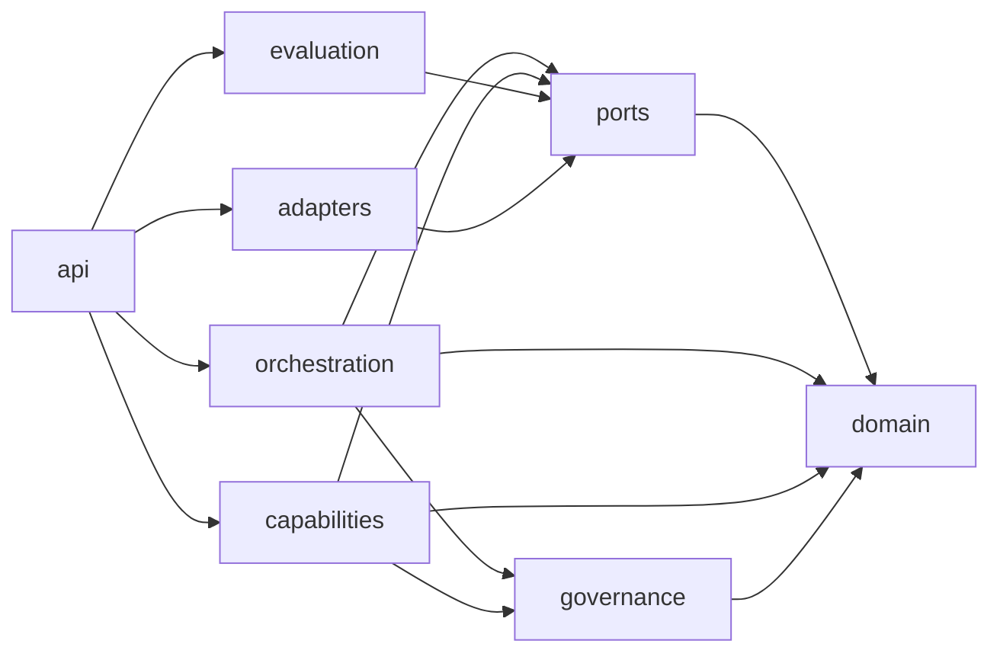
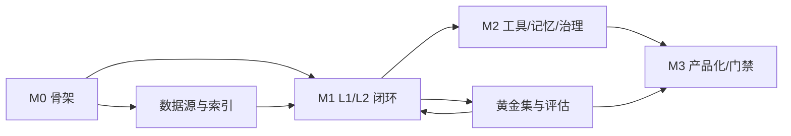

# 04 · 工程落地计划：zCAISAgent 目录骨架、扩展点、里程碑与 ADR

> 版本：v1.0 ｜ 日期：2026-11-05
> 前置：[03-architecture.md](03-architecture.md)
> 本文回答：**代码怎么放、依赖怎么控、新能力怎么加、按什么顺序开发、怎么验收。**

---

## 1. 代码目录骨架

目标：**模块化单体（modular monolith）**。一个进程可跑，边界按未来可拆服务的方式划好。

```
zCAISAgent/
├── pyproject.toml                  # 依赖与工具链（ruff/mypy/pytest）
├── README.md                       # 快速开始
├── Makefile                        # make dev / test / eval / lint
├── docker-compose.yml              # api + worker + pg + redis + minio
├── .env.example
│
├── configs/
│   ├── agents/
│   │   ├── general_assistant.yaml
│   │   ├── enterprise_qa.yaml
│   │   ├── deep_research.yaml
│   │   └── support_copilot.yaml
│   ├── retrieval/
│   │   ├── sources.yaml            # 数据源注册与连接参数
│   │   └── policies.yaml           # top_k / rerank / sufficiency
│   ├── models.yaml                 # 模型档位与 purpose 映射
│   ├── guardrails.yaml
│   ├── security.yaml               # 认证 / 授权 / 脱敏 / 审计策略
│   ├── schedules.yaml              # 定时任务（cron）
│   └── skills/                     # Skill 注册与版本配置
│
├── src/zcaisagent/
│   ├── __init__.py
│   ├── settings.py                 # 环境变量 + 配置加载 + Pydantic 校验
│   │
│   ├── domain/                     # ① 纯领域层：无 DB/HTTP/SDK 依赖
│   │   ├── enums.py
│   │   ├── models.py               # RunState / Evidence / Answer / Plan / Budget
│   │   ├── mandate.py              # 授权：谁/策略版本/scope/ACL
│   │   ├── stage.py                # Ticket stage 派生表
│   │   ├── patch.py                # StatePatch + reducer
│   │   ├── events.py
│   │   └── errors.py               # 领域错误码
│   │
│   ├── ports/                      # ② 抽象接口（依赖倒置的支点）
│   │   ├── llm.py
│   │   ├── retrieval.py
│   │   ├── tools.py
│   │   ├── memory.py
│   │   ├── checkpoint.py
│   │   ├── trace.py
│   │   ├── evaluation.py
│   │   ├── health.py               # HealthPort：每部件一个健康项
│   │   ├── skills.py               # SkillRegistryPort
│   │   ├── scheduler.py            # SchedulerPort
│   │   ├── security.py             # Identity / Policy / Guardrail / Audit / Secret
│   │   └── mcp_server.py           # McpServerPort（对外暴露，默认关闭）
│   │
│   ├── orchestration/              # ③ 编排层
│   │   ├── graph.py                # GraphSpec / Edge / next_node
│   │   ├── runtime.py              # 执行循环 / 预算 / checkpoint / interrupt
│   │   ├── reducers.py
│   │   ├── nodes/
│   │   │   ├── analyze.py          # 意图/复杂度/时效/权限
│   │   │   ├── route.py            # L0-L3
│   │   │   ├── plan.py
│   │   │   ├── act.py              # 按 ActionSpace 选择检索/工具/代码/浏览/文件
│   │   │   ├── observe.py          # 结果归一化为 Observation/Evidence
│   │   │   ├── reflect.py          # 目标是否达成 / 继续 / 人介入
│   │   │   ├── rewrite.py
│   │   │   ├── source_route.py
│   │   │   ├── retrieve.py         # 多源并行
│   │   │   ├── grade.py            # 证据评分 + 充分性
│   │   │   ├── synthesize.py       # 证据约束生成
│   │   │   ├── verify.py           # claim 级校验
│   │   │   ├── repair.py
│   │   │   ├── clarify.py
│   │   │   ├── respond.py
│   │   │   └── abstain.py
│   │   ├── actions/
│   │   │   └── registry.py         # ActionSpace 注册与选择
│   │   └── policies/
│   │       ├── budget.py
│   │       ├── termination.py
│   │       ├── routing.py
│   │       └── fallback.py
│   │
│   ├── capabilities/               # ④ 能力层（可插拔实现）
│   │   ├── retrieval/
│   │   │   ├── registry.py         # 源注册与发现
│   │   │   ├── hybrid.py           # 向量 + BM25
│   │   │   ├── fusion.py           # RRF + 去重
│   │   │   ├── rerank.py
│   │   │   ├── query_rewrite.py
│   │   │   ├── context_pack.py     # 父子块 + token 预算
│   │   │   └── sources/
│   │   │       ├── pgvector.py
│   │   │       ├── pg_fts.py
│   │   │       ├── web.py
│   │   │       ├── http_api.py
│   │   │       └── sql_readonly.py
│   │   ├── tools/
│   │   │   ├── gateway.py          # 注册 / 授权 / 校验 / 审批 / 审计
│   │   │   ├── mcp_client.py
│   │   │   ├── openapi_adapter.py
│   │   │   ├── sql_tool.py
│   │   │   ├── file_ops.py
│   │   │   ├── browser.py
│   │   │   └── sandbox.py
│   │   ├── memory/
│   │   │   ├── working.py
│   │   │   ├── episodic.py
│   │   │   ├── semantic.py
│   │   │   └── procedural.py
│   │   ├── skills/                 # Skill 注册 / 匹配 / 加载（非独立运行时）
│   │   │   ├── registry.py
│   │   │   ├── loader.py
│   │   │   └── executor.py
│   │   └── generation/
│   │       ├── prompts/
│   │       │   ├── analyze.md
│   │       │   ├── rewrite.md
│   │       │   ├── synthesize.md
│   │       │   └── verify.md
│   │       └── structured.py       # JSON schema 输出与修复
│   │
│   ├── governance/                 # ⑤ 治理层
│   │   ├── identity.py             # 认证（OIDC / API Key）
│   │   ├── policy.py               # 授权（RBAC / OPA 适配）
│   │   ├── permissions.py
│   │   ├── guardrails.py           # 注入检测 / 输出校验
│   │   ├── redaction.py
│   │   ├── secret.py               # 密钥（env / Vault）
│   │   └── audit.py
│   │
│   ├── evaluation/                 # ⑥ 评估层
│   │   ├── datasets.py
│   │   ├── metrics.py              # ragas 封装 + 自研
│   │   ├── trajectory.py
│   │   ├── judge.py                # 双 judge + 校准
│   │   └── runner.py
│   │
│   ├── observability/
│   │   ├── tracing.py              # OTel span
│   │   ├── cost.py
│   │   └── logging.py
│   │
│   ├── adapters/                   # ⑦ 适配层（唯一允许 import 第三方 SDK）
│   │   ├── llm/
│   │   │   ├── openai_compat.py
│   │   │   └── fake.py             # 测试用
│   │   ├── store/
│   │   │   ├── postgres.py
│   │   │   ├── pgvector.py
│   │   │   └── fts.py
│   │   ├── cache/redis.py
│   │   ├── trace/otel.py
│   │   ├── trace/langfuse.py
│   │   ├── checkpoint/postgres.py
│   │   ├── health/memory.py        # HealthBoard
│   │   └── mcp/
│   │       ├── client.py
│   │       └── server.py
│   │
│   ├── ingestion/                  # ⑧ 离线索引管线
│   │   ├── pipeline.py
│   │   ├── parsers/{pdf,docx,html,md,csv}.py
│   │   ├── chunker.py
│   │   ├── metadata.py
│   │   └── indexer.py
│   │
│   ├── scheduler/                  # ⑨ 调度层（只触发，不执行业务）
│   │   ├── service.py
│   │   ├── cron.py
│   │   └── jobs.py
│   │
│   ├── api/                        # ⑩ 接入层
│   │   ├── app.py
│   │   ├── deps.py
│   │   ├── schemas.py
│   │   └── routes/
│   │       ├── chat.py             # SSE
│   │       ├── runs.py             # 创建/查询/恢复/取消
│   │       ├── threads.py
│   │       ├── admin.py            # 数据源/配置/权限
│   │       ├── eval.py
│   │       └── feedback.py
│   │
│   └── cli.py                      # dev 调试入口（run/eval/trace）
│
├── tests/
│   ├── unit/                       # domain/policies/reducers
│   ├── contract/                   # 每个 port 的适配器同一套用例
│   ├── integration/                # PG/Redis/Fake LLM 端到端
│   ├── evals/                      # 黄金集 + 回归门禁
│   ├── security/                   # 越权/注入红队
│   └── fakes/                      # 内存端口实现
│
├── data/
│   ├── eval/golden.jsonl
│   └── eval/security.jsonl
│
├── skills/                         # Skill 资产（与代码分离）
│   └── policy_compare/
│       └── SKILL.md
│
└── docs/
    ├── 01-research-cais.md
    ├── 02-product.md
    ├── 03-architecture.md
    └── 04-engineering-plan.md
```

### 1.1 命名与文件规范

| 规范 | 说明 |
|---|---|
| 节点函数 | `async def xxx_node(state, ctx) -> StatePatch` |
| 适配器类 | `XxxAdapter`，实现对应 `XxxPort` |
| 配置模型 | `XxxConfig(BaseModel)`，启动时校验 |
| 错误 | 领域错误码大写蛇形，如 `TOOL_UNAUTHORIZED` |
| 事件 | 点号命名，`run.started` / `step.finished` |
| 测试 | `test_<module>_<behavior>`，一个行为一个断言组 |

---

## 2. 依赖规则（架构护栏）

### 2.1 允许的依赖方向

> **实现现状（2026-11-11 复核）**：实际分层与上图略有出入——`orchestration` 依赖 `capabilities`（节点直接 import `capabilities.retrieval.*` / `skills.registry` / `tools.gateway`）；`evaluation` 依赖 `orchestration`（复用 `build_default_graph` / `Runtime`）与 `capabilities`；`governance` 依赖 `ports`（`guards.py` 用 `ports.security`）。完整层序见 §2.2 的 `.importlinter`。



| 层 | 可以依赖 | **禁止依赖** |
|---|---|---|
| `domain` | Pydantic、标准库 | DB、HTTP、LLM SDK、FastAPI、Redis |
| `ports` | `domain` | `adapters`、`capabilities`、`orchestration` |
| `orchestration` | `domain`、`ports`、`governance`、标准库 | `adapters`、`api`、第三方 SDK |
| `capabilities` | `domain`、`ports`、`governance`、标准库 | `adapters`、`api`、`orchestration` 的具体节点 |
| `adapters` | `ports`、`domain`、第三方 SDK | `api`、`orchestration` 节点 |
| `api` | 所有内层 | — |
| `ingestion` | `domain`、`ports`、`adapters` | `api` |
| `scheduler` | `domain`、`ports`、`orchestration`（RunService） | `api` 路由、`adapters` 具体实现 |

### 2.2 自动校验（CI 必跑）

```bash
# 用 import-linter 固化依赖规则
lint-imports --contract layered
```

```ini
# .importlinter
[importlinter]
root_package = zcaisagent

[importlinter:contract:layered]
name = Layered architecture
type = layers
# 自上而下（上层可依赖下层）；实测 `python -m importlinter.cli lint` 通过
layers =
    zcaisagent.api
    zcaisagent.evaluation
    zcaisagent.orchestration
    zcaisagent.capabilities
    zcaisagent.governance
    zcaisagent.ports
    zcaisagent.domain
```

> 没有自动校验的"架构约定"等于没有约定。这条护栏能防止半年后内核被 SDK 调用淹没。

### 2.3 禁止事项清单

| 禁止 | 原因 | 替代 |
|---|---|---|
| 节点里 `import openai` | 锁定供应商、无法测试 | 用 `ctx.llm` |
| 节点里 `db.commit()` | 副作用不可回放 | 通过 `CheckpointPort` / 专用端口 |
| 在 `RunState` 存 SDK 对象/连接 | 状态不可序列化 | 只存数据，连接放 `RunContext` |
| 适配器返回 SDK 类型 | 污染内核 | 转成领域模型 |
| 全局单例 | 测试隔离差、多租户串数据 | 依赖注入 `RunContext` |
| 在 prompt 里拼未经校验的工具输出 | 注入风险 | `sanitize` + `<evidence>` 分区 |
| 用 `print` / 裸日志 | 丢失 trace 关联 | `ctx.trace` |

---

## 3. 扩展点手册

每个扩展点都给"改哪里、写什么、怎么验"，目标：**新增能力不改内核**。

### 3.1 Recipe A：新增一个检索源

| 步骤 | 动作 |
|---|---|
| 1 | 在 `capabilities/retrieval/sources/` 新建 `xxx.py`，实现 `RetrieverPort` |
| 2 | 把源级错误映射为领域错误码；权限过滤必须在查询条件里 |
| 3 | 在 `configs/retrieval/sources.yaml` 注册（名称、类型、连接、超时、top_k） |
| 4 | 在 `retrieval/registry.py` 的工厂中按 `type` 实例化 |
| 5 | 在 `tests/contract/test_retriever_port.py` 增加该实现的契约用例 |
| 6 | 在黄金集中增加 5 条依赖该源的用例，跑回归 |

**验收**：`pytest tests/contract -k xxx` 通过；关闭该源时系统可降级且 trace 标记 `degraded`。

### 3.2 Recipe B：新增一个工具

| 步骤 | 动作 |
|---|---|
| 1 | 优先走 MCP：在 `configs/tools` 注册 `mcp://xxx`，无需写代码 |
| 2 | 若走 OpenAPI：提供 spec URL 与 operationId 白名单 |
| 3 | 自定义工具：实现 `ToolPort`，填写 `ToolSpec`（尤其 `risk_level`/`scopes`/`idempotent`） |
| 4 | 在 `ToolGateway` 注册；写操作设置 `requires_approval=true` |
| 5 | 输出必须可转为 `Evidence`（`source_type=tool`） |
| 6 | 加安全用例：无权限调用、参数注入、超长输出、注入内容 |

**验收**：无权限调用返回 `TOOL_UNAUTHORIZED`；高风险动作 100% 进入 `AWAITING_USER`；审计日志可查。

### 3.3 Recipe C：新增一个节点或策略

| 步骤 | 动作 |
|---|---|
| 1 | 在 `orchestration/nodes/` 新建 `async def node(state, ctx) -> StatePatch` |
| 2 | 只读 `state`，只返回 patch；不写库、不发消息 |
| 3 | 在 `graph.py` 的内置图中注册节点与边（条件函数必须纯函数） |
| 4 | 在 `policies/budget.py` 声明该节点消耗（节点步数/预计 token） |
| 5 | 在 `domain/events.py` 增加事件（如需） |
| 6 | 单测：给定状态 → 断言 patch；集成：断言轨迹 |

**验收**：节点可独立单测（无需容器）；在 trace 中可见；预算检查覆盖。

### 3.4 Recipe D：替换编排引擎（如改用 LangGraph）

| 步骤 | 动作 |
|---|---|
| 1 | 新增 `orchestration/runtime/langgraph_adapter.py`，实现 `RuntimePort`（`execute`/`resume`/`cancel`） |
| 2 | 把 `GraphSpec` 编译为 LangGraph 图；节点函数复用 |
| 3 | Checkpoint 用 `PostgresSaver` 适配同一 `CheckpointPort` |
| 4 | 用同一套集成测试（`tests/integration/test_runtime_contract.py`）验证两种 runtime 行为一致 |
| 5 | 通过配置 `runtime: langgraph` 切换，保留自研实现作为 fallback |

**验收**：同一黄金集在两种 runtime 下指标差异 < 2%；可一键切回。

### 3.5 Recipe E：替换模型供应商

| 步骤 | 动作 |
|---|---|
| 1 | 新建 `adapters/llm/xxx.py`，实现 `LLMPort`（complete/stream） |
| 2 | 映射错误码（429/5xx/超时/内容拒绝） |
| 3 | 在 `configs/models.yaml` 增加 provider 与档位 |
| 4 | 跑契约测试：流式、结构化输出、token 计量、取消 |
| 5 | 用同一评估集对比新旧模型（质量/成本/延迟） |

**验收**：切换只改配置；成本与 token 统计准确；失败可降级到备用模型。

### 3.6 Recipe F：新增评估指标

| 步骤 | 动作 |
|---|---|
| 1 | 在 `evaluation/metrics.py` 实现 `Metric` 协议（`compute(sample, run) -> float`） |
| 2 | 在 `evaluation/runner.py` 注册 |
| 3 | 在 `data/eval/golden.jsonl` 补充所需字段 |
| 4 | 在门禁配置中声明阈值与阻断级别 |
| 5 | 用 10 条人工标注样本校准指标（避免指标本身失真） |

**验收**：报告可见；门禁生效；与人工判断相关性 ≥ 0.7。

### 3.7 Recipe G：新增一个 Skill（技能包）

| 步骤 | 动作 |
|---|---|
| 1 | 新建 `skills/<name>/SKILL.md`，frontmatter 声明 `name/version/description/when_to_use/scopes` |
| 2 | 在 `capabilities/skills/registry.py` 注册（启动扫描 + 版本索引） |
| 3 | 声明 `allowed_tools` / `allowed_sources` / `required_scopes`；`policy_overrides` 只能收紧 |
| 4 | 正文按需加载（渐进披露），不要把所有 Skill 正文常驻上下文 |
| 5 | 加 `tests/contract/test_skill_port.py`：命中、越权、提权、版本切换 |
| 6 | 黄金集补 5 条应命中该 Skill 的用例，验证路由与稳定性 |

**验收**：命中可解释（`SkillMatch.reason`）；无权限时拒绝加载并回退通用策略，不中断 Run；审计可见 `skill.loaded/executed`。

### 3.8 Recipe H：新增一个定时任务（Cron）

| 步骤 | 动作 |
|---|---|
| 1 | 在 `configs/schedules.yaml` 定义 `JobSpec`（cron、timezone、agent、identity、budget_profile、notify） |
| 2 | `scheduler/service.py` 只调用 `POST /v1/runs`，**不写业务逻辑、不直接调 LLM** |
| 3 | 强制 `idempotency_key = job_id:scheduled_at` + Redis 互斥锁 |
| 4 | 配置 `concurrency`（forbid/replace/allow）与 `misfire`（skip/run_once） |
| 5 | 使用服务账号，scope 最小化；结果投递前校验目标权限 |
| 6 | 测试：重复触发只执行一次、并发策略、补跑、超时取消、失败告警 |

**验收**：`JobRun.run_id` 可关联完整 trace；定时任务使用独立预算，不影响在线请求；失败可告警与重试。

### 3.9 Recipe I：接入新的认证 / 授权 / 护栏

| 步骤 | 动作 |
|---|---|
| 1 | 实现 `IdentityPort`（API Key / OIDC / SAML），输出统一 `AuthContext` |
| 2 | 实现 `PolicyPort`（内置 RBAC 或 OPA/Casbin 适配器），`deny by default` |
| 3 | 实现 `GuardrailPort`：`check_input` / `check_evidence` / `check_output` |
| 4 | 接入 `AuditPort`（append-only）与 `SecretPort`（env/Vault），密钥不落配置文件 |
| 5 | 加越权、注入、PII、跨租户红队用例；进入硬门禁 |
| 6 | 在 `configs/security.yaml` 声明策略；启动时校验，不兼容则 fail fast |

**验收**：越权召回 = 0；注入红队通过率 ≥ 90%；审计可按 run_id 追溯；更换认证方式不改内核代码。

---

## 4. 开发顺序与里程碑

> 原则：**每一步都可运行、可验证**。不做"先写一个月代码再联调"。

### M0 · 可运行骨架

> 状态：**已交付（骨架）**。67 项测试全绿；CLI、HTTP/SSE、trace/checkpoint 可运行；M0 检索使用内存实现，pgvector 适配器接口仅预留、**适配器未实现**；已吸收 dsh 的 SourceRegistry / Mandate / TicketStage / HealthBoard 四项机制；Docker Compose 文件已提供，未在本机验证。
>
> **2026-11-08 复核差异**：M0-5 的 `adapters/store/pgvector.py` 不存在；M0-8 的 `observability/tracing.py` 未建（仅 JSONL trace）；M0-11 仅 30 条（DoD 的 ≥30 达标）；SSE 为"跑完后切片"的伪流式；黄金集与评估的"分层指标"在 M1 补齐。
>
> **2026-11-11 M1 收口复核（检索链路 + 运行时）**：Agentic RAG 检索链路升级已落地，**226 项测试全绿**。
> ① BM25 源（SQLite FTS5）+ RRF 融合（支持源权重）；② vector 语义源（OpenAI 兼容 `/embeddings`）+
> 专用 cross-encoder rerank（DashScope 原生格式，`FallbackReranker` 自动回退 embedding 余弦 → LLM 打分）；
> ③ PageIndex 章节树源 + GraphRAG 实体图源（含失败补抽与磁盘缓存；消融显示融入常规链路为负贡献，默认
> `enabled=False` 仅保留单源评测）；④ 离线评测体系 `retrieval-eval` CLI（Recall@5/@10、MRR、NDCG@10，
> doc/answer 双口径，golden 100 案例）。当前最优 **doc R@10=0.9971 / NDCG@10=0.9525**，M0-11 黄金集已达
> 100 条（M1 部分指标提前达标）。
> 2026-11-11 收口补齐：两阶段真流式（SSE 逐 token + claims 抽取，`done.answer` 覆盖草稿）、
> HyDE 与父子块（默认关闭）、pgvector/Postgres 持久化（默认关闭，连接失败回退内存）、
> `eval-gate` 本地门禁与 `.github/workflows/ci.yml`（见 03 §8.4.1 实现状态对照表）。

| # | 任务 | 产出 | 验证 |
|---|---|---|---|
| 1 | 初始化工程（pyproject、ruff、mypy、pytest、CI） | 可 `make lint test` | CI 绿 |
| 2 | `domain/` 模型 + patch/reducer | 单测覆盖 reducer 规则 | `pytest tests/unit/domain` |
| 3 | `ports/` 7 个接口 + fake 实现 | 内存版可跑 | 单测 |
| 4 | `orchestration/runtime.py` 最小循环 | 支持 step/checkpoint/预算 | 单测：超预算终止 |
| 5 | `adapters/llm/openai_compat.py` + `adapters/store/pgvector.py` | 真实调用 | 集成测试 |
| 6 | `ingestion/` 最小管线（PDF/MD） | 可索引 20 篇文档 | CLI 索引成功 |
| 7 | `api/routes/chat.py` SSE + `cli.py` | 端到端问答 | curl 可流式返回 |
| 8 | `observability/tracing.py` + checkpoint 落库 | 每次运行可查轨迹 | trace 表有记录 |
| 9 | 20 条 smoke 用例 | 通过率 100% | `make smoke` |
| 10 | `IdentityPort`(API Key) + `PolicyPort`(RBAC 骨架) + `SecretPort`(env) | 最小安全闭环 | 越权请求被拒 |
| 11 | 黄金集 100 条标注（与开发并行，含无答案/越权/注入） | 评估基线 | M1 前完成 ≥ 100 条 |

**M0 DoD**：`docker compose up` 后，导入文档 → 提问 → 得到带引用的回答 → 在 trace 中看到每一步。无任何硬编码密钥；黄金集标注 ≥ 30 条。

### M1 · L1/L2 闭环（MVP）

| # | 任务 | 产出 | 验证 |
|---|---|---|---|
| 1 | `analyze` + `route` + 配置化分级 | L0-L2 可路由 | 分级准确率 ≥ 85%（50 条标注） |
| 2 | 改写策略分级（none/light/multi/hyde） | 原 query 永远保留 | 简单查询不被改坏（专项集）；2026-11-11：`capabilities/retrieval/rewrite.py` 已实现 none/light/multi/decompose 确定性分级 + HyDE（默认关闭，仅 `open` 复杂度） |
| 3 | 混合检索 + RRF + 重排 + 去重 | Recall@10 ≥ 0.85 | 检索评估脚本；无 pgvector/embedding 时先做多路关键词 + RRF。2026-11-11：`fusion.py`（RRF k=60）+ 专用 rerank + vector/pgvector 向量路均已接入，doc R@10=0.9971 |
| 4 | 证据评分 + 充分性判断 | 四维评分 + coverage | 与人工一致性 ≥ 0.8 |
| 5 | 证据约束生成 + claim 拆解 + 引用绑定 | 答案卡片数据 | Citation Support ≥ 0.85 |
| 6 | claim 级校验 + 修复 + 拒答 | Verdict + repair | 无依据断言率 < 5% |
| 7 | 预算/终止/无进展检测 | 无超预算、无死循环 | 压测 100 并发无失控；节点步数上限（预算）L1=16 / L2=22 / L3=32；有效动作次数硬上限 max_actions=1/3/8/15 且效率目标均值 ≤2/5/12（PRD FR-AI-08） |
| 8 | 黄金集 100 条 + 评估 runner | 一键报告 | 7.2 MVP 指标达标 |
| 9 | 前端最小版：对话 + 证据面板 + 轨迹抽屉 | 可演示 | 人工走查 |
| 10 | `SkillRegistryPort` 骨架 + 1 个内置 Skill | 一个技能包可加载 | 匹配可解释、无提权 |
| 11 | 通用循环 `act/observe/reflect` + `ActionSpace` 注册 | 检索/工具/代码/浏览/文件可选 | 多步任务端到端跑通；2026-11-08：循环与 ActionSpace 已接入 L2/L3；`ToolGateway` 只读网关与内置 `kb_search` 工具已交付，`act` 已分派 `tool_call` 并端到端验证 |

**M1 DoD**：L1/L2 分级可用；黄金集指标达标；任一任务可展开证据与轨迹；预算与越权测试通过。

### M2 · 工具、记忆与治理

| # | 任务 | 产出 | 验证 |
|---|---|---|---|
| 1 | `ToolGateway` + MCP client | 3 个真实工具 | 契约测试 |
| 2 | OpenAPI 适配 + schema 校验 | 业务 API 接入 | 参数非法被拦截 |
| 3 | 审批中断（interrupt/resume） | HITL 卡片 | 写操作 100% 审批 |
| 4 | 工具权限分级 + 审计 | scope/风险/日志 | 越权测试通过 |
| 5 | 三类记忆 + 写入策略 | 多轮与偏好 | 多轮准确率 +10% |
| 6 | RBAC + 文档 ACL + 租户 RLS | 权限体系 | 越权召回 = 0 |
| 7 | 注入防护 + 红队集 | 检测与隔离 | 通过率 ≥ 90% |
| 8 | 缓存（检索/语义/prompt） | 成本下降 | 命中率 ≥ 20% |
| 9 | `IdentityPort` + `PolicyPort` 完整化（OIDC / OPA 可选） | 企业 SSO 与策略引擎 | 认证/授权契约测试 |
| 10 | `SchedulerPort` + 定时订阅调研任务 | 定时任务可用 | 幂等/并发/补跑测试 |
| 11 | `EventSinkPort`(Webhook) + `SecretPort`(Vault) | 事件订阅与密钥托管 | 签名重试、密钥不落盘 |

**M2 DoD**：客服/工单场景可试点；工具调用全链路可审计；安全硬门槛通过。

### M3 · 产品化与门禁

| # | 任务 | 产出 | 验证 |
|---|---|---|---|
| 1 | Studio 最小四页（数据源/轨迹/评估/配置） | 运营可自助 | 走查通过 |
| 2 | 回归门禁接入 CI | 劣化阻断 | 故意降级被拦；2026-11-11：`eval-gate` CLI 与 `.github/workflows/ci.yml` 已接入 |
| 3 | 成本/延迟/质量看板 | 可观测 | 数据准确 |
| 4 | 压测与容量规划 | 20/50 并发 | P95 达标 |
| 5 | 故障演练（模型/检索/DB/Redis） | 降级生效 | 演练报告 |
| 6 | 部署文档 + 运维手册 + SDK | 可交付 | 新人按文档可部署 |

**M3 DoD**：可交付客户试用；CI 门禁生效；故障演练通过；文档齐全。

### 4.1 任务依赖图



**关键路径**：领域模型 → 运行时 → 检索闭环 → 评估集 → 工具/权限 → 门禁。
**可并行**：前端与 Studio 可在 M1 后半段并行；数据源接入可与 M1 并行。

---

## 5. 测试策略

| 层级 | 范围 | 工具 | 门禁 |
|---|---|---|---|
| **单元** | domain/reducer/policies/prompt 构造 | pytest | 覆盖率 ≥ 80%（核心 90%） |
| **契约** | 每个 Port 的所有适配器跑同一套用例 | pytest parametrize | 全绿 |
| **集成** | PG + Redis + Fake LLM 端到端 | testcontainers / compose | 全绿 |
| **评估** | 黄金集 100+，分层指标 | 自研 runner + Ragas | 阈值门禁 |
| **安全** | 越权、注入、PII、工具滥用 | 专项集 | 硬门槛 |
| **性能** | 20/50 并发、长任务 | k6 / locust | P95 达标 |
| **混沌** | 模型超时、检索失败、DB 断连 | fault injection | 降级生效 |

### 5.1 关键测试用例（必须存在）

```text
test_reducer_append_evidence_dedup
test_budget_exceeded_terminates_run
test_no_progress_detection_stops_replan
test_retriever_contract_pgvector
test_retriever_contract_web
test_tool_gateway_denies_without_scope
test_destructive_tool_requires_approval
test_injection_in_evidence_is_quarantined
test_citation_requires_existing_evidence
test_acl_filter_applied_before_retrieval
test_stream_cancel_releases_resources
test_runtime_resume_from_checkpoint
test_eval_gate_blocks_regression
```

### 5.2 CI 流水线

```yaml
stages:
  - lint        # ruff + mypy + import-linter
  - unit        # 快速
  - contract    # 端口契约
  - integration # 容器
  - eval        # 黄金集（可 nightly）
  - security    # 红队（可 nightly）
```

---

## 6. 架构决策记录（ADR）

### ADR-001：编排核心自研，框架只做适配器
- **背景**：LangGraph 成熟，但内核若直接依赖其类型，后续替换成本高，且调试被抽象层遮挡。
- **选项**：A 直接用 LangGraph；B 完全自研；C 自研 RuntimePort + LangGraph 适配器。
- **决策**：C。
- **后果**：需要维护 ~200 行运行时；换来可测试、可替换、可解释。MVP 可用适配器加速。

### ADR-002：主存储统一 Postgres + pgvector
- **背景**：MVP 不想维护多套存储。
- **选项**：专用向量库（Milvus/Qdrant）vs pgvector。
- **决策**：pgvector + FTS；当 Recall/延迟成为瓶颈且数据量 > 千万级时再引入专用库。
- **后果**：运维简单；超大规模需迁移（已由 `RetrieverPort` 隔离）。

### ADR-003：Evidence 作为跨能力的统一抽象
- **背景**：检索、工具、记忆返回结构不同，融合与引用困难。
- **决策**：所有外部信息转为 `Evidence`，带来源、评分、引用、权限元数据。
- **后果**：新增能力必须实现转换；换来统一的引用、校验、审计、展示。

### ADR-004：预算与终止是一等公民
- **背景**：Agentic 系统最大风险是成本与死循环。
- **决策**：`Budget` 进入 `RunState`，由运行时强制执行；任何回退/重规划都消耗预算。
- **后果**：节点无法绕过；配置需按等级设定；换来可控的成本与延迟。

### ADR-005：配置驱动策略，代码兜底
- **背景**：不同租户/场景需要不同的自主性与检索深度。
- **决策**：路由、预算、检索参数、模型档位放 YAML；危险策略需代码白名单。
- **后果**：需要配置校验与契约测试；换来运营可调、无需发版。

### ADR-006：MCP 优先的工具接入
- **背景**：工具生态碎片化，自研协议成本高。
- **决策**：MCP 为默认；OpenAPI 为业务系统补充；SQL/沙箱为特例。
- **后果**：依赖 MCP 生态成熟度；换来即插即用与权限统一。

### ADR-007：模块化单体优先，按指标拆分
- **背景**：早期微服务会拖慢迭代。
- **决策**：单进程多模块；仅当队列积压/独立扩容有数据支撑时拆 worker/检索服务。
- **后果**：部署简单；需用 import-linter 守住边界，避免变成"大泥球"。

### ADR-008：评估即代码，CI 门禁
- **背景**：LLM 系统改动影响面大，人工回归不可靠。
- **决策**：黄金集入库，指标阈值入 CI；越权/注入为硬门槛。
- **后果**：需要维护数据集与 judge 校准；换来可持续的质量基线。

### ADR-009：检索来源注册表（借鉴 dsh SourceRegistry）
- **背景**：M0 只有一个内存检索源；M1 要接 pgvector、Web、API、SQL，若在节点里写死会迅速耦合。
- **决策**：所有来源实现 `RetrieverPort`，经 `SourceRegistry` 注册；节点只通过 `RetrieverPoolPort.list()` 获取来源，并行检索并合并证据；单源失败降级为 `degraded`，不影响整体。
- **后果**：新增来源不改内核；需要统一 `source_name` 唯一性与契约测试；多源会增加延迟与去重成本（用并行 + 证据 id 去重缓解）。

### ADR-010：授权与上下文分离（借鉴 dsh Mandate）
- **背景**：M0 的 `AuthContext` 直接传入各层，缺少"为什么可以执行、依据哪版策略"的可审计记录。
- **决策**：引入不可变 `Mandate`，记录 `tenant/user/policy_version/strength/scopes/acl`；由认证结果在创建 Run 时生成；上下文（检索内容、工具输出）不授予任何权限。
- **后果**：Run 具备可审计的授权依据；策略变更时可按 `policy_version` 找出受影响 Run；后续需补 Mandate 重新校验（M1）。

### ADR-011：Ticket stage 派生而非存储（借鉴 dsh stage 表）
- **背景**：只存 `RunStatus` 无法回答"现在在等谁"（等人回答、等人审核、被阻塞、排队中）。
- **决策**：用纯函数 `ticket_stage(state)` 派生阶段，API 返回 `stage`；不新增第二份状态字段，避免状态漂移。
- **后果**：UI/告警/运营看板共用一张表；新增阶段只改纯函数与测试，不改存储。

### ADR-012：组件健康板（借鉴 dsh HealthBoard）
- **背景**：M0 的 `/health` 只返回进程存活，无法定位 LLM/检索/检查点哪一环坏了。
- **决策**：每个部件注册一个健康项、单一写入者；Runtime 节点失败时置 `down`；`/health` 返回组件级状态与消息。
- **后果**：排障从"服务活着"升级为"哪个部件坏了"；后续可扩展为连续失败计数、按 Source/模型分项。

---

## 7. 风险与权衡

| 权衡 | 选择 | 代价 | 缓解 |
|---|---|---|---|
| 自主性 vs 可控性 | 默认 L1，显式升级 | 复杂问题需用户多点一次 | 自动判定 + 一键升级 |
| 质量 vs 延迟 | L2 允许 25s | 交互体验下降 | 流式 + 阶段性反馈 |
| 通用性 vs 简单性 | 端口化 | 初期抽象成本 | 只保留 7 个端口 |
| 成本 vs 覆盖 | 多源 + 重排 | 单次成本上升 | 缓存 + 模型分层 + 早停 |
| 记忆收益 vs 污染 | 严格写入策略 | 个性化变弱 | 显式记忆 + 审核 |
| 框架便利 vs 锁定 | 自研核心 | 开发量增加 | LangGraph 适配器加速 MVP |
| 单库简单 vs 规模 | pgvector | 超大语料受限 | 端口隔离，按需替换 |

### 7.1 最可能翻车的三个点

1. **判断器不稳定**（路由/充分性/校验）→ 用规则 + 小模型 + 大模型三级融合，阈值用评估集校准，不要拍脑袋。
2. **权限过滤漏掉**（尤其后置过滤）→ ACL 必须进检索查询条件；越权用例设为硬门禁；日志不落原文。
3. **评估集自嗨**（题目太简单、judge 偏差）→ 分层集 + 双 judge + 每周人工抽检 50 条。

---

## 8. 下一步行动清单（可直接执行）

| # | 动作 | 产出 | 依赖 |
|---|---|---|---|
| 1 | 已完成：`02-product.md` §13 的 Q1-Q6 已确认 | MVP 场景、部署、技术栈、评估集基线锁定 | 2026-11-05 |
| 2 | 建工程骨架（pyproject/CI/import-linter/compose） | 可运行空壳 | 本文第 1 节 |
| 3 | 实现 `domain/` + `ports/` + fake | 单测全绿 | M0-1/2/3 |
| 4 | 实现最小 runtime + checkpoint + trace | 端到端可回放 | M0-4/8 |
| 5 | 接 1 个真实检索源 + 1 个模型 | 能回答单跳问题 | M0-5/6/7 |
| 6 | 建 100 条黄金集（含无答案/越权/注入） | 评估基线 | 需业务输入 |
| 7 | 按 M1 任务表实现闭环 | MVP 可演示 | 6 完成 |
| 8 | 接入 CI 评估门禁 | 质量可持续 | M3-2 |

---

## 9. 文档索引

| 文档 | 内容 | 读者 |
|---|---|---|
| [01-research-cais.md](01-research-cais.md) | 范式研究、图中流程优劣、统一模型 | 产品/架构/技术负责人 |
| [02-product.md](02-product.md) | 定位、场景、功能、指标、路线图 | 产品/业务/管理层 |
| [03-architecture.md](03-architecture.md) | 分层、运行时、契约、子系统、部署、配置 | 研发/架构 |
| [04-engineering-plan.md](04-engineering-plan.md) | 目录、依赖规则、扩展点、里程碑、ADR | 研发/项目管理 |

---

**结论**：本方案把图中"最小 Agentic RAG"升级为 **可生产化的 CAIS 运行时**——保留其闭环思想，补齐路由、证据、预算、验证、记忆、治理与评估；以**通用 Agent**为主形态，Agentic RAG 作为内置能力；通过**端口-适配器 + 配置驱动 + 一套运行时**避免核心模块耦合，并为后续扩展留出稳定接缝。
