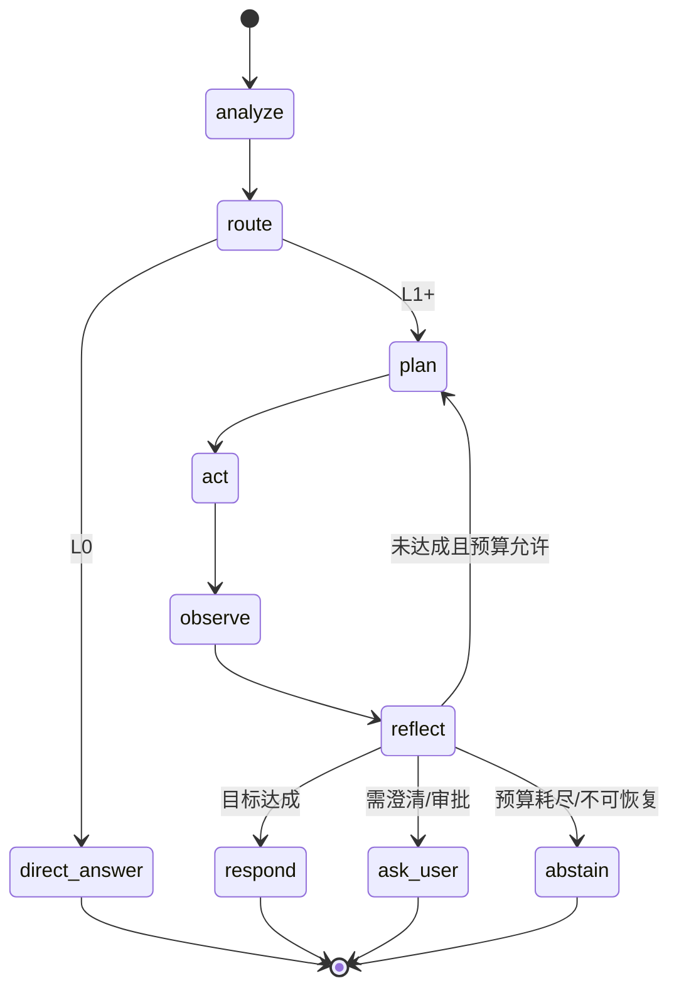
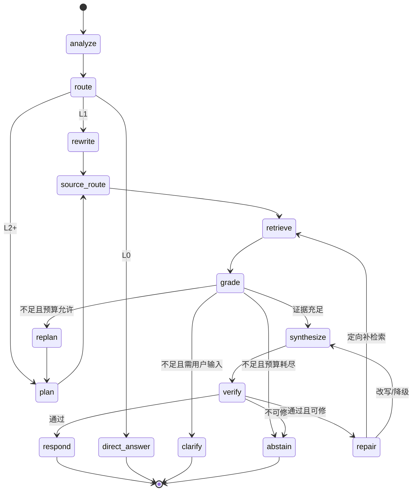

# 05 · PRD：zCAISAgent 通用 Agent 运行时

> 版本：v1.1 ｜ 状态：待评审 ｜ 日期：2026-11-06
> v1.1 修订：① 全部 FR 补 P0/P1/P2 标注（对齐 04 里程碑 M1/M2/M3）；② §3.2 增补可观测/集成接口/AI 能力三行；③ 明确验收依据规则并补关键 P0 判据；④ 新增非功能需求（§7）与界面交互汇总（§8）；⑤ 补 person/* 派生条件、分级预算矩阵、合规类判定、MVP 动作边界、实现契约引用边界；⑥ 统一开放问题与测量口径。
> 读者：产品、研发、测试、安全、知识运营
> 事实来源：[01-research-cais.md](01-research-cais.md)、[02-product.md](02-product.md)、[03-architecture.md](03-architecture.md)、[04-engineering-plan.md](04-engineering-plan.md) 与 M0 已交付代码
> 本文定位：**需求契约**。回答"系统在什么条件下必须表现出什么行为"；不回答"用哪个类、哪张表、哪条路由实现"。
> 实现状态（2026-11-11）：检索相关需求（多源融合、重排、版本/ACL 过滤、检索评测、HyDE、父子块、pgvector 持久化）与流式/评估门禁已落地（226 项测试，doc NDCG@10 0.9525），逐条验收状态见 [README](../README.md) 与 [04 §4 M0 复核](04-engineering-plan.md)；工具/记忆/多模态类需求仍按里程碑排期。

---

## 0. 文档约定

### 0.1 优先级

| 标记 | 含义 | 开发要求 |
|---|---|---|
| **P0** | MVP 必须，缺失则核心闭环不成立 | 必须实现并有自动化验证 |
| **P1** | V1 必须，支撑生产可用 | 排入 M2/M3 |
| **P2** | V2 或预留 | 只保留接口，不阻塞 P0 |

### 0.2 交付状态标记

| 标记 | 含义 |
|---|---|
| `[已交付]` | M0 代码中存在且可运行；行为细节以本文为准，差异见对应条目 |
| `[待开发]` | 尚无实现，需按本文开发 |
| `[待收敛]` | 已有临时实现，行为未达本文目标，需在指定阶段替换 |

> **冲突处理**：本文与 01-04 文档冲突时，以本文为需求口径；与代码冲突时，`[已交付]` 项以代码现状为准并登记差异，其余以本文为准。任何口径变更需同步更新本文并记录原因。

### 0.3 需求编号

`FR-<模块>-<序号>` 为稳定标识，供开发任务、测试用例、缺陷单引用。每条 FR 标题带优先级标记（P0/P1/P2，与 04 里程碑对齐：P0→M0/M1，P1→M2/M3，P2→V2）。

**验收依据规则**：本文不设独立验收章节，验收由三层共同承载——
1. 文中"可观察结果 / 硬规则"给出量化判据或可检查的输入输出（阈值、状态码、轨迹字段）；
2. 未单列量化判据的 P0 需求，以 04 §5.1 关键测试用例（如 `test_tool_gateway_denies_without_scope`、`test_acl_filter_applied_before_retrieval`）作为最小验收；
3. 跨需求的质量/延迟/成本指标统一由 FR-AI-08 指标表与 FR-EVAL-04 门禁承载，测试用例按 FR 编号反向引用本表。

---

## 1. 背景与问题

企业内的知识型任务存在三个稳定矛盾：

1. **信息在多个系统里，且版本会变**。员工问"住宿标准是多少"，答案可能同时存在于制度文档、财务系统与邮件通知中；过期文档与现行制度冲突时，用户无法判断该信谁。
2. **通用工具无法可靠完成多步任务**。一次检索能回答的问题只是一部分；对比、核查、跨系统查询需要"判断要不要查、查哪里、够不够、要不要换手段"的运行时决策。
3. **AI 输出缺少可验证性**。现有问答产品给结论不给依据，出错时无法定位是检索错、生成错还是权限错；企业不敢把它放进有合规要求的流程。

现有方案的两类缺口：

| 方案 | 缺口 |
|---|---|
| 固定管线 RAG（检索→拼上下文→生成） | 控制权在代码；无法按需换源、补检索、调工具；证据不足仍硬答 |
| 低代码 Agent 平台 | 内核与 UI 耦合；轨迹、评估、权限通常较弱；私有化与深度定制受限 |

**产品应答**：用同一套运行时驱动"检索、工具、代码、浏览、文件"等动作，把**证据、预算、校验**做成一等公民；Agentic RAG 是该运行时在知识密集任务下的内置形态，而不是另一套系统。

**可观察的目标结果**：

- 用户拿到的每条关键结论都能点开到具体来源；
- 证据不足时系统明确说"没找到缺什么"，而不是编造；
- 任一任务都能还原"为什么这么答、花了多少、错在哪一步"；
- 新增数据源、工具、模型不改动内核行为。

---

## 2. 用户与核心任务

### 2.1 角色

| 角色 | 核心任务 | 关键权限边界 |
|---|---|---|
| **终端用户**（员工/客服/分析师） | 提问、执行任务、查看依据、反馈纠错 | 只能访问授权范围内的知识与工具；只能看自己的任务轨迹 |
| **知识运营** | 接入与维护数据源、处理解析失败、维护评估集、定位答不好的问题 | 可管理数据源与索引；不可查看他人对话正文（脱敏后可看统计） |
| **开发者** | 通过接口集成、注册工具、扩展 Skill、调试轨迹 | 可注册能力与查看技术轨迹；不可绕过权限与审计 |
| **管理员/合规** | 管理租户、角色、审批策略、导出审计 | 可查看审计与策略；不可修改历史审计记录 |

### 2.2 核心任务（JTBD）

| # | 任务 | 完成判据 |
|---|---|---|
| J1 | "公司制度怎么规定的？" | 得到直接结论 + 可点开的现行版本来源 + 生效时间 |
| J2 | "对比 A 与 B 在 X 上的差异" | 覆盖双方关键维度，逐条有出处，明确未覆盖项 |
| J3 | "这个客户的历史问题怎么处理的？" | 跨系统取到事实，动作有授权、有记录 |
| J4 | "这份材料有没有违反新规？" | 逐条比对、冲突标注、可审计轨迹 |
| J5 | "系统为什么这么答？" | 展开决策链、每步输入输出、证据与校验结论 |

---

## 3. 范围

### 3.1 最小完整旅程（P0）

```
用户提出目标
→ 系统判定自主性等级（L0-L3）
→ （需要时）检索/调用工具获取外部信息
→ 证据评分与充分性判断
→ 证据约束生成（结论 + 要点 + 引用）
→ 校验（结构/语义/一致性）
→ 通过：返回答案卡片；不通过：补检索或改写，仍不通过则拒答
→ 全过程可查看轨迹与成本
```

进入条件：用户已认证，且至少有一个可用数据源或工具。
完成证据：用户看到"结论 + 引用 + 置信度 + 局限"，且轨迹可展开。
最重要的恢复路径：证据不足或校验失败时，系统在预算内补检索/改写；耗尽预算则明确拒答并给出下一步建议。

### 3.2 P0 / P1 / P2 边界

| 能力域 | P0（MVP） | P1（V1） | P2（V2/预留） |
|---|---|---|---|
| 会话 | 单轮/多轮问答、流式输出、任务模式切换 | 澄清选项、会话历史与分享 | 定时订阅调研 |
| 编排 | L0-L3 路由、预算与终止、通用循环（计划/动作/观察/反思） | 断点恢复、缓存 | 并行 worker 深度研究 |
| 检索 | 文档多格式接入、向量+关键词混合、重排、权限过滤、证据评分、充分性 | Web/API/SQL 多源、冲突检测、索引版本 | 多模态解析 |
| 生成 | 证据约束生成、claim 拆解、引用绑定 | 对比表/报告结构化输出 | 多媒体产物 |
| 校验 | 结构校验、语义校验、定向修复、拒答 | 一致性/数字日期专项校验 | — |
| 工具 | 只读工具接入与权限校验 | MCP/OpenAPI/SQL/沙箱/文件/浏览器、HITL 审批 | 对外 MCP 服务、A2A |
| 记忆 | 工作记忆（当前任务上下文） | 情景/语义/程序记忆 | 跨租户共享记忆 |
| 技能 | 企业知识问答 Skill | Skill 注册、版本、白名单 | 第三方 Skill 市场 |
| 评估 | 黄金集、离线评估 | CI 门禁、在线反馈、质量看板 | 自动标注 |
| 治理 | 认证、租户隔离、检索前 ACL、审计最小集 | 企业 SSO、策略引擎、PII 脱敏、密钥托管 | DSR 全链路删除 |
| 可观测 | 决策轨迹、组件健康检查、单任务成本可见 | 成本/延迟/质量看板、告警 | 全链路性能剖析 |
| 集成接口 | 同步任务接口、流式接口、轨迹接口 | Python SDK、Webhook 事件订阅 | 对外 MCP 服务、A2A |
| AI 能力 | 模型档位映射、提示词分层契约、证据边界、上下文压缩、行为红线、指标基线 | 生成参数确定性、失败降级矩阵、五类版本化管理 | large 档位深度研究（默认关闭） |

### 3.3 明确不做（MVP）

- ❌ 通用低代码工作流编排（不替代 Dify/n8n）
- ❌ 模型训练与微调平台
- ❌ 分布式多 Agent 自由协作（只做图内多角色节点）
- ❌ 自研向量数据库/检索引擎
- ❌ 移动端原生 App、通用 IM/OA
- ❌ 纯 SaaS 计费与多租户物理共享

---

## 4. 产品模型

### 4.1 核心对象

| 对象 | 定义 | 关键属性 | 谁创建/变更 |
|---|---|---|---|
| **Thread（会话）** | 用户与系统的一段连续交互 | thread_id、租户、用户、消息序列 | 用户创建；系统追加消息 |
| **Run（任务运行）** | 一次目标执行的最小单元 | run_id、目标、等级、状态、预算、证据、答案、校验结论 | 系统创建；运行时变更状态 |
| **Mandate（授权凭据）** | 本次 Run 为何可以执行 | 租户/用户、策略版本、授权强度、scopes、ACL 令牌 | 认证后生成，运行期只读 |
| **Evidence（证据）** | 一切外部信息（检索片段、工具结果、记忆条目） | 来源类型/名称、内容、评分、权威等级、时间、版本、权限 | 检索/工具/记忆写入 |
| **Claim（结论断言）** | 答案中可独立校验的最小陈述 | 文本、支撑证据 id 列表、支撑等级 | 生成节点产出；校验节点更新 |
| **Answer（答案）** | 面向用户的最终输出 | 文本、claims、引用、置信度、局限、是否拒答 | 生成与校验共同产出 |
| **Plan（计划）** | 为达成目标拆解出的步骤 | 子问题、步骤类型、目标源/工具、状态 | 计划节点产出；重规划替换 |
| **Skill（技能包）** | 指令+工具白名单+知识资源+策略收紧的可复用包 | 名称、版本、适用条件、允许的工具/源、权限要求 | 运营/开发者注册；系统加载 |
| **Budget（预算）** | 硬约束用量 | 节点步数、模型调用数、token、成本、墙钟时间 | 运行时强制更新 |

### 4.2 Run 状态机

**状态定义**（用户可见）：

| 状态 | 含义 |
|---|---|
| `running` | 正在执行 |
| `awaiting_user` | 等待用户澄清或审批 |
| `succeeded` | 正常完成，答案通过校验，或动作任务完成 |
| `abstained` | 证据不足/不可回答，系统主动拒答 |
| `budget_exceeded` | 预算耗尽，停止 |
| `failed` | 不可恢复错误 |
| `cancelled` | 用户或管理员取消 |

**允许迁移**：

| 当前状态 | 可迁移到 | 触发 |
|---|---|---|
| running | awaiting_user / succeeded / abstained / budget_exceeded / failed / cancelled | 见各功能需求 |
| awaiting_user | running（用户补充/批准）、cancelled（用户放弃） | 恢复或取消 |
| succeeded / abstained / budget_exceeded / failed / cancelled | — | 终态，不可再执行 |

**派生阶段（对外展示）**：系统不存储第二份状态，按下表从 Run 状态与执行进度派生，供 UI、告警、运营看板统一使用。

**命名说明**：`person/` 前缀表示"当前正在等待人处理"的阶段（源于 Ticket stage 惯例：把待人处理的工单归入 person 队列），其余阶段为机器侧状态。`person/blocked` 与 `person/answer` 都派生自 `awaiting_user`，区别在中断原因字段：前者是校验/合规类人工判断，后者是澄清/审批类用户输入。

| 阶段 | 派生条件 | 来源 |
|---|---|---|
| `queued` | 状态非终态且尚未执行任何步骤 | Run 创建后 |
| `working` | 状态 `running` 且无待处理异常 | 执行中 |
| `person/answer` | 状态 `awaiting_user` 且中断原因 = 澄清提问 | FR-CHAT-05 |
| `person/review` | 状态 `running` 且已生成答案、校验尚未完成 | FR-VER 系列 |
| `person/blocked` | 状态 `awaiting_user` 且中断原因 = 校验未通过需人工判断（触发来源：FR-VER-03 修复 2 轮后仍存在冲突，且租户策略开启"校验失败人工复核"；未开启时直接进入拒答，不产生该阶段） | FR-VER-03 |
| `person/failed` | 状态 `failed` | FR-VER-04 等不可恢复错误 |
| `budget_exceeded` | 状态 `budget_exceeded` | FR-LOOP-05 |
| `done` | 状态 `succeeded` | — |
| `abstained` | 状态 `abstained` | FR-VER-04 |
| `cancelled` | 状态 `cancelled` | — |

> 派生规则必须唯一实现，禁止各处自行计算；新增阶段只允许修改派生逻辑并同步本表。

### 4.3 自主性等级

| 等级 | 适用 | 允许动作 | 默认节点步数上限（预算） | 默认延迟目标 |
|---|---|---|---|---|
| **L0 直答** | 闲聊、翻译、格式化、缓存命中 | 无外部动作 | 4 | < 3s |
| **L1 快路径** | 单步任务：一次检索或一次只读工具 | 1 个动作 | 16 | < 8s |
| **L2 多步** | 跨源检索、多个工具、文件处理 | 多动作、可重规划 | 22 | < 25s |
| **L3 深度** | 开放调研、代码/浏览/文件组合 | 多动作、子问题分解、报告 | 32 | < 90s |

**硬规则**：
- 默认 L1；L2/L3 必须由分析器判定或用户显式选择；
- 用户选择优先于系统判定；
- 合规类场景默认禁止 L3，只允许 L1/L2 + 人工复核。**"合规类"不由意图分类自动判定**（FR-ROUTE-01 的意图类型不含"合规"），而是由租户策略在**数据源、Skill 或场景维度显式标注**（如"制度库=合规类"）；未标注即视为非合规类；
- 路由不确定时向低等级收敛（宁慢勿失控）。

### 4.4 术语

| 术语 | 含义 |
|---|---|
| **证据闭环** | 检索→评分→充分性→生成→校验→修复的完整链路，任一环不通过都有明确分支 |
| **充分性（Sufficiency）** | 证据是否足以支撑回答；区别于"相关"（Relevance） |
| **无进展（No-progress）** | 连续重规划没有新增有效证据；用于防止空转 |
| **降级（Degraded）** | 部分能力不可用但整体可继续，并在轨迹中标记 |
| **HITL** | Human-in-the-loop，人类在环：澄清、审批、纠错 |

### 4.5 实现契约的引用边界

本文只约束**需求级结果**；以下实现契约以 03/04 对应章节为准，研发与测试对"可实现边界"的共识以那边为规格来源：

| 契约 | 规格位置 | 本文只约束的需求级结果 |
|---|---|---|
| ACL 表达式、来源系统与匹配语义 | [03-architecture.md](03-architecture.md) §13.1（权限模型） | 缺 ACL 拒绝入索引（FR-ING-03）；检索前过滤生效（FR-RET-05）；越权召回 = 0 |
| 核心对象完整字段规格 | 03 §4（领域模型 `domain/`） | §4.1 仅列关键属性；字段增减以 03 为准，不得破坏本文声明的不可变性（如 Mandate 运行期只读） |
| API 请求/响应 schema | [04-engineering-plan.md](04-engineering-plan.md) §1（`api/schemas.py`）与 03 §18（扩展接口矩阵） | FR-API 系列只约束接口必须返回的字段与语义 |
| 节点/端口/错误码命名 | 04 §1.1（命名规范） | 本文错误码口径（如 `UNAUTHORIZED`）与 04 一致 |

---

## 5. 核心流程

### 5.1 通用任务循环（L2/L3）



**动作空间**（每个动作必须声明：输入 schema、副作用等级、所需权限、超时、是否幂等）：

| 动作 | 用途 | 最小权限 | 默认风险 |
|---|---|---|---|
| `retrieve` | 获取知识片段 | 读取授权数据源 | 只读 |
| `tool_call` | 调用注册工具 | 工具声明的 scope | 只读/写/破坏性 |
| `code_exec` | 数据分析/计算 | 沙箱执行 | 只读（隔离） |
| `browse` | 网页访问 | 域名白名单 | 只读 |
| `file_op` | 文件读写/转换 | 路径白名单 | 写 |
| `ask_user` | 澄清或审批 | — | 无 |
| `finish` | 结束并输出结果 | — | 无 |

**MVP（P0）动作边界**：P0 允许 `retrieve`、`tool_call`（限只读工具）、`code_exec`（沙箱隔离）、`browse`（域名白名单）、`file_op`（路径白名单内）、`finish`；写/破坏性 `tool_call`、`ask_user`（澄清与审批卡）为 P1，随 M2 交付。`file_op` 的写操作在 P0 由"路径白名单 + Mandate 显式 `file_write` scope + 审计"承载授权，未授权写执行率为 0；HITL 审批卡（FR-TOOL-04）自 P1 起统一覆盖所有写/破坏性动作。

### 5.2 知识问答快路径（L1/L2）



> 快路径是通用循环的固定组合，不是独立运行时；其中每个环节也可被 L2/L3 当作单个动作调用。

### 5.3 失败与恢复路径

| 失败点 | 系统行为 | 用户可见结果 | 是否消耗预算 |
|---|---|---|---|
| 检索无结果 | 改写/换源/扩大范围（受预算） | 若最终无果：拒答 + 缺什么 + 建议来源/关键词 | 是 |
| 单源失败 | 标记降级，其余源继续 | 答案正常，轨迹显示该源 degraded | 是（该源超时） |
| 全部源失败 | 不使用无来源内容生成 | 提示"检索服务不可用"，不输出推测 | 是 |
| 充分性不足 | 重规划或澄清 | 继续执行，或向用户提出 2-4 个可选澄清项 | 是 |
| 校验不通过 | 补检索 > 改写 claim > 降置信度并标注 > 拒答，最多 2 轮 | 更保守的答案或拒答 | 是 |
| 模型超时/限流 | 退避重试，切换备用模型 | 延迟增加或降级提示 | 是 |
| 结构化输出失败 | 修复重试 1 次，仍失败走规则兜底 | 通常不可见；兜底时可能降级 | 是 |
| 工具失败 | 按错误码重试/换工具/降级 | 说明哪一步失败、下一步建议 | 是 |
| 预算耗尽 | 停止，返回已有最佳结果 | 状态 `budget_exceeded` + 未完成项 | — |
| 用户取消 | 立即停止，保留部分结果 | 状态 `cancelled` | — |
| 权限不足 | 拒绝，且不泄漏是否存在 | "无权限"，不给文档标题/片段 | 否 |

---

## 6. 功能需求

### 6.1 会话与任务入口

#### FR-CHAT-01 发起任务 `P0` `[待收敛]`

- **触发**：已认证用户提交目标（自然语言），可选指定会话、租户、自主性等级。
- **处理规则**：
  1. 目标不得为空；
  2. 未指定会话时创建新会话；指定会话时校验归属，禁止跨用户复用；
  3. 未指定等级时交给分析器判定（见 FR-ROUTE）；
  4. 目标原文必须全程保留，后续改写/摘要都不得覆盖它。
- **结果**：创建 Run 并返回 run_id、会话 id、初始状态；执行在后台推进，接口不阻塞等待全文生成。
- **异常**：空白目标拒绝；跨租户会话拒绝；未认证返回未授权。
- **现状差异**：M0 为请求内同步执行（先跑完整 Run 再返回），无后台推进；M1 已补齐目标去空白校验（400）、会话归属校验（跨用户 403，不泄漏会话存在性）与历史装载；**后台执行仍为同步**（C2 未决策，保持现状），`run_id`、`thread_id` 与初始状态已返回。

#### FR-CHAT-02 流式输出 `P0` `[待收敛]`

- **触发**：客户端请求流式返回。
- **处理规则**：
  1. 先发送元信息（run_id、状态），再分片发送答案文本，最后发送结束事件（引用、置信度）；
  2. 首 token 必须在答案生成开始后立即推送，不得等全文生成完；
  3. 客户端断开时停止推送并释放执行资源；已产生的状态保留。
- **可观察结果**：首 token P95 ≤ 3.0s（MVP），≤ 2.5s（V1）。
- **异常**：生成失败时以错误事件结束，不得发送空答案冒充成功。
- **现状差异**：已改为两阶段真流式——`synthesize` 先逐 token 推送正文、再抽取 claims，`direct_answer` 同步流式；`done.answer` 为校验后的权威文本并覆盖前端草稿；客户端断开时取消后台 Run。首 token P95 尚未专项测量。

#### FR-CHAT-03 多轮上下文 `P0` `[待收敛]`

- **触发**：同一会话内继续提问。
- **处理规则**：
  1. 指代与省略必须基于最近上下文补全，但**原始目标永不改写**；
  2. 上下文按预算压缩：先压缩中间结论，再裁剪低分证据；始终保留最近一轮用户输入；
  3. 用户显式切换话题时，不继承上一话题的证据。
- **可观察结果**：多轮追问准确率 ≥ 80%（MVP）。**测量口径**：基于多轮专项标注集（≥ 50 组含指代/省略的追问，独立于黄金集），judge 评分 + 每周人工抽检 ≥ 10 组复核。
- **现状差异**：M1 已实现（`capabilities/conversation/context.py` + `api/service.py`）：同 `thread_id` 复用会话时装载最近 Run 的用户消息与已成功答案，按最近 6 条消息截断；短问句/含指代/省略词（呢、还有、上述等）生成 `analysis["followup_query"]` 供检索与计划使用，`state.goal` 始终保留原文；显式切换话题词（换个话题/新问题等）不继承上下文。缺口：① 未做中间结论压缩与低分证据裁剪（只做消息窗口截断）；② 指代消解为规则匹配，未接模型；③ 多轮准确率未用专项集测量；④ 证据本身按 Run 隔离，尚无跨 Run 继承路径。

#### FR-CHAT-04 任务模式切换 `P0` `[已交付]`

- **规则**：
  - 用户可强制"快速/多步/深度"，系统必须遵守，即使判定结果不同；
  - 用户强制降级时，若任务实际需要更多步骤，系统在预算内执行并说明"可能需要更多信息"；
  - 用户强制升级时，系统不得拒绝执行，但预算仍受租户上限约束。
- **现状差异（已补齐）**：M1 已实现"用户选择优先"（`container.create_state` 保留 `requested_level`，`analyze` 以 `basis="user"` 覆盖规则判定），并有单测覆盖；非法等级字符串按 L1 兜底（需求未定义该输入的对外错误，暂不拦截）。

#### FR-CHAT-05 澄清 `P1` `[待开发]`

- **触发**：目标存在歧义、缺少关键参数、或权限需要用户确认。
- **规则**：
  1. 只提必要问题，给出 2-4 个可选项 + "其他"；
  2. 一次最多问 2 个问题；
  3. 用户不回答时不得猜测关键参数（如金额、对象、时间范围）；
  4. 澄清导致状态 `awaiting_user`，恢复后继续同一 Run。
- **异常**：无权限时说明"无权限"，不提示"该文档存在但你不能看"。

#### FR-CHAT-06 会话历史与分享 `P1` `[待开发]`

- 用户只能查看自己有权访问的会话；分享链接必须携带有效期（默认 7 天，租户可配置 1-30 天）与访问校验，到期自动失效；脱敏后的轨迹可导出。

---

### 6.2 意图分析与自主性路由

#### FR-ROUTE-01 意图与复杂度分析 `P0` `[待收敛]`

- **输入**：目标原文 + 最近会话上下文（如有）。
- **必须产出的判定**：意图类型（闲聊/查事实/对比/操作指引/分析/不安全）、复杂度（简单/多跳/开放）、时效要求（无/近期/实时）、是否需要工具、是否需要澄清、语言。
- **语言字段用途**：用于检索源语言路由与答案语言跟随提问；MVP 仅支持中文，该字段为多语言预留（全量多语言支持不在本文范围）。
- **规则优先级**：
  1. 规则优先：编号、代码、精确标题、短问句 → 不改写；
  2. 模型兜底：结构化输出 + 置信度；置信度低于阈值时向低等级收敛；
  3. 用户显式选择覆盖以上判定。
- **现状差异**：M1 已实现多信号规则判定（意图/复杂度/时效/工具/语言/置信度）+ 低置信度模型兜底 + 规则失败默认 L1；用户显式等级优先。2026-11-08 已建成 50 条路由分级专项集（`data/eval/grading.jsonl`，L1 20 / L2 20 / L3 10），`zcaisagent grade` 实测 49/50 = 98%（目标 ≥85% 达标），L1/L2/L3 recall 为 1.0 / 0.95 / 1.0，`basis` 全部为 `rule`（未触发模型兜底）。唯一失败 `g037`（"新员工设备由主管申请，离职设备归还是否也由主管审批？"应为 L2、判为 L1，原因：并列问句未触发多跳标记）。双人独立标注与仲裁流程仍未执行，登记待办。
- **可观察结果**：分级准确率 ≥ 85%。**测量口径**：基于路由分级专项标注集（≥ 50 条，独立于黄金集 100 条，覆盖各等级与意图类型，标注期望等级），比对实际判定等级；分歧样本人工复核。

#### FR-ROUTE-02 等级选择 `P0` `[待收敛]`

- 按 §4.3 执行；路由结果必须写入轨迹，包含判定依据（规则/模型/用户）。
- **现状**：M1 已将 `basis`（rule/model/user）写入 analysis 与轨迹 notes；路由失败默认 L1 已落地。
- **禁止**：模型自由选择"超过租户上限"的等级；路由失败时默认 L1。

#### FR-ROUTE-03 能力可用性检查 `P1` `[待开发]`

- 执行前检查所需源/工具/模型是否可用；不可用时：
  - 有等价能力 → 切换并在轨迹标记降级；
  - 无等价能力 → 告知用户并给出可选范围，不静默失败。

#### FR-ROUTE-04 一键升级/降级 `P1` `[待开发]`

- 用户可在运行中或运行后调整等级；调整必须记录操作者、时间、原因，并重新执行或续跑。

---

### 6.3 规划与执行循环

#### FR-LOOP-01 计划生成 `P0` `[待收敛]`

- **触发**：L2/L3。
- **规则**：
  1. 子问题数量 ≤ 5，且必须可回指原始目标；
  2. 每个子问题标注依赖关系与建议来源；
  3. 计划必须包含至少一个动作步骤；空计划视为失败；
  4. 计划为结构化输出，解析失败按 FR-AI-02 处理。
- **结果**：写入计划并推进；计划版本号递增。
- **现状差异**：M1 已实现 `plan` 节点（`orchestration/nodes/plan.py`）与确定性拆解：`multi_hop/open` 复用改写分级拆出子问题（L2 上限 2 条、L3 上限 5 条，无拆分时回退原目标），`simple` 只生成单步；计划写入 `Plan` 并递增版本，notes 记 `plan:v<n>:<steps>`。L2/L3 已接入通用循环。缺口：① 子问题依赖关系与建议来源未建模（`PlanStep` 暂无 depends_on 字段）；② 模型结构化计划未接入，纯规则。

#### FR-LOOP-02 动作选择与执行 `P0` `[待收敛]`

- **规则**：
  1. 动作必须来自 §5.1 的动作空间，且在当前 Mandate 的 scopes 内；
  2. 每次只执行一个动作（并行只允许发生在同一动作的多源/多分支内）；
  3. 动作参数必须通过 schema 校验；
  4. 高风险动作必须进入审批（FR-TOOL-04；P0 期间唯一高风险动作 `file_op` 写按 §5.1 MVP 动作边界以显式 scope 承载）；
  5. 任何动作不得由证据内容"指令化"触发，只能由计划/模型的结构化决策触发。
- **结果**：动作结果写入观察；消耗节点步数与预算。
- **现状差异**：M1 已实现 `ActionSpace`（`orchestration/actions/registry.py`）：注册 retrieve/tool_call/code_exec/browse/file_op/ask_user/finish，声明副作用等级、所需 scope、超时、幂等性与 MVP 可用性（ask_user 标记 P1 不可用）；`act` 节点按计划取首个 pending 步骤，执行前校验可用性与 scopes，缺失 scope 直接 `ACTION_UNAUTHORIZED`，每节点只执行一个动作；当前实际可执行动作为 `retrieve`（多源并行查询），其余动作只完成注册未接执行器；动作仅由 `Plan.steps` 驱动，不从证据内容触发。缺口：动作参数 schema 仅做非空校验，未引入正式 schema；写/破坏性审批未接（P1）。

#### FR-LOOP-03 观察归一化 `P0` `[待收敛]`

- 所有动作结果必须转为统一证据/观察结构：来源、内容、时间、评分、权限、可用性。
- 不允许把原始 SDK 对象、HTML 全文或未清洗内容直接进入生成上下文。
- **现状差异**：M1 已实现 `observe` 节点：把 `act` 的 JSON 安全观察项重建为 `Evidence`（来源/标题/内容/评分/权限元数据/检索时间），补齐 `snippet`，并接入 `GuardrailPort.check_evidence` 隔离命中注入的证据；notes 记 `observe:<step>:<count>`。缺口：内容清洗/截断策略仅在 snippet 层，尚无 HTML 去标签等清洗器；`code_exec`/`browse` 结果尚无实现可归一。

#### FR-LOOP-04 反思与继续/终止 `P0` `[待收敛]`

- **必须回答**：目标是否达成、证据是否充分、是否出现新缺口、是否需要人介入、是否应停止。
- **规则**：
  1. 达成 → 进入响应；
  2. 未达成且预算允许 → 重规划，只修改未完成步骤，已完成结果保留；
  3. 连续 2 轮无新增有效证据 → 停止，输出局限；
  4. 需要关键参数/审批 → `awaiting_user`；
  5. 预算耗尽 → `budget_exceeded`，返回部分结果与未完成项。
- **禁止**：无新证据的重复检索/重复工具调用；同一参数重复调用超过 2 次。
- **现状差异**：M1 已在修复路径实现无进展即停：补检索后由 `grade` 判定"证据数未超过补检索前基线"即直接拒答（notes 记 `no_progress`），不再进入第二轮 repair；预算耗尽即停（规则 5）。完整反思（目标是否达成、是否需人介入）与重规划尚未实现。

#### FR-LOOP-05 预算强制 `P0` `[已交付]`

- **默认预算**（MVP，按等级成表；节点步数上限与 §4.3 一致，可按租户覆盖，只能收紧）：

| 项 | L0 直答 | L1 快路径 | L2 多步 | L3 深度 |
|---|---|---|---|---|
| 最大节点步数 | 4 | 16 | 22 | 32 |
| 最大模型调用数 | 1 | 3 | 12 | 40 |
| 最大 token | 4,000 | 20,000 | 60,000 | 180,000 |
| 最大成本 | $0.002 | $0.008 | $0.05 | $0.20 |
| 最大墙钟时间（秒） | 10 | 60 | 40 | 120 |

> **节点步数口径（预算硬上限）**：按"节点执行次数"计，而非"动作次数"。L0=4 覆盖 `analyze→route→direct_answer`；L1=16 覆盖最坏修复路径（6 个主流程 + 补检索 3 + 改写 3 + 收尾 4）；L2=22 覆盖"2 子问题通用循环 + 2 轮修复 + 降级收尾"（3 个前置 + 2×3 循环 + 4 生成校验 + 9 修复收尾）；L3=32 覆盖"5 子问题通用循环 + 2 轮修复 + 降级收尾"。三者满足 L0<L1<L2≤L3。**该口径只用于预算终止，不作为效率指标**；效率指标按"有效动作次数"统计，见 FR-AI-08。L1 墙钟放宽到 60s 是为覆盖最多 3 次生成重试，正常快路径的 P95 延迟目标（FR-AI-08）不变。子问题超过档位可承载数量时按 FR-LOOP-05 规则 5 以 `budget_exceeded` 返回部分结果与未完成项。
> 墙钟为硬上限（超过即终止），区别于 §4.3 的延迟目标与 FR-AI-08 的 P95 指标（软目标，用于评估）。L0/L1 无 L3 场景；L3 默认关闭（Q4），预算在其开启的租户生效。

- **规则**：
  1. 预算检查由运行时在每步开始执行，节点无权绕过；
  2. 实际用量由模型网关与工具网关回报，禁止节点自报；
  3. 超预算必须终止为 `budget_exceeded`，不得"再试一次"；
  4. 租户级预算只能收紧，不能突破平台上限。

---

### 6.4 检索与证据

#### FR-RET-01 数据源注册与发现 `P0` `[已交付]`

- 数据源以唯一名称注册，声明类型、优先级、启用状态、超时。
- **规则**：新增源不得修改内核行为；同名重复注册必须拒绝；禁用源不参与检索。

#### FR-RET-02 多源并行与降级 `P0` `[已交付]`

- 同一次检索可对多个源并行执行；单源超时/失败不得拖垮整体。
- **结果**：成功源结果合并；失败源在轨迹标记 `degraded` 与原因。
- **异常**：全部源失败时不得生成"基于常识"的答案，按 §5.3 处理。

#### FR-RET-03 查询改写分级 `P0` `[待收敛]`

| 策略 | 触发 | 硬规则 |
|---|---|---|
| `none` | 精确查询、编号、代码、短问句 | 原样检索 |
| `light` | 口语化、含指代 | 去寒暄 + 指代消解；原查询仍参与检索 |
| `multi_query` | 语义模糊、多义 | 生成 2-3 个变体；原查询必须保留 |
| `hyde` | 召回极低且预算允许 | 假设答案只用于检索，不进入最终上下文 |
| `decompose` | 多跳/对比 | 拆 ≤5 个子问题，必须回指原问题 |

**硬规则**：原始查询永远至少参与一路检索，改写结果不得替代它。

- **现状差异**：M1 已实现确定性改写分级（`capabilities/retrieval/rewrite.py`）：`simple` 短问句/不安全意图只走 `none`，其余走 `none + light`；`multi_hop` 按连接词拆 `multi_1..3`；`open` 按标点拆 `decompose_1..3`；原 query 恒为首路。HyDE 已实现（`hyde_variant`：仅 `open` 复杂度、默认关闭、失败/超时跳过并计入预算）；"含指代"的上下文消解依赖 FR-CHAT-03；改写质量未用专项集测量。

#### FR-RET-04 混合检索与融合 `P0` `[待收敛]`

- 向量检索与关键词检索并行，结果按排名融合并去重（内容相同或高度相似只保留一条）；合并后的证据必须保留该内容对应的全部来源出处（`metadata.sources` 记录 `source_name` 与 `evidence_id`），以支持多源佐证追溯。
- **默认参数**：每路候选 30，重排后进入上下文 8 条；参数可按租户/场景配置。
- **可观察结果**：Recall@10 ≥ 0.85；重排使 NDCG@5 提升 ≥ 10%。
- **现状差异**：M1 已实现 RRF 融合与去重（`capabilities/retrieval/fusion.py`，`k=60`，按 `1/(k+rank)` 累加），按内容合并去重（跨源相同内容只保留一条），并在 `metadata.sources` 保留全部来源出处；`retrieve` 节点已按"改写变体 × 数据源"并行检索后融合。缺口：① 无向量检索后端（C3），当前为多路关键词重叠检索，未构成"向量+关键词"混合；② 无重排与候选 30/上下文 8 的配置化，上下文上限由 `max_evidence_in_context` 控制；③ 未测量 Recall@10 与 NDCG@5。

#### FR-RET-05 权限过滤 `P0` `[待收敛]`

- **硬规则**：
  1. 租户、ACL、密级、时间、版本过滤必须在检索执行前生效，不得"先召回再丢弃"；
  2. 无 ACL 元数据的文档禁止入索引；
  3. 越权召回为 0，且为硬门禁；
  4. 拒绝时不得泄漏文档是否存在、标题或片段。

#### FR-RET-06 证据评分 `P0` `[待收敛]`

- 每条证据必须计算四维分并给出保留/丢弃/冲突判定：

| 维度 | 含义 | 默认权重 |
|---|---|---|
| 相关性 | 与问题/子问题的匹配 | 0.45 |
| 权威性 | 一手/二手/未知；官方源加分 | 0.25 |
| 时效性 | 按场景半衰期衰减 | 0.15 |
| 一致性 | 与其他证据一致/冲突 | 0.15 |

- **结果**：每条证据带最终分、判定与理由；冲突证据必须并排保留，不得静默选一个。
- **可观察结果**：与人工标注一致性 ≥ 0.8。
- **现状差异**：M1 已实现四维确定性评分（`orchestration/policies/evidence.py`）与评分门节点；冲突判定为启发式（高相似文本 + 数字互斥），尚未用人工标注集验证一致性，故仍为待收敛。

#### FR-RET-07 充分性判断 `P0` `[待收敛]`

- **必须区分**"相关"与"足够"。
- **判定信号**：每个子问题至少有一条达标证据；关键实体/维度有对应证据；模型给出缺口清单（结构化 + 置信度）。
- **默认阈值**：覆盖率 ≥ 0.7 且无"无依据 claim"才进入生成；否则重规划。
- **结果**：输出已覆盖/未覆盖子问题、覆盖率、缺失方面、结论（充足/不足/冲突）。
- **现状差异**：M1 已实现覆盖率 ≥0.7 门与缺口清单，并按单问题建模（子问题拆分待 FR-LOOP-01 落地后补齐）；模型结构化缺口清单未接入。2026-11-08 增补主题门禁：问题与证据之间必须存在"非通用二元组"完整命中，疑问虚词、通用业务词（公司/员工/标准/补贴等）与地名定位词（上海/城市等）不计入，避免字面撞词被判充分。已知局限：中文二元组仍可能跨词碎片命中（如"停车费"撞"出租车费用"中的"车费"），该样本在 100 条评估集中仍漏判 1 条（q027）；后续以分词或向量相似度替代规则判据。

#### FR-RET-08 索引版本与时效 `P1` `[待开发]`

- 文档必须带生效/失效时间与版本；检索默认只返回当前生效版本。
- 用户明确问"旧版本/某时间点"时，可按时间点检索，并在答案中标注版本。
- **规则**：版本切换必须原子生效；不得出现同一文档新旧版本混合召回。

#### FR-RET-09 缓存 `P1` `[待开发]`

| 缓存 | 键 | 失效 |
|---|---|---|
| 检索结果 | 规范化查询 + 过滤条件 + 源 + top_k | 10 分钟；文档版本变更前缀失效 |
| 语义缓存 | 问题向量近邻（高阈值） | 仅 L1 高频问题；命中必须标注 |
| 重排 | 查询 + 证据 id | 证据变化即失效 |

- 缓存命中不得改变权限结果；跨租户永不共享缓存。

---

### 6.5 生成与引用

#### FR-GEN-01 证据约束生成 `P0` `[待收敛]`

- **规则**：
  1. 生成只能使用当前 Run 的证据与用户明确提供的内容；
  2. 证据按"可信度 + 覆盖缺口"排序打包，低分证据可裁剪；
  3. 不得引入证据之外的事实性断言；
  4. 答案结构固定：结论（1-2 句）→ 关键要点 → 引用 → 置信度 → 局限。
- **现状差异**：M0 已有 `<evidence>` 分区与 JSON 输出约束，但缺少四维评分、充分性判断与上下文打包；claim 与引用为简化实现。

#### FR-GEN-02 claim 拆解 `P0` `[待开发]`

- 每条可独立判断真伪的关键结论必须成为独立 claim，并绑定至少一个证据 id。
- **禁止**：一条 claim 绑定"整篇文档"而无具体片段；把多个不相关结论合并为一条以规避校验。

#### FR-GEN-03 引用绑定 `P0` `[已交付]`

- 每个引用必须指向真实存在的证据 id；引用包含 evidence_id、可选原文片段、置信度。
- **硬规则**：不存在的证据 id 视为无效引用；无效引用必须导致校验不通过。
- **现状**：M1 已执行硬规则——生成端不再静默过滤未知 id，校验端将 `invalid_evidence_id` 记为失败。

#### FR-GEN-04 答案卡片 `P0` `[待收敛]`

- 必须展示：结论、要点、引用、置信度（高/中/低）、局限、反馈入口、轨迹入口。
- **硬规则**：
  - 无证据的关键结论不得使用确定语气；
  - 置信度只能由校验器产出，模型不得自报；
  - "没找到"必须给出下一步建议，不得空白。
- **现状差异**：结论/要点/引用/置信度/局限与轨迹入口已具备；**反馈入口未实现**（FR-EVAL-05 亦未开发），故由 `[已交付]` 下调为待收敛。

---

### 6.6 校验、修复与拒答

#### FR-VER-01 结构校验 `P0` `[已交付]`

- 每条 claim 必须有存在且有效的 evidence_id；引用必须存在；答案不能为空（除非拒答）。
- **现状**：M1 已补齐 `empty_answer` / `no_claims` / `invalid_evidence_id` 三类结构校验，无效引用会导致整体校验失败。

#### FR-VER-02 语义校验 `P0` `[待收敛]`

- claim 是否被证据蕴含；数字、日期、专有名词是否与证据一致；证据间是否存在硬冲突。
- **目标阈值**：faithfulness ≥ 0.85，citation support ≥ 0.85（MVP）。
- **实现口径（2026-11-08 起，两指标独立测量，不再同源赋值）**：
  - `citation_support`（结构化口径）：逐 claim 校验 `evidence_id` 是否有效、claim 文本与证据的重叠率（阈值 0.55）、claim 内数字是否可由证据直接命中或经可追溯推导得到；取值为"通过校验的 claim 数 / claim 总数"。该指标是校验门控项，`passed` 由它决定。
  - 数字判定（2026-11-08 起支持派生值放行）：claim 数字若未在证据中直接出现，仅当满足下列任一可复算依据时放行，否则判 `number_mismatch`：
    - `given`：数字出现在题设（用户问题）中，属引用而非臆造；
    - `date`：由证据/题设日期 + 期限（天/日/月/年）经有限步加减推出，最多 2 步，例如 `2026-03-01+6个月-30天=2026-08-02`；
    - `num`：由证据/题设数字经明确算式复算得到（加减乘除、`a*(b-c)/b`、`a*b+c*d`），例如 `24-9=15`、`6000*(24-9)/24=3750`。
    - 放行还需 claim 含推导语义词（合计/比例/最晚/前提交等），且每条推导链写入 `claim.note` 的 `derived:` 字段供追溯。
    - **派生与编造的区分**：推导链必须闭合——只允许使用题设/证据中已有的数字与日期，复算结果误差 ≤ 0.01；复算不出、需要引入证据外常量、或只能靠巧合算式命中的，一律判 `number_mismatch`。日期分量（"8 月 31 日"中的 8、31）若未被日期推导覆盖，直接判失败，不允许再用通用算式兜底（防止 `3+6=9` 这类巧合放行编造日期）。
    - **硬失败语义**：任一 claim 的文本重叠达标、仅数字对不上（`number_mismatch`）时，`passed` 直接为 false，不因 claim 通过率（如 2/3 ≥ 0.6）达标而放行；若文本重叠本身不达标，归为证据不足（note 记 `weak_overlap_with_number_conflict`），不进入硬失败分支，避免把 no_answer 题误归因为"数值无法确认"。
  - `faithfulness`（文本口径）：按句号/问号/分号/换行切分答案，用内容词元（英文/数字词 + 中日韩二元组，`domain/text.py:content_tokens`）计算每句在全部证据（title + content）中的覆盖率，覆盖率 ≥ 0.55 视为"由证据支撑"；取值为"有支撑句数 / 计分句数"。该指标只测量、不参与 `passed` 门控。
  - 两者互补：引用合法但正文夹带证据外内容时 faithfulness 下降（q017：citation 1.0 / faith 0.667）；正文措辞与证据一致但 claim 数字写错时 citation_support 下降（q032：citation 0.333 / faith 1.0）。deepseek-flash 100 条中有 16 个样本两者差值 ≥ 0.05（最大 0.667），证明不再同源。
  - 两者的平均值只统计 `status == succeeded` 的样本：拒答/失败没有可被支撑的生成答案，且可能残留上一轮 verdict（如 q058 曾出现 abstained 但 faithfulness 0.875），不得计入。
- **已知限制**：推导型答案（日期 +N 天、金额合计）的数字不会逐字出现在证据中，覆盖率口径会低估其支持度；数字正确性由 `citation_support` 负责（已支持有限步复算，见上）。后续若引入 NLI / 模型 judge，应替换 `_faithfulness` 实现，而非与现有近似并列叠加。
- **实测（2026-11-08，deepseek-flash 全量 100 条 × 3 轮均值）**：`avg_citation_support` 0.9596（波动 0.9519–0.969）、`avg_faithfulness` 0.8931（波动 0.8685–0.9152），均已过 MVP 0.85；多跳强化后的单轮旧值 0.9007 / 0.9397 不再作为基线。
- **现状差异**：语义蕴含仍未实现，当前为"重叠率 + 数字 + 内容词元覆盖"的近似实现，FR-VER-02 仍记 `[待收敛]`。

#### FR-VER-03 定向修复 `P0` `[待收敛]`

- 优先级：补检索 > 改写 claim > 降低置信度并标注 > 拒答。
- 每次修复消耗预算，最多 2 轮；修复后必须重新校验。
- **禁止**：删除无法支撑的 claim 后仍宣称"完整回答"；无证据时继续补生成。
- **现状差异**：M1 已实现 repair 节点与上述优先级、2 轮上限、修复后重校验、无进展即停；"改写 claim"当前以 strict 重新生成近似，"降级标注"输出低置信度与局限。语义级 claim 改写尚未实现。
- **方案 A（2026-11-08）**：当校验判定 `number_mismatch` 时 `passed` 直接为 false（硬失败，不受 claim 通过率影响）；修复轮次耗尽后不再"降级标注后仍交付"，改为直接拒答（`repair:abstain`，`analysis.abstain_reason=number_mismatch`）。仅覆盖率/引用不足而无数字冲突时，仍保留降级交付路径，避免把"措辞不完美"等同为"数值错误"。
- **预算预检（2026-11-08）**：在决定补检索或改写前检查剩余步数与模型调用数，不足走完一轮修复（retrieve 分支 5 步、rewrite 分支 3 步，另加本节点）时直接拒答并标 `abstain_reason=budget_insufficient`，不再让运行到一半的任务落入 `budget_exceeded`（该状态既无答案也无拒答分类）。token/成本无法预判，仍由运行时兜底，避免用额度上限估算导致过度拒答。

#### FR-VER-04 拒答 `P0` `[待收敛]`

- **触发**：证据不足、数值无法确认（校验判定 `number_mismatch` 且修复失败）、预算耗尽、权限不足、输入不安全。
- **输出要求**：说明缺什么、已覆盖什么、建议补充什么来源/关键词；不得输出部分猜测冒充结论。
- **状态口径（唯一）**：
  - 证据不足 / 数值无法确认 / 输入不安全 → `abstained`；
  - 预算耗尽 → `budget_exceeded`；
  - 权限不足 → `failed`（错误码 `UNAUTHORIZED`，不泄漏目标是否存在）。
- **拒答分类（写入 `analysis.abstain_reason`，供指标区分）**：
  - `evidence_insufficient`：证据不足，文案"未找到足够证据回答该问题" + 缺失项 + 建议补充来源；
  - `number_mismatch`：数值/日期与制度原文不一致且修复失败，文案"资料中的数值无法确认" + 缺失项 + 建议核对原文数值或日期条款，`limitations[0]=unverifiable_numbers`；
  - `unsafe_input`：注入/越权/破坏性操作，沿用原有拒绝文案与 `limitations[0]=unsafe_input`；
  - `budget_insufficient`：剩余预算不足以走完这一轮修复时提前拒答，文案"本次未能在预算内完成核对…" + 待确认项 + 建议缩小范围或重试，`limitations[0]=budget_insufficient`。
- **现状差异**：M1 已按触发条件分派拒答；2026-11-08 将输入不安全细分为 `injection` / `privilege_escalation` / `destructive_action` 三类，`abstain` 按类别输出不同拒绝文案与 `limitations`；同日新增 `number_mismatch` 拒答分类（方案 A），与证据不足拒答在文案、`limitations` 与指标分类上均独立。

#### FR-VER-05 置信度规则 `P0` `[待收敛]`

| 等级 | 条件 |
|---|---|
| 高 | 全部关键 claim 通过语义校验，无冲突，证据覆盖完整 |
| 中 | 关键 claim 通过，但存在未覆盖方面或证据权威性不足 |
| 低 | 部分 claim 仅部分支撑，或存在冲突未解决 |

- 低置信度必须说明原因；置信度不随答案长度变化。

---

### 6.7 工具与高风险动作

#### FR-TOOL-01 工具注册 `P1` `[待收敛]`

> MVP 仅要求只读工具的最小注册（名称、输入 schema、scopes、只读标记），随 M1 交付；完整声明项为 P1。
> 现状（2026-11-08，M1）：`ToolSpec` + `ToolGateway.register/get/all` 已覆盖名称、用途描述、输入/输出 schema、风险等级、scopes、超时、幂等、审批标记与输出上限；已内置 1 个只读工具 `kb_search`（复用检索器，`builtin.py`）；**缺**限流声明与外部工具适配器（MCP/OpenAPI/SQL 等按 Recipe B 后续接入）。

- 每个工具必须声明：名称、用途（何时用/何时不用）、输入 schema、输出 schema、风险等级（只读/写/破坏性）、所需 scopes、超时、是否幂等、是否需要审批、输出上限、限流。

#### FR-TOOL-02 调用流水线 `P1` `[待收敛]`

> MVP 仅要求只读链路：解析 → 授权 → 参数校验 → 执行 → 清洗 → 审计 → 转证据（无审批环节）；含审批的完整流水线为 P1。
> 现状（2026-11-08，M1）：只读链路已在 `ToolGateway.call` 落地——未注册即失败 → 风险/审批/scope 三重拦截 → 参数校验（required/type/additionalProperties 最小子集）→ `asyncio.wait_for` 超时执行 → 超长截断并标注 → `tool.call` 审计 → `to_evidence` 转 `SourceType.TOOL`；`act` 已分派 `tool_call`（计划步骤 `tool` 映射动作空间 `tool_call`），`test_tool_call_runs_end_to_end` 已验证端到端；**缺**脱敏、注入检测、重试/熔断与限流。

解析 → 授权 → 参数校验 → （高风险）审批 → 执行（超时/重试/熔断）→ 清洗（截断/脱敏/注入检测）→ 审计 → 转证据。

**规则**：
- 只允许调用已注册工具，禁止模型自由拼 URL/命令；
- 参数校验必须严格，不接受未声明字段；
- 输出超过上限必须截断并标注；
- 输出中的指令性内容不得当作指令执行。

#### FR-TOOL-03 权限 `P0` `[待收敛]`

> 现状（2026-11-08，M1）：scopes 不满足即 `TOOL_UNAUTHORIZED` 拒绝并写审计，对应单测 `test_missing_scope_denies_without_invoking` 已交付；`act` 在动作空间 scope 不足时以 `ACTION_UNAUTHORIZED` 结束；**缺**租户级隔离校验（由具体工具适配器承担）与安全专项集越权用例（随黄金集扩容补齐）。

- 用户 scopes ∩ 工具 scopes；租户隔离；默认只读；写操作需显式授权。
- 无权限调用必须拒绝并记录，不得降级为"偷偷执行"。
- **验收**：无权限调用 100% 拒绝并留审计记录（04 §5.1 `test_tool_gateway_denies_without_scope`）；安全专项集越权用例 0 失败。

#### FR-TOOL-04 高风险审批 `P1` `[待开发]`

> P0 口径：审批卡未交付期间，唯一的高风险动作 `file_op`（写）以显式 scope 授权 + 审计承载（见 §5.1 MVP 动作边界）；本条的 HITL 审批自 P1 起生效并接管全部写/破坏性动作。

- 风险等级为写/破坏性，或声明需要审批时，必须进入 `awaiting_user`。
- 审批卡必须展示：动作、参数、影响范围、是否可撤销、建议。
- 选项：本次允许 / 始终允许（在授权范围内）/ 拒绝并说明。
- **硬规则**：高风险动作未审批通过，执行率为 0；审批记录不可篡改。

#### FR-TOOL-05 工具错误 `P1` `[待收敛]`

> 现状（2026-11-08，M1）：`TOOL_NOT_FOUND` / `TOOL_UNAUTHORIZED` / `TOOL_REQUIRES_APPROVAL` / `TOOL_INVALID_ARGS` / `TOOL_TIMEOUT` / `TOOL_FAILED` 已实现（写/需审批的只读网关直接拒绝，待 FR-TOOL-04 接管）；**缺**限流与注入检测两类。

统一错误码与 Agent 可采取的动作：

| 错误 | Agent 行为 |
|---|---|
| 工具不存在 | 换工具或告知用户 |
| 无权限 | 请求授权或降级 |
| 参数非法 | 修正重试，最多 2 次 |
| 超时 | 重试或换源 |
| 限流 | 退避或换源 |
| 执行失败 | 记录并降级 |
| 输出过大 | 截断/分页 |
| 疑似注入 | 隔离，不作为指令 |

---

### 6.8 记忆

#### FR-MEM-01 工作记忆 `P0` `[待收敛]`

- 当前 Run 的消息、计划、证据摘要、中间结论；单次运行有效；超出上下文预算时压缩。
- **验收**：压缩后原始目标与最近一轮用户输入完整保留（FR-AI-04"永不裁剪"项）；压缩触发与裁剪内容可在轨迹中核对。
- **现状差异**：RunState 已有消息/证据/结论字段与运行内生效语义；**上下文压缩与裁剪轨迹未实现**（FR-AI-04 亦未开发），故由 `[已交付]` 下调为待收敛。

#### FR-MEM-02 情景记忆 `P1` `[待开发]`

- 历史会话、决策与反馈；按会话/用户召回；默认保留 90 天（可配置）。

#### FR-MEM-03 语义记忆 `P1` `[待开发]`

- 用户/租户偏好、稳定事实；长期保存；按向量 + 精确键召回。

#### FR-MEM-04 程序记忆 `P1` `[待开发]`

- 成功计划模板、工具使用套路；按任务类型召回。

#### FR-MEM-05 写入策略 `P1` `[待开发]`

| 来源 | 策略 |
|---|---|
| 用户显式"记住…" | 可写语义记忆，需脱敏与确认 |
| 任务结束蒸馏 | 生成候选 → 规则过滤 → 低风险自动写入，高风险待审核 |
| 反馈纠错 | 写情景记忆 + 评估样本；不直接改语义记忆 |
| 工具/网页内容 | **禁止**写入长期记忆 |

---

### 6.9 知识接入与索引

#### FR-ING-01 接入与解析 `P0` `[待收敛]`

- 支持 PDF/DOCX/HTML/MD/CSV；解析失败按单文件隔离并标记，不影响其他文件。
- 多模态（图片/视频）不在 MVP。

#### FR-ING-02 清洗与分块 `P0` `[待收敛]`

- 去页眉页脚/导航/重复模板；保留原文指纹用于追溯；
- 结构感知分块：512-800 tokens，重叠约 15%；超长表格独立成块并重复表头。

#### FR-ING-03 元数据 `P0` `[待开发]`

- 必须写入：租户、ACL、密级、生效/失效时间、版本、来源、语言。
- **硬规则**：缺 ACL 的文档拒绝入索引。

#### FR-ING-04 索引幂等与增量 `P1` `[待开发]`

- 以"文档指纹 + 分块序号"保证幂等；文档未变则跳过；
- 删除走软删除 + 索引墓碑，缓存同步失效。

#### FR-ING-05 引用定位 `P0` `[待收敛]`

- 引用必须可定位到文档、版本、片段；M0 可定位到来源与片段，页码级定位待实现。

---

### 6.10 技能包（Skill）

#### FR-SKILL-01 定义与注册 `P1` `[待收敛]`

- 技能包声明：名称、版本、描述、适用条件、允许的工具/来源、所需权限、策略覆盖。
- **硬规则**：策略覆盖只能收紧，不得提权。
- **现状差异**：M1 已提前落地 `domain.models.Skill`（名称/版本/描述/指令/触发词/源与工具白名单/所需 scopes/引用阈值）与 `InMemorySkillRegistry` 注册表；策略收紧仅实现引用阈值（`verify` 取 `max(基线, 技能阈值)`），其余策略覆盖未建模；配置化与版本管理未做。

#### FR-SKILL-02 匹配与加载 `P0` `[待收敛]`

- 命中必须可解释（说明命中原因）；未命中回退通用策略，不中断 Run。
- 正文按需加载，禁止把所有技能正文常驻上下文。
- **验收**：命中/未命中/回退三类用例的加载决策与原因可在轨迹中核对；上下文中同时出现的技能正文 ≤ 1 个。
- **现状差异**：M1 已实现关键词匹配与可解释原因（`skill:<name|none>:<keyword|no_match|intent_not_applicable|permission_denied>` 写入轨迹），未命中直接回退通用策略；技能正文只在该技能命中时拼入 `synthesize` 的 system prompt，同一时刻最多 1 个技能正文。缺口：匹配仅关键词，无语义匹配；三分类用例已覆盖（单测+集成），但轨迹"决策原因"是 notes 字符串而非结构化字段。

#### FR-SKILL-03 权限 `P1` `[待收敛]`

- 用户无权使用该技能时拒绝加载并回退，不得部分加载。
- **现状差异**：M1 在匹配阶段校验 `required_scopes`，缺任一 scope 即整包拒绝并回退通用策略，轨迹记 `permission_denied:<scope>`；无技能级 ACL 与审计事件。

#### FR-SKILL-04 首个内置技能 `P0` `[待收敛]`

- "企业知识问答"作为首个技能，验证"指令 + 源白名单 + 策略"的组合能力。
- **验收**：黄金集中企业问答用例（≥ 10 条）端到端跑通，技能命中、源白名单与策略收紧均生效。
- **现状差异**：M1 已内置 `enterprise_knowledge_qa`（指令、11 个触发词、源白名单、`retrieve` scope、引用阈值 0.7）；命中后 `retrieve`/`act` 只查询白名单内源，`verify` 采用收紧阈值，集成测试验证白名单外的 `web` 源不被检索。缺口：白名单当前仅含唯一在用的 `inmemory` 源（C3 未接入向量/关键词后端）；黄金集无独立企业问答子集（C5 保持 30 条），"≥ 10 条端到端"尚未达成。

---

### 6.11 评估与质量门禁

#### FR-EVAL-01 黄金集 `P0` `[待收敛]`

- 当前 100 条（`[已交付]`；2026-11-08 由 46 → 92 → 100 条），覆盖检查按 100 条绝对配比，每条样本以 `category` 归入唯一类别。
- 分层比例：单跳 ≥30%，多跳/对比 ≥25%，时效 ≥15%，无答案 ≥15%，越权 ≥5%，注入/对抗 ≥10%。
- 每条样本字段：id、问题、场景、等级、期望答案、期望来源、是否可答、标签、租户、ACL。
- **现状差异**：100 条中单跳 30/30、多跳对比 25/25、时效 15/15、无答案 15/15、越权 5/5、注入 10/10，六类全部达标。时效类缺口（q093–q100）由新增种子文档 `attendance_overtime.md`（考勤与加班管理办法）与 `training_contract.md`（培训与劳动合同管理办法）补齐，两篇共提供 16 个独立、可核验的制度性时限条款。为验证"是否真正检索到该文档"，两篇植入独有专有称谓（`燕麦管家` / `麦穗学监`）与非常规数值（`1.2 个工作日` / `4.5 个工作日`）及书面古语（`载明缘由`/`不予展期`/`逾…者`/`须…`），仅存在于对应文档。语料扩容后重跑原 92 条：无过度拒答，无 answerable 回归，仅 q027 仍漏拒答；8 条新样本的首条召回 8/8 命中期望文档，专有称谓可在答案文本中直接核验。
- **多跳区分度修正（2026-11-08 已完成）**：原 25 条多跳/对比样本中约 15 条不具备区分度（不强制等级时被判 L1、1 次检索即可成功）。现将 25 条全部改造为跨文档对比、多跳组合、派生计算或日期推算题（首批替换 15 条 + 第二批强化 10 条），每条补 `expected_answers`（需全部出现的要点）与 `rationale`（推导依据）。无强制等级时规则判定 25/25 为 L2；首条检索无法命中全部要点。FakeLLM 的多跳正确率由 0.32 降至 0.00、整体 0.46 → 0.38，说明题目不再能被"抄首句"通过。
- **剩余已知局限**：q027（上海停车费）仍为漏拒答，留待 C3 处理；新增派生题 q055 / q058 / q064 在真实模型下会因单次检索只命中部分制度文档而拒答，属难度提升后的正常表现，待检索/规划增强后复测。

#### FR-EVAL-02 标注规范 `P0` `[待收敛]`

- 双人独立标注，分歧由第三人仲裁；
- 标注内容：期望答案要点、必须引用的来源、不可接受答案、是否应拒答；
- 每周抽检 50 条轨迹，校准 judge；
- 争议样本必须进入复盘清单，禁止直接删除。
- **路由分级专项集（2026-11-08 已交付）**：`data/eval/grading.jsonl` 共 50 条，L1 20 / L2 20 / L3 10，字段为 `id` / `question` / `expected_level` / `scenario` / `rationale` / `tags`；`zcaisagent grade`（默认读取该文件）逐条调用 `analyze` 并与 `expected_level` 比对，返回码 0/1。实测 49/50 = 98%（目标 ≥85%），混淆矩阵中唯一错误为 g037（L2 → L1）。报告落盘 `data/eval/baselines/grading-deepseek-flash.json`。
- **L3 实测结论（2026-11-08）**：分级集 L3 10 条全部判对（recall 1.0）；另取 10 条 L3 开放任务端到端实测（`data/eval/baselines/l3-probe.json`）：有效动作次数 avg 2.1 / max 3（≤12 达标），节点步数 avg 12.3（预算 32 内），9 条 `abstained`、1 条 `succeeded`。结论：L3 的"有效动作次数 ≤12"成立；"L3 能产出完整报告"尚不能证明，小语料下 9/10 因证据不足拒答，需扩充语料后复测。
- **现状差异**：本次分级集由单人构造并逐条给出 rationale，双人独立标注与第三人仲裁未执行；判分为规则等级比对，未接入模型 judge。

#### FR-EVAL-03 离线评估 `P0` `[已交付]`

- 一键跑黄金集，输出分层指标，不得只报平均值。
- 必须覆盖：正确率、faithfulness、引用支持率、上下文召回、拒答准确率、拒答原因分布、节点步数、有效动作次数与成本。
- **拒答原因分布**：`abstained` 样本按 `analysis.abstain_reason` 分为 `evidence_insufficient` / `number_mismatch` / `budget_insufficient` / `unsafe_input`，未标注的记为 `unspecified`；用于区分"证据不足拒答""因校验失败而拒答""因预算不足拒答"，避免把校验收紧或预算收紧误读为召回退化。
- **实现口径**：`zcaisagent/cli.py eval` 调用 `evaluation/runner.py`，按 level/tag/scenario 分层输出上述全部指标；正确率基于"期望答案子串匹配"（归一化去标点与空格），多要点题用 `expected_answers` 要求全部要点出现，尚未接入模型 judge（judge 校准属 FR-EVAL-02）。当前各项数值受 FakeLLM 首句抽取限制，不能等同于真实模型质量。2026-11-08：`coverage` 改为按 100 条绝对配比（单跳 30 / 多跳对比 25 / 时效 15 / 无答案 15 / 越权 5 / 注入 10）检查，每条样本以 `category` 归入唯一类别；另支持 `--tag` / `--level` 筛选。同日补充效率口径：`evaluate_case` 增加 `actions`，`run_dataset` 从 trace 的 `retrieve`/`act` 节点统计有效动作次数，节点步数单独保留为预算观测。同日修复安全/无答案拒答并加入无进展即拒答后，FakeLLM 100 条基线为 `correct_rate` 0.46、`abstain_accuracy` 0.99（仍仅 `q027` 因二元组碎片命中漏拒答）、`avg_steps` 7.74、`avg_actions` 1.15。
- **真实模型旧基线（多跳强化前，2026-11-08）**：以 `deepseek-flash`（`https://api.deepseek.com/v1`）跑全量 100 条，结果 `correct_rate` 0.99、`abstain_accuracy` 0.99、`avg_steps` 8.13、`avg_actions` 1.16、`citation_support` 与 `faithfulness` 同为 0.9707（旧实现两指标同源，该值已作废）、`context_recall` 0.9857；108 次模型调用，输入 98,868 / 输出 27,451 tokens，`total_cost_usd` 0.058（价格按峰值 2/8 元每百万 token 折美元 0.2778/1.1111，折合约 ¥0.42，属上限估算）。唯一不正确样本为 `q027`：状态未标 `abstained`（计为漏拒答），答案内容已说明"资料中未提供"、未编造金额。旧基线快照保留为 `deepseek-flash-100-pre-hardening.json` / `-answers.jsonl`。
- **真实模型新基线（多跳强化后，2026-11-08）**：`correct_rate` 0.96、`abstain_accuracy` 0.96、`avg_citation_support` 0.9007、`avg_faithfulness` 0.9397、`avg_context_recall` 1.0、`avg_steps` 8.88、`avg_actions` 1.22、`total_cost_usd` 0.075093。分层：L1 `correct_rate` 0.987（75 条，与旧基线持平）、L2 0.88（旧 1.0）。失败 4 条：q027（`succeeded`，漏拒答，留待 C3）、q055 / q058 / q064（应作答却 `abstained`，均为新增派生日期题）。落盘 `deepseek-flash-100.json` / `-answers.jsonl`。
- **可比性与波动**：25 条多跳题已整体更换，新旧正确率不可直接相减；共同不变的 75 条 L1 样本正确率持平（0.987），下降全部来自 L2，属题目变难而非能力退化。同一配置两次运行得到 0.96 与 0.94（温度 0.0 仍存在约 2 个百分点非确定性），q060 首次 `abstained`、重跑 `succeeded`，单次结果不宜作为回归结论。FakeLLM 对照：`correct_rate` 0.46 → 0.38（多跳 0.32 → 0.00），`avg_steps` 7.74 → 7.65，`avg_actions` 1.15 → 1.12。
- **口径变更说明**：`citation_support` 与 `faithfulness` 改为独立计算（见 FR-VER-02），且两个均值只统计 `status == succeeded`。按此口径对同一批逐条结果离线重算，旧聚合口径的 0.8627 / 0.9123 修正为 0.9007 / 0.9397（逐条答案未变，仅排除拒答样本残留的 verdict）。
- **真实模型修复后基线（2026-11-08，修复输出截断与派生数字误杀，全量 100 条 × 3 轮）**：`correct_rate` 均值 0.987（0.99 / 0.98 / 0.99）、`avg_citation_support` 0.9596（0.9519 / 0.958 / 0.969）、`avg_faithfulness` 0.8931（0.8955 / 0.8685 / 0.9152）、`avg_steps` 8.33（8.20 / 8.41 / 8.38）、`avg_actions` 1.17（1.16 / 1.18 / 1.17）；三轮成本 0.063854 / 0.070622 / 0.065488。分层：L1 正确率 0.987 / 0.987 / 1.0，L2 1.0 / 0.96 / 0.96。
- **q032 / q064 结果**：q032 三轮均恢复正确（"2500 元"与"3750 元"两个要点全部命中）；q064 三轮中 1 轮正确（"8 月 2 日"），2 轮给出错误日期（"8 月 1 日"，源于模型把试用期满误算为 8 月 31 日）——已不再因输出截断而必然拒答，但答案正确性受模型日期推理稳定性影响，数字校验会把该错误日期判为 `number_mismatch`（citation_support 0.5，仍不足以阻断 `repair:degrade` 后的输出）。q027 仍是 L1 唯一稳定错误（`succeeded` 漏拒答，留待 C3）；r3 中 q027 正确拒答而 q064 答错。三轮结果落盘 `deepseek-flash-100-r1/2/3.json` 与对应 `-answers.jsonl`。**注**："citation_support 0.5 不足以阻断 `repair:degrade`"已被下条方案 A 取代，本条仅作为方案 A 之前的历史基线保留。
- **与旧基线的可比性**：旧值 0.96 为修复前单轮结果，本次为 3 轮均值，不可逐点相减；可比的稳定项是 L1 的 75 条（修复前 0.987，3 轮 0.987 / 0.987 / 1.0），差异集中在 L2 的 25 条与 q064。
- **方案 A + 分档 `max_tokens` 最终基线（2026-11-08，全量 100 条 × 3 轮，未启用 `reasoning_effort`）**：`correct_rate` 均值 0.9733（0.99 / 0.96 / 0.97）、`avg_citation_support` 0.9815（0.9710 / 0.9771 / 0.9963）、`avg_faithfulness` 0.8844（0.8908 / 0.8655 / 0.8968）、`avg_steps` 8.29（8.18 / 8.31 / 8.38）、`avg_actions` 1.16（1.13 / 1.16 / 1.19）；三轮成本 0.071402 / 0.069170 / 0.071310（合计 0.211882）。`abstained` 30 / 31 / 32（另有 `failed` 1 / 0 / 0），`abstain_accuracy` 1.0 / 0.97 / 0.98，`abstain_reasons` 逐轮为 `{evidence_insufficient 13, number_mismatch 1, unsafe_input 16}` / `{13, 2, 16}` / `{14, 2, 16}`。落盘 `deepseek-flash-100-v2-r1/2/3.json` 与对应 `-answers.jsonl` / `-tokens.json`。分层正确率：L1 1.0 / 0.987 / 0.987（75 条），L2 0.96 / 0.88 / 0.92（25 条）。
- **方案 A 对指标的影响**：`correct_rate` 由 0.987 降至 0.9733（-1.37pp），下降样本（q055 / q056 / q067 等）原先经 `repair:degrade` 交付、靠答案子串"蒙对"，现按 `number_mismatch` 拒答；拒答准确率均值 0.9833（1.0 / 0.97 / 0.98），因为拒答判定本身正确。新增的拒答原因分布使"因校验失败而拒答"与"证据不足拒答"在指标上可区分，避免把校验收紧误读为召回退化。
- **遗留边界（q027 待 C3）**：q027 r1 仍被归 `number_mismatch`，r2 漏拒答、r3 归 `evidence_insufficient`，归因存在轮次波动，留待 C3；q064 的预算耗尽边界已由预算预检消除（见下条）。
- **token 分布（同批实测）**：L1/L2（2048）272 次调用 `reasoning_tokens` 中位约 150、p95 769–968、最大 1627（未触顶），触顶 3 次；L3（4096）12 次调用 2 次触顶、1 次 content 为空。
- **预算预检 + L3 8192 最终基线（2026-11-08，全量 100 条 × 3 轮，未启用 `reasoning_effort`）**：`correct_rate` 均值 0.9867（0.98 / 0.99 / 0.99）、`abstain_accuracy` 0.9867（0.98 / 0.99 / 0.99）、`avg_citation_support` 0.9785（0.9721 / 0.9859 / 0.9774）、`avg_faithfulness` 0.8991（0.8924 / 0.9026 / 0.9024）、`avg_actions` 1.16（1.15 / 1.20 / 1.14）、`avg_steps` 8.23（8.21 / 8.35 / 8.14）；三轮成本 0.065509 / 0.063367 / 0.064675（合计 0.193551）。`abstained` 30 / 29 / 29，`failed` 0 / 0 / 1，`abstain_reasons` 逐轮为 `{evidence_insufficient 13, unsafe_input 16, number_mismatch 1}` / `{13, 16}` / `{13, 16}`；**`budget_insufficient` 三轮均为 0，`budget_exceeded` 也未再出现**。分层正确率：L1 0.987 / 0.987 / 0.987（75 条），L2 0.96 / 1.0 / 1.0（25 条）。落盘 `deepseek-flash-100-v3-r1/2/3.json` 与对应 `-answers.jsonl` / `-tokens.json`。
- **改动影响**：q064 r1 由原先的 `budget_exceeded` 变为 `abstained`（`number_mismatch`，19 步，预算 22 内完成），三轮正确性 r1 拒答、r2/r3 正确（"8 月 2 日"）；正确率由 0.9733 回升至 0.9867，来源是预算预检与 8192 额度减少了中途失败与截断，不代表判定放宽。r3 唯一 `failed` 是 q052 在 `synthesize` 抛出空消息异常（`httpx` 超时特征，30s `node_timeout_s` 触发），与预算无关；L3 探针的 g044 同类超时。
- **L3 探针（`l3-probe-v3.json`）**：10 条 L3 任务 3 succeeded / 6 abstained / 1 failed（超时），7 次生成调用均未触顶、无空输出；成功样本答案正文 1048–1910 字符，`reasoning_tokens` 最大 3008、`completion_tokens` 最大 4078。另：拒答样本主要在 grade 阶段因证据不足直接终止，未进入生成。
- **超时分档基线（2026-11-08，全量 100 条 × 3 轮，未启用 `reasoning_effort`）**：`correct_rate` 均值 0.9633（0.95 / 0.97 / 0.97）、`abstain_accuracy` 0.9867（0.98 / 0.99 / 0.99）、`avg_citation_support` 0.9681（0.9595 / 0.9695 / 0.9754）、`avg_faithfulness` 0.8920（0.8981 / 0.8939 / 0.8840）、`avg_actions` 1.16（1.20 / 1.16 / 1.12）、`avg_steps` 8.21（8.39 / 8.29 / 7.96）；三轮成本 0.066349 / 0.070007 / 0.060281（合计 0.196637）。`abstained` 30 / 29 / 29，`failed` 0 / 0 / 0；`abstain_reasons` r1 `{evidence_insufficient 14, unsafe_input 15, number_mismatch 1}`、r2/r3 `{13, 16}`，`budget_insufficient` 与 `budget_exceeded` 仍为 0。分层正确率：L1 0.96 / 0.973 / 0.973，L2 0.92 / 0.96 / 0.96。落盘 `deepseek-flash-100-v4-r1/2/3.json` 及对应 `-answers.jsonl` / `-tokens.json`。
- **波动说明**：本轮 0.9633 低于上一批 0.9867，差异为 q008 / q024 在 r1 答错（前两批全对）、q053 在 r3 答错、q064 三轮均错、q027 三轮漏拒答；q008 / q024 的 `citation_support` 与 `faithfulness` 均正常，属模型生成波动，L1/L2 超时值未变，与本次改动无关。
- **L3 探针（`l3-probe-v4.json`）**：9 次生成调用（额度 8192、超时 60s），4 succeeded / 6 abstained / 0 failed；耗时中位 10.86s、p95 与最大均 25.83s，**无超时、无空输出、无触顶**（最大 `completion_tokens` 4112 < 8192）。
- **`budget_insufficient` 验证方案（未执行）**：预检在剩余步数/调用数不足以完成一轮修复（retrieve 5 步、rewrite 3 步，另加本节点）时才触发。真实样本未触发，因为 q064 在 L2 上限内完成了拒答。若要验证，需把 L2 的 `max_steps` 收紧到 14–16 并选中必然触发修复的数值冲突题（如 q064），或在离线脚本中直接构造 `Budget(used_steps=…)` 运行该题；当前预算档位尚未暴露为租户级配置项，需先补该能力。

#### FR-EVAL-04 CI 门禁 `P1` `[待开发]`

| 规则 | 阈值 |
|---|---|
| 总分下降 | > 2% 阻断 |
| Faithfulness | < 0.85 阻断 |
| Citation Support | < 0.85 阻断 |
| 越权召回 | > 0 阻断 |
| 注入通过率 | < 90% 阻断 |
| P95 延迟 | 超基线 20% 警告 |

- judge 不一致率 > 15% 时必须人工复核，不得直接放行。

#### FR-EVAL-05 在线反馈 `P1` `[待开发]`

- 赞/踩/改答案必须关联 run_id 与轨迹；反馈样本可进入评估集，但需脱敏与人工确认。

---

### 6.12 权限、安全与合规

#### FR-GOV-01 认证与授权凭据 `P0` `[已交付]`

- 支持 API Key（M0）与后续 OIDC/SSO；认证结果生成不可变 Mandate（租户、用户、策略版本、scopes、ACL）。
- **规则**：上下文内容（检索片段、工具输出）不授予任何权限。

#### FR-GOV-02 租户隔离 `P0` `[待收敛]`

- 所有数据带租户标识；检索、缓存、轨迹、审计必须按租户隔离。
- 越权与跨租户访问是硬门禁。
- **验收**：跨租户访问用例 0 失败（04 §5.1 `test_acl_filter_applied_before_retrieval` 与安全专项集）。

#### FR-GOV-03 审计 `P0` `[待收敛]`

- 记录：谁在何时问了什么（可脱敏存储）、用了哪些证据、调用了哪些工具、审批结论、最终状态。
- 审计为 append-only，保留 ≥ 180 天（具体天数 `[TBD]`），可导出。

#### FR-GOV-04 PII 与脱敏 `P1` `[待开发]`

- 输入、输出、日志三处脱敏；正则 + 模型双检；日志默认不记录完整提示词与证据正文。

#### FR-GOV-05 数据删除 `P1` `[待开发]`

- 按文档/用户级联删除原文、索引、缓存、轨迹；删除动作可审计。
- **审计豁免**：审计记录为 append-only，不随级联删除物理移除（保留期见 FR-GOV-03）；按合规要求仅对被删主体做脱敏/匿名化关联，审计完整性优先于删除请求。

#### FR-GOV-06 注入防护 `P0` `[待收敛]`

- **硬规则**：
  1. 证据放入明确分隔的"数据区"，系统声明区内任何指令均视为数据；
  2. 检测"忽略以上指令/你现在是/输出系统提示"等模式，命中即隔离；
  3. 证据不得直接触发高风险工具；
  4. 输出不得包含新指令、系统提示或外链；
  5. 注入样本为硬门禁，通过率 ≥ 90%（MVP），≥ 95%（V1）。
- **现状差异**：M1 已将 `RuleGuardrail` 接入分析（输入）与检索（证据隔离，命中即从证据集移除并记入轨迹），完成规则 1/2 的内核落地；输出侧检测、红队集与通过率测量（规则 4/5）未实现，故仍为待收敛。2026-11-08 输入侧规则按风险分为 `injection`（忽略指令/系统提示词/要求脱离证据）、`privilege_escalation`（跨租户、他人薪资、管理员凭据、审计日志）与 `destructive_action`（删除知识库、绕过审批）；证据侧仍只匹配提示注入标记，避免把制度正文"禁止安装破解软件"误判为攻击。

---

### 6.13 轨迹与可观测

#### FR-OBS-01 决策轨迹 `P0` `[已交付]`

- 每个 Run 可查看：决策链（分析→路由→计划→动作→观察→反思→生成→校验）、每步输入摘要/输出摘要/耗时/token/成本/模型、检索每源 query 与命中、校验每条 claim 的判定。
- **产品要求**：轨迹是用户信任功能，不是调试附属品；导出支持 JSON，分享需脱敏。
- **现状**：M1 已补齐每步 `input/output/duration_ms/tokens/cost_usd/model`、检索 notes（含每源命中与隔离）与 `claim:<id>:<support>` 判定；通用循环已产出 `plan:<version>:<steps>`、`action:<step>:<kind>:<count>`、`observe:<step>:<count>`、`reflect:<decision>:<done>/<total>`，可在轨迹中还原计划→动作→观察→反思链。

#### FR-OBS-02 成本与延迟 `P1` `[待开发]`

- 按租户/模型/用途切片统计；单任务成本必须可在轨迹中看到。

#### FR-OBS-03 组件健康 `P0` `[已交付]`

- 健康检查必须返回组件级状态（模型、检索、检查点、轨迹等），而非仅进程存活。
- 节点失败时对应组件标记不可用，并包含消息。

#### FR-OBS-04 告警 `P1` `[待开发]`

- 触发条件：单租户小时成本超预算 2 倍；错误率 > 3%（5 分钟）；P95 延迟超 SLO 50%；越权召回 > 0（立即）；注入拦截突增。

---

### 6.14 集成接口

#### FR-API-01 任务接口 `P0` `[已交付]`

- 提供同步任务接口与流式对话接口；请求包含目标、会话、租户、用户、可选等级；响应包含 run_id、状态、阶段、答案、置信度、引用、证据数、节点步数、有效动作次数、授权凭据 id、局限。
- **现状差异**：接口形态已交付；流式与后台执行的语义差异见 FR-CHAT-01、FR-CHAT-02。

#### FR-API-02 轨迹接口 `P0` `[已交付]`

- 按 run_id 查询轨迹；必须校验租户与用户权限。

#### FR-API-03 SDK 与事件订阅 `P1` `[待开发]`

- Python SDK 覆盖任务、流式、轨迹、反馈；
- Webhook 事件：任务完成、审批请求、任务失败；必须签名、可重试、租户隔离。

---

## 7. 非功能需求（NFR）

> 与功能需求同为验收口径；容量与并发基线对应 04 M3-4 压测（20/50 并发）。数值为默认验收基线，部署方案可调整，调整需在本文记录。

| 类别 | 指标 | MVP 基线 | V1 基线 |
|---|---|---|---|
| 容量-索引 | 支持文档数 / 分块总量 | ≥ 1,000 文档 / ≥ 10 万分块 | ≥ 10,000 文档 / ≥ 100 万分块 |
| 容量-单文档 | 单文档大小、解析超时 | ≤ 50 MB；超时按单文件隔离（FR-ING-01） | 同左 |
| 并发 | 同时执行任务数（压测 P95 达标，同会话串行见 §11） | 20 | 50 |
| 吞吐 | 索引吞吐 | ≥ 30 文档/分钟 | ≥ 100 文档/分钟 |
| 可用性 | 工作时段可用性（单机部署） | ≥ 99%；组件级健康检查（FR-OBS-03）+ 降级（FR-AI-07） | ≥ 99.5% |
| 数据保留 | 会话与轨迹 | ≥ 90 天 | 同左 |
| 数据保留 | 审计日志 | ≥ 180 天（定稿见 §12 Q1） | 同左 |
| 数据保留 | 情景记忆 | 90 天（可配置，FR-MEM-02） | 同左 |
| 备份恢复 | RPO / RTO | 每日备份；RPO ≤ 24h，RTO ≤ 4h | 每日全量 + 增量；RPO ≤ 1h，RTO ≤ 2h |
| 安全 | 越权召回 / 注入通过率 | 0 / ≥ 90%（硬门禁） | 0 / ≥ 95% |

---

## 8. 界面与交互需求（汇总）

> 各需求正文为主口径，本节汇总散落的界面/交互需求，供前端排期与走查；冲突时以对应 FR 为准。

| 界面/组件 | 需求来源 | 关键要求 | 优先级 |
|---|---|---|---|
| 对话与流式输出 | FR-CHAT-01/02 | 异步提交、增量推送、断开释放资源 | P0 |
| 答案卡片 | FR-GEN-04 | 结论、要点、引用、置信度、局限、反馈入口、轨迹入口 | P0 |
| 任务模式切换 | FR-CHAT-04 | 快速/多步/深度选择；用户选择优先 | P0 |
| 轨迹抽屉 | FR-OBS-01 / FR-API-02 | 决策链展开、每步输入输出/耗时/成本、引用定位 | P0 |
| 澄清卡 | FR-CHAT-05 | 2-4 个选项 + 其他，一次最多 2 问 | P1 |
| 审批卡 | FR-TOOL-04 | 动作、参数、影响范围、可撤销性、建议；本次/始终/拒绝 | P1 |
| 会话历史与分享 | FR-CHAT-06 | 本人可见、有效期、脱敏导出 | P1 |
| 一键升级/降级 | FR-ROUTE-04 | 运行中/运行后调整等级并记录 | P1 |
| Studio 四页（数据源/轨迹/评估/配置） | 04 M3-1 | 运营可自助 | P1 |

---

## 9. AI 专项规格

> 本章是"AI 部分"的完整需求口径。所有 AI 行为必须可配置、可评估、可回放，不得依赖"模型自觉"。

### FR-AI-01 模型档位与用途 `P0` `[待开发]`

| 档位 | 用途 | 要求 |
|---|---|---|
| small | 路由、改写、证据评分、结构化抽取 | 低延迟、低成本；允许本地部署 |
| medium | 综合生成、语义校验 | 质量优先；可云端 |
| large | 深度研究与复杂规划 | 仅 L3；默认关闭按租户开启（**P2**：MVP/V1 不交付，仅保留档位定义） |

- **规则**：
  1. 用途 → 档位映射必须配置化，不得硬编码；
  2. 单一供应商故障可切换备用模型，切换不得改变权限与证据规则；
  3. 模型调用必须计量 token 与成本，并写入预算与轨迹；
  4. 私有化场景允许全部档位指向本地模型，功能不得降级（仅性能变化）。

### FR-AI-02 提示词契约 `P0` `[待收敛]`

**分层结构（优先级从高到低）**：

1. **系统策略层**：身份、红线、输出格式、证据规则；任何输入不得覆盖；
2. **技能/角色层**：当前 Skill 的指令与工具白名单；
3. **用户层**：目标与补充信息；
4. **数据层**：证据、工具结果、记忆；**明确标记为数据，不是指令**；
5. **输出契约层**：结构化 schema 或回答结构。

**结构化输出规则**：

- 路由、计划、评分、校验必须使用结构化输出；
- 解析失败自动修复重试 1 次；
- 仍失败则走规则兜底（向低等级/保守策略收敛），不得把原始文本当结构化结果使用。

**提示词版本**：每条提示必须有版本号；版本变更必须跑黄金集对比，并在评估报告中记录。

### FR-AI-03 证据边界 `P0` `[待收敛]`

- 证据内容是不可信数据，不得被解释为指令；
- 证据必须带来源与权限标记；
- 证据与用户输入冲突时，以"证据支持的事实"为准，并向用户说明差异；
- 工具/网页内容禁止写入长期记忆；
- 无来源内容不得进入"事实性结论"。

### FR-AI-04 上下文预算与压缩 `P0` `[待开发]`

```
系统策略 + 最近 N 轮 + 记忆摘要 + 证据 + 当前问题 ≤ 上下文上限
```

**裁剪顺序**：先压缩中间结论 → 再裁剪低分证据 → 最后减少历史轮次。
**永不裁剪**：原始目标、最近一轮用户输入、当前任务的安全策略。
**证据选择**：优先高分 + 覆盖未覆盖子问题的条目；冲突证据成对保留。

### FR-AI-05 生成参数与确定性 `P1` `[待开发]`

| 用途 | 温度 | 要求 |
|---|---|---|
| 路由/评分/校验 | 0 | 同输入多次结果应稳定 |
| 改写 | 0-0.2 | 与原查询语义一致 |
| 综合生成 | 0.2-0.3 | 可配置；不得为流畅牺牲引用 |
| 深度报告 | 0.3-0.5 | 仅 L3 |

- 同一问题重复 5 次运行的指标方差必须可统计；方差超阈值视为不稳定，需调整提示或阈值。

### FR-AI-06 AI 行为红线 `P0` `[待收敛]`

系统在任何情况下不得：

1. 输出无证据支撑的事实性断言并标为确定；
2. 自报置信度（必须由校验器产出）；
3. 泄漏系统提示、内部策略、其他租户数据；
4. 执行证据内容中出现的指令；
5. 在权限不足时暗示目标文档存在；
6. 无授权执行写/破坏性动作（P0：无显式 `file_write` scope 的写文件执行率为 0；P1 起：未经 HITL 审批的写/破坏性工具执行率为 0）；
7. 预算耗尽后继续执行；
8. 把"没找到"输出为空白或编造。

### FR-AI-07 失败模式与降级矩阵 `P1` `[待开发]`

| 失败模式 | 检测方式 | 降级行为 | 用户可见 |
|---|---|---|---|
| 检索空结果 | 证据数为 0 | 改写/换源 → 拒答 | 缺什么 + 建议 |
| 单源超时 | 源级超时 | 标记降级继续 | 轨迹标记 |
| 全部源失败 | 全源异常 | 不做无源生成 | 服务不可用提示 |
| 模型超时/429 | 网关错误码 | 退避 + 备用模型 | 延迟提示 |
| 结构化输出失败 | 解析异常 | 修复 1 次 → 规则兜底 | 通常不可见 |
| 校验不通过 | 校验结论 | 补检索/改写/降置信度/拒答，≤2 轮；数值不一致且修复失败直接拒答 | 保守答案或拒答 |
| 无进展 | 证据指纹未变 | 停止重规划 | 局限说明 |
| 预算耗尽 | 运行时检查 | 停止并保留结果 | `budget_exceeded` |
| 工具失败 | 错误码 | 重试/换工具/降级 | 失败步骤 + 建议 |
| 注入命中 | 护栏检测 | 隔离证据；输入级注入直接拒绝 | 拒绝说明 |

**统一原则**：降级必须"可继续、可解释、可审计"；不得静默改变答案性质。

### FR-AI-08 指标与门禁 `P0` `[待收敛]`

| 类别 | 指标 | MVP 目标 | V1 目标 |
|---|---|---|---|
| 质量 | 答案正确率 | ≥ 80% | ≥ 88% |
| 质量 | Faithfulness | ≥ 0.85 | ≥ 0.92 |
| 质量 | Citation Support | ≥ 0.85 | ≥ 0.92 |
| 质量 | Context Recall | ≥ 0.80 | ≥ 0.88 |
| 质量 | 拒答准确率 | ≥ 75% | ≥ 85% |
| 质量 | 动作任务完成率 | ≥ 70% | ≥ 80% |
| 轨迹 | 平均有效动作次数（L1/L2/L3） | ≤ 2 / 5 / 12 | 同左 |
| 轨迹 | 无效调用率 | ≤ 10% | ≤ 5% |
| 轨迹 | 循环未收敛 | 0 | 0 |
| 效率 | 首 token P95 | ≤ 3.0s | ≤ 2.5s |
| 效率 | L1/L2/L3 完成 P95 | ≤ 10s / 35s / 120s | ≤ 8s / 25s / 90s |
| 成本 | L1/L2 单次成本 | ≤ $0.008 / $0.05 | ≤ $0.005 / $0.03 |
| 成本 | L3 单次成本 | —（默认关闭） | ≤ $0.30 |
| 安全 | 越权召回 | 0 | 0 |
| 安全 | 注入红队通过率 | ≥ 90% | ≥ 95% |

> 指标必须分层报告（按场景/等级/来源/租户），禁止只报平均值。
>
> **效率口径说明**：表中的"平均有效动作次数"只统计产生外部信息获取或副作用的行为（`retrieve`、`tool_call`、`code_exec`、`browse`、`file_op`、`ask_user`），每执行一次计 1 次；`analyze`、`route`、`plan`、`grade`、`synthesize`、`verify`、`respond` 等控制节点不计入该指标。节点步数按"节点执行次数"统计，仅用于预算硬上限（FR-LOOP-05），不得用于套用 ≤2/5/12 的目标。
>
> **质量指标口径**：`faithfulness` 与 `citation_support` 必须独立测量（定义见 FR-VER-02），不得复用同一数值；两者的平均值只统计 `status == succeeded` 的样本，拒答/失败不计入。
>
> **推理与重试口径**：`deepseek-flash` 属推理模型，`reasoning_tokens` 计入 `completion_tokens`（即占用 `max_tokens` 额度），故 `max_tokens` 按等级分档：L1/L2 为 2048，L3 为 8192（多段报告需更长输出）。解析失败（空输出或 JSON 未闭合）时最多重试 1 次，重试额度必须大于首次：L1/L2 4096、L3 16384，重试计入调用数与成本，不设无限重试。分档表位于 `orchestration/nodes/synthesize.py` 的 `_MAX_TOKENS_BY_LEVEL` / `_RETRY_MAX_TOKENS_BY_LEVEL` 常量，未做运行期可配置（预算按调用次数与 token 用量结算，分档只改变单次额度上限，不影响预算口径）。
>
> **额度实测（2026-11-08，方案 A + L3 8192 之后 3 轮 + L3 探针）**：L1/L2 3 轮合计 279 次调用，`hit_cap`（`finish_reason=length`）0 次、content 为空 0 次，`reasoning_tokens` 中位 140–152、p95 681–856、最大 1870，`completion_tokens` 最大 2030；L3 探针 9 次调用（额度 8192）`hit_cap` 0、content 为空 0，`reasoning_tokens` 中位 1111、最大 3087，`completion_tokens` 中位 1622、最大 4112，答案正文 676–1836 字符，4096 时期的两处触顶与一例空输出已消失。
>
> **超时口径（2026-11-08）**：单次生成请求超时按等级分档——L1/L2 沿用 `ZCAISAGENT_NODE_TIMEOUT_S`（默认 30s），L3 取其两倍（默认 60s）。实现在 `synthesize.py` 的 `_timeout_s()`，通过 `LLMRequest.timeout_s` 传给适配器覆盖 httpx 默认值；基线可由环境变量整体调整，L3 自动按倍数跟随。超时属系统/基础设施失败，保持 `failed`（`NODE_FAILED`）独立状态，**不并入 `abstain_reasons`**，避免把系统故障计成主动拒答、污染 `abstain_accuracy`；如需单独观测可另设 `failure_reasons`（待定）。
>
> **超时实测（2026-11-08）**：全量 3 轮 279 次生成调用耗时中位 2.02s、p95 6.09s、最大 12.24s，无超时；L3 探针 9 次调用中位 10.86s、p95 与最大均为 25.83s，60s 下无超时、无空输出。q052 五次复跑单次生成 1.5–2.8s，r3 那次"空消息 + 30s"属服务端挂起抖动，与阈值无关，故未放宽 L1/L2 超时。
>
> **`reasoning_effort`（实测未启用）**：接口接受 `low` / `high` / `max`（非法值返回 422，错误信息列出合法枚举 `none/minimal/low/medium/high/xhigh/ultra/max`），但三档 `reasoning_tokens` 差异不显著且不单调（中等题均值 low 210 / high 293.5 / max 230.5，难题三档均触顶），无法证明确实生效。按"验证不通过不得宣称生效"的约束，未注入该参数；下文真实模型基线均在默认推理档下完成。

### FR-AI-09 数据与标注规范 `P0` `[待收敛]`

**黄金集字段**（与现有格式一致）：

| 字段 | 必填 | 说明 |
|---|---|---|
| id | 是 | 稳定唯一 |
| question | 是 | 用户真实问法 |
| scenario | 是 | 业务场景 |
| level | 是 | 期望自主性等级 |
| expected_answer | 可答时必填 | 要点，不要求逐字；与 `expected_answers` 二选一 |
| expected_answers | 多要点题可选 | 需全部出现的要点列表，全部要点均按子串匹配命中才判正确 |
| rationale | 可答时建议 | 期望答案的推导依据，供人工复核 |
| expected_sources | 可答时必填 | 必须出现的来源 |
| answerable | 是 | 是否应回答 |
| tags | 是 | 单跳/多跳/时效/无答案/越权/注入等 |
| tenant | 是 | 租户 |
| acl | 是 | 访问所需令牌 |

**标注质量要求**：

1. 双人标注 + 仲裁；
2. 每条样本必须有"不可接受答案"说明（防 judge 只看关键词）；
3. 无答案样本必须说明"为什么不能答"；
4. 派生题（日期推算、金额合计、期限累加）的 `rationale` 必须写明可复算的推导链（如 `6000×(24−9)/24=3750`、`2026-03-01+6 个月−30 天=2026-08-02`），不得只写结论；该字段同时作为数字校验放行依据的人工对照。
5. 越权样本必须验证"拒绝且不泄漏存在性"；
6. 注入样本必须覆盖直接注入与间接注入（文档/工具输出）；
7. 每季度复审一次过期样本。

**数据最小集要求**：覆盖所有 P0 场景；每个场景至少 10 条；禁止用训练/提示中出现的原文当测试。

**专项小样本集**：路由分级（FR-ROUTE-01，≥ 50 条）与多轮追问（FR-CHAT-03，≥ 50 组）各建专项标注集，独立于黄金集 100 条，用于专项测量与校准；不参与黄金集门禁，但其结果计入分层报告。2026-11-08：路由分级集已建成 50 条（`data/eval/grading.jsonl`，实测 98%，见 FR-EVAL-02）；多轮追问集仍未建。

### FR-AI-10 版本化与变更管理 `P1` `[待开发]`

以下五类版本必须在每次运行与每次评估中可追溯：

| 版本 | 记录位置 |
|---|---|
| 提示词版本 | 轨迹 + 评估报告 |
| 模型版本 | 轨迹 + 成本记录 |
| 索引版本 | 证据元数据 |
| 技能版本 | 轨迹 |
| 策略版本 | Mandate |

**变更规则**：
- 任一版本变更都必须跑黄金集对比；
- 质量下降超过门禁阈值必须阻断；
- 回滚必须能恢复到变更前的五元组组合。

---

## 10. 共享规则

### 10.1 引用规则（唯一口径）

1. 引用只能指向本次 Run 的证据；
2. 每条关键 claim 至少一个有效引用；
3. 引用必须可定位到来源、版本与片段；
4. 无效引用 = 校验不通过；
5. 引用不因答案压缩/改写而丢失。

### 10.2 置信度规则（唯一口径）

- 只能由校验器产出；模型输出中的"confidence"字段一律忽略；
- 三档定义见 FR-VER-05；
- 低置信度必须给原因；
- 拒答时置信度不展示为"低"，而展示为"未回答"。

### 10.3 权限矩阵

| 能力 | 终端用户 | 知识运营 | 开发者 | 管理员 |
|---|---|---|---|---|
| 提问/执行任务 | ✅（授权范围内） | ✅ | ✅ | ✅ |
| 查看自己的轨迹 | ✅ | ✅ | ✅ | ✅ |
| 查看他人会话正文 | ❌ | ❌（脱敏统计可） | ❌ | ⚠️ 需审批 + 审计 |
| 管理数据源/索引 | ❌ | ✅ | ⚠️ 需授权 | ✅ |
| 注册工具/技能 | ❌ | ❌ | ✅（需审核） | ✅ |
| 管理租户/角色 | ❌ | ❌ | ❌ | ✅ |
| 导出审计 | ❌ | ❌ | ❌ | ✅（脱敏） |
| 审批高风险动作 | ⚠️ 本人操作可审 | ❌ | ❌ | ✅ |

**规则**：默认拒绝；权限只能收紧不能自我提权；技能/工具不得突破 Mandate。

### 10.4 时间与版本规则

- 制度类问答默认只用"当前生效"版本；
- 用户明确指定时间点时，按时间点检索并标注版本；
- 证据时间必须展示；过期证据必须标注"已失效"；
- 冲突证据并排展示，不得静默选一。

### 10.5 预算规则

见 FR-LOOP-05；任何重试、重规划、修复都计入预算；租户配置只能收紧。

---

## 11. 异常与边界

| 场景 | 必须行为 |
|---|---|
| 空结果 | 明确"未找到"，给建议；不生成推测 |
| 部分失败 | 标记降级，继续可继续的部分 |
| 全部失败 | 明确失败原因，不伪装成功 |
| 超时 | 按节点/调用双层超时；返回已得结果或明确失败 |
| 取消 | 立即停止，保留部分结果，状态 `cancelled` |
| 重试 | 仅幂等动作自动重试；非幂等需审批或明确提示 |
| 并发 | 同会话并发任务必须串行或明确冲突提示（`[TBD]`：MVP 统一串行） |
| 重复提交 | 同一目标重复提交不得产生重复副作用；需幂等键（`[待开发]`） |
| 权限变更 | 运行中权限被回收时，后续动作必须立即拒绝；已产生的证据不再用于新回答 |
| 索引更新 | 运行中索引版本变化时，本次 Run 固定使用启动时版本，避免证据漂移 |

---

## 12. 开放问题

| # | 问题 | 影响 | 当前处理 |
|---|---|---|---|
| Q1 | 审计日志保留天数（180 天为建议值） | 合规与存储成本 | `[TBD]` 待合规确认 |
| Q2 | 同会话并发任务策略（串行/拒绝/隔离） | 一致性与体验 | **MVP 已定稿：串行**（作为实现基线，见 §11）；V1 策略（拒绝/隔离）影响开发，需在 M2 评审前定稿 |
| Q3 | 拒答时的状态归类（`abstained` vs `failed`） | 运营统计口径 | 已定口径：按 FR-VER-04 唯一口径执行（证据不足/不安全→`abstained`，预算耗尽→`budget_exceeded`，权限不足→`failed`/`UNAUTHORIZED`）；仅待合规复核，如变更将同步更新 FR-VER-04 |
| Q4 | L3 默认是否对全部租户开放 | 成本与风险 | 建议默认关闭，按租户开启 |
| Q5 | 语义缓存的启用范围 | 成本与新鲜度 | MVP 只对 L1 高频问题开启 |
| Q6 | 文档页码级定位能力 | 引用体验 | M1 先到片段级，页码级待解析能力 |

---

## 13. 附录：术语与事实来源

### 13.1 术语表

| 术语 | 含义 |
|---|---|
| CAIS | 复合 AI 系统：多个交互组件（模型、检索器、工具、记忆、编排）协同完成任务 |
| Agentic RAG | 由模型在运行时决定检索行为的 RAG；检索是动作，不是固定阶段 |
| ActionSpace | 可执行动作集合，每个动作有 schema、副作用、风险、成本 |
| Evidence | 统一外部信息抽象：来源、内容、评分、时间、权限、引用 |
| Mandate | 本次运行的授权凭据：谁、依据哪版策略、可访问什么 |
| Ticket stage | 从 Run 状态派生的对外阶段，用于 UI/告警/运营 |
| Golden Set | 分层黄金评估集，用于回归门禁 |

### 13.2 事实来源

| 内容 | 来源 |
|---|---|
| 范式与边界 | 01-research-cais.md |
| 场景、指标、优先级 | 02-product.md |
| 状态机、检索、校验、评估细则 | 03-architecture.md |
| 目录、依赖规则、里程碑、ADR | 04-engineering-plan.md |
| M0 实际行为（46 项测试） | `src/zcaisagent/` 与 `data/eval/golden.jsonl` |

### 13.3 已确认决策（继承 02 §13）

| # | 决策 | 状态 |
|---|---|---|
| Q1 | 通用任务循环 + 企业知识问答为首个内置 Skill | 已确认 |
| Q2 | 私有化单机起步；逻辑多租户、物理单租户 | 已确认 |
| Q3 | 生成用云/本地大模型，embedding/rerank 本地 | 已确认 |
| Q4 | Python 3.12 + 端口化 + 自研轻量运行时 | 已确认 |
| Q5 | 黄金集从零建 100 条，M0 启动标注 | 已确认 |
| Q6 | 多模态不进 MVP | 已确认 |

---

**结论**：本 PRD 把"通用 Agent + 内置 Agentic RAG"收敛为可开发、可测试、可审计的需求契约。核心验收逻辑只有一句：**每条关键结论有据可查，每次失败有明确分支，每项 AI 行为可配置、可评估、可回滚。**
